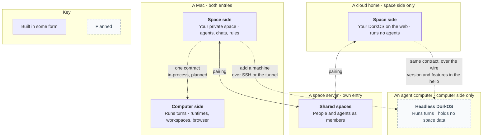

# DorkOS target architecture

## How to read this

- This page is the **target**: the shape DorkOS is being built toward, layer by layer, and the order to get there.
- What runs where **today**, with diagrams, is [the system architecture atlas](system-architecture.md). How today's code works is [the implementation guide](architecture.md).
- Decision records win over this page. Where they disagree, the record is right and this page is a bug.
- Any PR that adds or changes an ADR which moves this shape updates this page in the same PR.
- Each layer has four parts: **Today** (true of the code now), **Target**, **How we get there** (ordered, with the Linear issue where one exists) and **Decided by**. "Open" means nobody has decided yet, and says who will.

## Overview

DorkOS stays one program with one release. Inside it, a **space side** holds a space's data and a **computer side** runs turns, with one contract between them and one entry for each side. This page replaces the [November 21 target design](../research/20261121_architecture-target-design.md) as the thing to steer by; that report stays as the evidence for the eight architecture tracks.

## Key Files

| Seam the target builds on             | Where it is today                                                                                |
| ------------------------------------- | ------------------------------------------------------------------------------------------------ |
| The runtime port                      | `packages/shared/src/agent-runtime.ts`                                                           |
| The contract's built chat operations  | `packages/shared/src/session-relay.ts`, `apps/server/src/services/core/session-relay/`           |
| The contract's schema-only operations | `packages/shared/src/session-relay-agent-computer.ts`                                            |
| The hub's end of the wire             | `apps/server/src/services/core/hub-relay/`                                                       |
| Roles today                           | `apps/server/src/lib/server-role.ts`, `apps/server/src/services/core/server-role/role-checks.ts` |
| The space store and its entry         | `apps/server/src/services/spaces/`, `apps/server/src/services/spaces/main.ts`                    |
| The capability registry               | `apps/server/src/services/core/capabilities/registry.ts`                                         |
| The shared HTTP kit                   | `packages/http-kit/`                                                                             |
| `dork:` references and addresses      | `packages/shared/src/dork-ref.ts`, `packages/shared/src/dork-address.ts`                         |
| The local sealed computer             | `apps/server/src/services/computers/`, `apps/server/src/startup/computers.ts`                    |

## When to Use What

| You are about to...                                  | Read                                                                           |
| ---------------------------------------------------- | ------------------------------------------------------------------------------ |
| Add a feature and wonder if it belongs in the server | [Mini apps and the core test](#8-mini-apps-and-the-core-test)                  |
| Add a new service, worker or process                 | [The process rule](#11-the-process-rule)                                       |
| Start a turn from rooms, tasks, beats or a mini app  | [Turns](#5-turns)                                                              |
| Add an endpoint, MCP tool or CLI verb                | [Ways in](#7-ways-in)                                                          |
| Store something new                                  | [The space side](#3-the-space-side), [the computer side](#4-the-computer-side) |
| Pick what to build next                              | [Build order](#12-build-order)                                                 |
| Revive an old plan                                   | [What is retired](#13-what-is-retired) first                                   |

## 1. The whole picture

**Today.** One server package runs in one of three roles, read once from `DORKOS_SERVER_ROLE` (`apps/server/src/lib/server-role.ts`): a person's computer, a hub, or an agent computer. The agent computer is the whole server with about a dozen startup branches switched off; nothing starts it (no image target, script or command). The space server is a fourth entry in the same package (`apps/server/src/services/spaces/main.ts`).

**Target.** One program, one release. Two kinds of state get two sides in the code:

- **The space side** holds space data: members, agents, conversations, rules, memory, schedules, connections, settings, documents and mini apps. It decides what an agent may do.
- **The computer side** holds execution state: runtimes, workspaces and worktrees, terminals, the agent's browser, running processes and a small record of its runs.
- **One contract** joins them. **Two entries** start them. A role is "which entries are on".

| Place                            | Space side    | Computer side | Notes                                                                      |
| -------------------------------- | ------------- | ------------- | -------------------------------------------------------------------------- |
| A Mac (or any person's computer) | on            | on            | The contract runs in-process first, the wire second                        |
| A cloud home (the hub)           | on            | off           | Runs no agents; reaches its computers over the wire                        |
| An agent computer                | off           | on            | The **headless DorkOS**; holds no space data                               |
| A space server                   | its own entry | off           | Stays as it is; shared hosts hold no member's credentials or computer keys |

A Mac can also be the home other computers attach to, with no cloud.

**How we get there.** Seam by seam, each behind a check that only tightens; no rewrite. The steps are the [build order](#12-build-order) below.

**Decided by.** ADR `261124-150516` (two sides, one contract, two entries; amends `261015-042933`, whose three roles stand as three ways to run the one program, and `261122-173853`, whose "a role setting read once" becomes "which entries are on"), ADR `261122-173853` (the two kinds of state), ADR `261018-124422` (one program, one package).

## 2. The contract between the two sides

**Today.** The contract was designed for cloud agent computers and is only partly built.

| Operation                                                                                  | State                                                                                                                                                                                         |
| ------------------------------------------------------------------------------------------ | --------------------------------------------------------------------------------------------------------------------------------------------------------------------------------------------- |
| `chats.list`, `session.stream`, `session.send`, `session.interrupt`, `interaction.respond` | Built and tested at both ends, behind the `sessionRelay.enabled` experiment (default off): `packages/shared/src/session-relay.ts`, `services/core/session-relay/`, `services/core/hub-relay/` |
| `agents.sync`, `turn.start`, `tools.list`, `tools.call`, `computer.status`                 | Schema only, in `packages/shared/src/session-relay-agent-computer.ts`. No file under `apps/` imports it                                                                                       |
| The forwarding runtime on the space side                                                   | Not built                                                                                                                                                                                     |

A Mac never uses any of it for its own runtimes: even a relayed request resolves the runtime in-process (`services/core/session-relay/live-deps.ts`).

**Target.** One contract, seven verbs: start a turn, stream it, stop it, answer an ask, call a DorkOS tool, sync an agent, report status. A Mac uses the same contract, first as calls inside one process, then over the wire, so there is one way to run a turn.

- **The hello negotiates.** Two machines can run different versions, so the hello carries a protocol version and a list of features, and each side uses only what both name. The schema already says this: the protocol stays at version 1 and every new operation is a feature. This holds from the first build, whatever the REST API does before 1.0.
- **The pipe is for reach only.** Over SSH or the tunnel, the computer still checks who is calling and for which space. From remote-host practice: identity fails closed, no secrets in configuration, presence is a lease that must be renewed, at most one live instance, a stop is final and works when the agent is stuck.

**How we get there.**

1. One turn port inside the process ([Turns](#5-turns)), so the space side already calls "start, stream, stop" through one door.
2. The DorkOS tool server out of the Claude Code runtime, behind the `tools.list` and `tools.call` shape (DOR-4926, under server boundaries DOR-4921).
3. Build the schema-only operations over the channel that already carries the chat operations.
4. The forwarding runtime on the space side, so a cloud home or a Mac drives a remote computer like a local one (the agent-computer issues DOR-2935, DOR-2939 and DOR-2940).

**Open: the permission gate across the wire.** The gate belongs on the space side, but a runtime checks tools beside its own process and reads an agent's level in-process today (about 36 imports of the turn-power code and 33 of the agent-identity code from `services/runtimes`). Across a wire the computer needs a signed, read-only copy of the agent's rules, refreshed by `agents.sync`, with the space side still deciding anything that changes state. The architect writes a design note before step 3; Security reads it; the operator decides.

**Decided by.** ADR `261124-150516` (it amends `261123-170832` for the computer-to-computer wire only: that wire negotiates, while the HTTP API keeps "breaking changes land at once"); the operation set comes from `specs/everything-is-a-space/design-agent-computers.md`.

## 3. The space side

**Today.** Space data lives in two systems. The Mac's rooms (`services/rooms`, SQLite, synchronous) serve one owner and run turns. The space store (`services/spaces`, Postgres) serves many people with roles, invites and erasure, and runs no turns. `CommunityAdapter` (`packages/shared/src/community-adapter.ts`) is how the app reads any space. An import wall keeps `rooms` and `spaces` apart (`apps/server/eslint-rules/space-boundary.js`). Owner checks are Mac-wide (`readOwnerAccount`, `isInstallOwner` in `services/core/auth/`).

**Target.** One model for a space: the space store's. A hub is a one-tenant space server, and the private space on a Mac is a tenant on the same store (PGlite on a Mac, if it passes its gates). Anything a private space offers, every space offers. Member checks ("may this member do this in this space") replace owner checks, and become the capability registry's visibility rule.

The server's domains regroup under the two sides. The four kernels from the November 21 report stand, with one rule: **a kernel imports no feature domain.**

| Group            | Proposed domains and kernels                                                                                                                                                                                                                                                                                                                                                              |
| ---------------- | ----------------------------------------------------------------------------------------------------------------------------------------------------------------------------------------------------------------------------------------------------------------------------------------------------------------------------------------------------------------------------------------- |
| Space side       | `agent-tools/` kernel (the tool registry runs here, answering `tools.call`), `trust/` kernel (the permission gate decides here), `agents/`, `rooms/` (its data half), `space-client/`, `spaces`, connections, `tasks` (schedules), `beats/`, `extensions/` (records), `installs/` (approvals), `record/` (audit and Activity), `notifications`, `memory`, `todos`, `work-queue`, `shapes` |
| Computer side    | `turns/` (`session` minus its chat-message parts), `runtimes/` (the runtimes only), `browser/` (the shipped browser), `workspace`, `diff`, `terminal`, `computers`, `workbench-serve`, `harness`, keep-awake                                                                                                                                                                              |
| Plumbing         | `access/` kernel (sign-in, the session gate, caller identity), `config/` kernel, `remote-access/`, `telemetry/`, the HTTP chain and OpenAPI                                                                                                                                                                                                                                               |
| Split by the cut | `session/chat-messages` and `private-messages` go to the space side; the mini app isolation host, marketplace file writes and mesh's folder scan stay on the computer side; `search` indexes both                                                                                                                                                                                         |

**Open:** the grouping in this table is the architect's proposal, from the November 21 report's kernels and the computer-side trace; no record decides it. The server-boundaries epic (DOR-4921) settles the names, and the operator decides.

Three import walls hold it: the existing `rooms` and `spaces` wall; a `services/*` boundary rule with an allowlist that may only shrink; and a computer-entry wall that refuses any space-side import.

**How we get there** (ADR `261122-173853`'s order, with "after launch" removed):

1. The shared HTTP kit, so both request chains share plumbing. Half done: `packages/http-kit` holds request facts, the body reader and the problem shape, and the main chain uses it (DOR-4954, done, under Spaces and Cloud seams DOR-4953). The space chain does not use it yet; that change waits for the freeze to end.
2. Member checks replace owner checks (DOR-5150, design first).
3. The PGlite measurement on a real Mac, then PGlite under the space store. Its gates: start to first reply within a minute on a cold Mac, and permission reads no slower than today's file read.
4. The private tenant moves onto that store one area at a time, each going async as it moves: rooms, canvas, schedules, connections, settings, the memory index, then agents.
5. `services/rooms` shrinks to execution concerns: turn dispatch, seats, worktrees and bridges.

Beside the order: the gates G1 to G4 (one wire schema, table placement, conformance first, one role predicate; DOR-5074); the `services/*` boundary rule and the four kernels (DOR-4921); the Mac-side renames such as `communities/remote` to `space-client/` (DOR-4918). A new feature built only on the Mac's store needs a ticket naming its move (the work graph's is DOR-5139). The freeze on `services/spaces`, `apps/space`, the community wire and `spaces/migrate.ts` holds until the Community Space has opened and its opening checks are green.

**Open:** whether internal folders, packages and functions say "space" while outside names stay "community" (DOR-4957; the operator decides). Whether server domains become workspace packages later, or stay a lint ratchet (the November 21 report's operator decision 2; the operator decides once the ratchet shows a cut is cheap).

**Decided by.** ADR `261122-173853` (one space model), ADR `261124-150515` (its order without "after launch"; the freeze tied to an event), ADR `261124-150516` (the two sides), ADR `261123-170830` (member checks as the visibility rule).

## 4. The computer side

**Today.** Runtimes sit behind `AgentRuntime` (`packages/shared/src/agent-runtime.ts`) with a shared conformance suite: Claude Code, Codex, OpenCode and Doe in `services/runtimes/`. Every runtime process is a plain child of the server; Doe runs inside it. The local sealed computer (`computer-local`, a Lima VM, default off, `services/computers/`) runs plain OpenCode in the guest, reached by a host-side OpenCode client (`services/runtimes/opencode/computer/`) and a tool bridge back (`startup/computer-mcp-bridge.ts`). It does not yet pass conformance (DOR-4902).

**Target.** The computer side is: runtimes, turn dispatch and streams, workspaces and worktrees, the terminal, the agent's browser, keep-awake, harness projection, the tool bridge client, a relay dialer and a small store with the run record. A **headless computer side** leaves out rooms, schedules, connections, mini app records, search, audit, sign-in pages and the client files. It is about 100,000 lines with OpenCode only, or about 175,000 with every runtime, out of about 750,000 in `apps/server/src`.

- **The local sealed computer converges** on the same contract: a computer whose agent happens to run in a VM on the same Mac, driven by the same forwarding runtime as a cloud computer.
- **A computer is a record in a space**: its name, when it was last seen, which agents work on it. The `host` reference kind exists (`dork:host:<id>`).
- **Adding a machine** is one command that installs the matching build on the far side: over SSH for developers, over DorkOS's tunnel with a sign-in for founders. Same contract on both.

**How we get there.**

1. A computer entry that boots alone, held by a lint wall and a test that it imports nothing from the space side (no issue yet).
2. The spike: can the computer side run as its own long-lived process on a Mac, runtime by runtime? OpenCode (a sidecar) and Codex (one app-server) look easy; Claude Code depends on owning its child process; Doe runs in-process.
3. The agent computer becomes the computer entry, with an image target (DOR-2935, DOR-2939, DOR-2940).
4. The computer record and "add a machine"; then the account directory, one sidebar grouped by computer, linking a Mac, and the self-hosted wake channel (DOR-2949, DOR-2950, DOR-2951, DOR-2961). Today each of those assumes a cloud home; under the target a Mac can be the home.
5. `computer-local` moves onto the contract and passes conformance (DOR-4902).
6. The parked browser engine goes, so `browser/` names the shipped browser (DOR-4284).

**Open:** whether the computer side runs as its own process on a Mac. The spike decides; recovery ships either way.

**Decided by.** ADR `261124-150516` (it amends `261012-211000`: the local sealed computer stands as built and moves onto the contract); ADR-0255 and ADR-0310 (runtime binding and runtime-owned transcripts) stand.

## 5. Turns

**Today.** Space-side code calls `services/session` directly in about 156 import lines; about 100 of them are rooms, tasks, heartbeats, canvas and mini apps starting and watching turns (for example `services/rooms/room-turn-runner.ts`, `services/tasks/scheduled-run-power.ts`). A restart loses the running turn. What survives is data: queued messages (`services/session/message-queue-store.ts`), the event log, held dispatches. Open asks expire at boot (`services/session/expire-orphaned-asks.ts`); open beats and task runs are marked failed (`services/heartbeats/beat-runner.ts`, `services/tasks/crash-recovery.ts`). Follow-up work (a hand-off, a report to a parent chat, a due wake) lives in memory, and each lost case has been fixed by hand (DOR-3816, DOR-5087, DOR-3231, DOR-4626, DOR-4148).

**Target.**

- **One turn port.** Every space-side caller starts, streams and stops a turn through one door. That door is the contract's in-process form.
- **A run record that DorkOS owns.** Per turn: id, status, attempt, which runtime chat it maps to, place in the queue, and the run it continues. Words stay in the runtime's transcript (ADR-0310). Every device reads status from the record.
- **Follow-up work saved with the turn.** When a turn is accepted, the work that must follow (start the runtime, deliver a hand-off, report to a parent, wake a waiting chat, continue after a restart) is written in the same write, in an outbox. A worker with leases carries it out. "Accepted" means "saved, with what comes next".
- **One writer per chat.** Changes to one chat apply one at a time, in order.
- **Recovery with caps.** Work tied to a dead process is dropped, never replayed. A turn continues only where its runtime can resume, at most three times in a row. A turn a person stopped, or one waiting on a person, never continues. The agent is told what background work died.
- **The own-process test.** The spike in [the computer side](#4-the-computer-side) may make restarts rarer. It never removes them, so everything above ships either way.

**How we get there.** The turn port first, one caller at a time, with the run record and the outbox behind it; then the recovery rule; then the spike. Each lands behind the existing turn path (no issues filed yet). A transport-independent session lock (DOR-2346) serves the one-writer rule.

**Open:** the cap values (three tries, what counts as safe) are judgment calls to tune from real use; the turns owner adjusts them.

**Decided by.** ADR `261124-150517`. It supersedes proposed ADR `260929-140932` (keeping its two rules: a timeout is not proof that work drained, and an effect with an unknown outcome is never retried). It amends ADR `0264` ("in-flight turns are lost on restart" is retired), `260812-134510` (the persistent process not surviving a restart is no longer a design choice) and `260818-234541` (a held room trigger becomes outbox work, not process memory). It builds on ADR-0310, ADR-0255, `260811-184735` and `260823-021312`.

## 6. Conversations and delivery

**Today.** Two message systems run side by side: the conversation and room stores, and Relay (`packages/relay`, `apps/server/src/services/relay`) with its Maildir store. The Relay package also carries the Telegram, Slack, webhook and Claude Code connection code (`packages/relay/src/adapters/`). The relay webhook publishes to a subject nothing acts on.

**Target.** One message system. The conversation log is the record: DorkOS-owned, durable, never trimmed, read by every member and every window (the app, Telegram, Slack, email). A session is one agent's private context behind it; a seat joins the two. Relay stays as the delivery engine and writes a delivery record per turn. Its Maildir store carries delivery only, takes nothing new, and retires. Relay is never its own service.

**How we get there.** The chat connections move out of the bus package (DOR-4912); delivery records ride the outbox ([Turns](#5-turns)); each chat kind becomes a conversation in turn (DOR-2744, spec `specs/conversation-model/`); Maildir retires.

**How agents work together: a playbook.** Decided as a direction by ADR `261124-152801`; nothing is built. A playbook is how a team of agents works: where the work happens, where it is reported and who is woken. It is a setting of a space (a room, a project or one agent may differ), with three parts: words the agents are told, rules DorkOS holds, and defaults DorkOS applies. DorkOS holds the rules at its own gate and at the turn port, never in one runtime's hooks. That needs every act of working together to be a capability on every runtime (today starting a helper chat is a tool only Claude Code agents get), one gate that can send an action elsewhere and say why, work that can move between a chat, a room and a channel, and a run record that names the playbook a run started under. Open: the rule kinds, and how the three levels combine (a spec, then the operator).

**Decided by.** ADR `261017-211859` (the conversation is the shared log; accepted on 2026-11-24 with Maildir retiring), ADR `261006-235240` (one message system), ADR `261124-150516` (no Relay service), ADR `261124-152801` (playbooks, as a direction).

## 7. Ways in

**Today.** The HTTP API has two authoring paths: hand-registered routes (`services/core/openapi-registry.ts`) and capabilities with an `http` surface. The document carries `operationId`s and tracks the product version (`docs/api/openapi.json`; DOR-4980, done). The API lint gate exists (DOR-4996). The capability registry already projects to MCP and to `dorkos call` (`packages/cli/src/commands/call.ts`). A program that wants one agent's answer has three partial paths: A2A (off by default, this computer only, a two-minute limit, missing from the API document), the sessions route (needs a chat first, refuses a script once an owner exists), and a raw Relay publish. No CLI verb or outside MCP tool does it. `dork:` references and addresses parse (`packages/shared/src/dork-ref.ts`, `dork-address.ts`); nothing sends to one yet.

**Target.**

- **The capability registry is the one definition.** REST, MCP, the CLI and A2A are projections of it. One generic mount serves every capability's route; the hand registry shrinks to zero, except an allowlist for shapes a capability cannot express (uploads, raw files, streams).
- **One error shape:** RFC 9457 problem+json, aligned with `packages/cloud-api`, sent only through `packages/http-kit`.
- **One event contract:** a `DorkOsEvent` envelope with `seq` and replay on every stateful stream; duplicate streams removed; every `202` names the event that reports its outcome.
- **Every operation is stable, preview or internal.** Before 1.0 there are no deprecation periods: a breaking change lands at once with every caller in the repo fixed and a changelog line. The computer-to-computer wire is the exception and negotiates ([the contract](#2-the-contract-between-the-two-sides)).
- **Every agent is addressable.** One "send to an agent" capability, projected to a REST route, `dorkos ask`, an MCP tool and A2A. Its target is the agent, named by its `dork:` reference or address, never a chat. An optional conversation key keeps a thread. The reply comes as a stream or later by id, with no fixed time limit. A program is its own kind of caller with its own level, and its words are marked as outside words. A server can run a single agent.
- **One `dork:` reference for every thing**: ids for machines, addresses for people.

**How we get there** (REST API epic DOR-4977):

1. Every mounted route in the document, then documentation moves onto capabilities (A1, DOR-4978, in progress).
2. One error contract on the HTTP kit (A2, DOR-4979, in progress).
3. Stability on every operation (A6, DOR-4983) and one event contract (A7, DOR-4986).
4. A generated TypeScript client (A4, DOR-4981) and normalised resources, one path per action (A5, DOR-4982, with no aliases).
5. The send capability: its shapes settled in a spec first (which chat a message lands in, caller identity, rate limits), then its four projections; the A2A executor, the sessions route used as a send and the Relay message route converge on it or go.
6. A read-only GraphQL projection last, and only when an outside SDK needs it (work graph W7, DOR-4973).

**Open:** the send capability's exact shapes. ADR `261124-150518` is accepted as a direction and requires a spec before any build; the spec's author proposes, the operator decides.

**Decided by.** ADRs `261123-170830` (the API is a projection), `261123-170831` (one error contract), `261123-170832` (stability, no deprecation periods), `261123-170833` (one event contract), `261124-150518` (send to an agent; it supersedes archived ADR 0175, so A2A is a projection and Relay is not the transport inside, and amends `261004-235818`, so an outside program's fixed level becomes its own level once the send is built), `261122-124821` (`dork:` references).

## 8. Mini apps and the core test

**Today.** `apps/server/src/services` has 38 domains and grows by one per idea. A mini app can already run its server half as its own limited process (`services/extensions/isolation/`), on a timer, with network access, and can start a turn (`services/extensions/agent-send/agent-send.ts`). A connected app's events reach one chat per subscription (`services/connectors/events/delivery-service.ts`). Heartbeat wakes take internal facts only (`services/heartbeats/event-wakes.ts`).

**Target.** A feature goes in the core only if at least one is true:

1. The core itself acts on it.
2. Only the core can see what it needs.
3. A mini app cannot do it correctly, even with care.

If all three are false, it is a mini app, or a schedule with a skill. Watchers (a pull request watcher, a pipeline watcher, a steward) are first-party mini apps on the same author API everyone else gets. The core owns **one wake**: "wake this chat or this agent when X happens", stored, safe across a restart, delivered through the normal turn path, marked as outside words unless its owner said otherwise. Nothing else may start a turn from an outside event.

**How we get there.** The author API's gaps close first, smallest first:

1. A tool call carries no chat id, so a watcher can wake only its own chat with an agent, not the chat that asked.
2. A connected app's event keeps only top-level text fields (`packages/connector-providers/src/event-content.ts`), so a nested payload arrives nearly empty.
3. A mini app cannot receive a connected app's events.
4. A beat cannot be woken by a subscription its owner approved.
5. A watcher an agent built needs a person to approve its exact files before it may use a connection.
6. The Relay webhook publishes to a subject nothing acts on.

Then the wake (the closest issue is DOR-3563, "a chat can wait on an outside condition and be woken"), then a first-party pull request watcher. Related author-API work: `ctx.relay` (DOR-2682), the per-mini-app database (DOR-2684), publishing `packages/extension-api` (DOR-3544).

**Open:** gap 4 needs a Security ruling, because today strangers never wake a beat and an approved subscription still counts as outside words.

**Decided by.** ADR `261124-150519`. It supersedes ADR `0017` (new subsystems no longer join the server by default) and builds on `261006-235242` (everything is a plugin) and ADR-0271 and ADR-0272 (first-party features on the public author API).

## 9. The client

**Today.** React 19 with Feature-Sliced Design (`apps/client/src/layers`). The `Transport` port (`packages/shared/src/transport.ts`) declares about 520 methods on one object, built from 59 hand-written method factories in `apps/client/src/layers/shared/lib/transport/`. No generated client exists.

**Target.** FSD stays. `Transport` is split by domain (`transport.rooms`, `transport.sessions`), so a feature's server needs show in its imports and test doubles shrink to one domain. `HttpTransport` becomes a thin layer over a client generated from the API document, slice by slice, with typed events from the one event union. The dev playground is marked and fenced, not moved. Feature packages under `packages/` wait until a feature has no sibling imports.

**How we get there.** The Transport split by codemod (shared and the ports, DOR-4930); the generated client (A4, DOR-4981) on top of the A1 and A7 work; the FSD lint gaps (a widgets block, barrel-only imports as a ratchet; prose into code, DOR-4936).

**Decided by.** No ADR of its own; the generated client follows ADR `261123-170830`. Moving the space pages to `apps/space/src/web` is retired by ADR `261122-173853`.

## 10. The workspace

Rules: one product, one folder; shared means both sides read it; tooling lives outside the product tree; a rule is code or it is deleted.

| Unit                                              | Today                                                   | Target                                                                                   | Owner epic               |
| ------------------------------------------------- | ------------------------------------------------------- | ---------------------------------------------------------------------------------------- | ------------------------ |
| Space server code                                 | `services/spaces`, image and migrations in `apps/space` | **Stays.** Moving it to `apps/space` or a `packages/space` is retired                    | ADR `261122-173853`      |
| `apps/community`                                  | pointer READMEs, no package                             | deleted                                                                                  | DOR-4912                 |
| `packages/browser`, `services/browser`            | parked engine, bundled into the CLI                     | deleted or re-scoped; `browser/` names the shipped browser                               | DOR-4284                 |
| `packages/relay`                                  | the bus plus the chat connections                       | delivery only; connections move out                                                      | DOR-4912                 |
| `packages/shared`                                 | about 185 subpaths, 35 server-only                      | wire schemas and the ports; server-only modules move to the server                       | DOR-4930                 |
| `packages/test-utils`                             | mocks beside port conformance suites                    | `test-utils` and a separate conformance package                                          | DOR-4930                 |
| `packages/http-kit`                               | built; used by the main chain                           | used by both request chains                                                              | DOR-4953 (DOR-4954 done) |
| `packages/ci-steward`, `heavy-slot`, gate scripts | product packages and a flat `scripts/`                  | a `tooling/` workspace and one check command                                             | DOR-4945                 |
| `packages/ui`, `icons`, `apps/design-system`      | three homes plus a facade                               | `packages/ui` absorbs them; the facade is generated                                      | DOR-4912                 |
| `packages/extension-api`                          | private, documented as public                           | published                                                                                | DOR-3544                 |
| `packages/doe`                                    | marked publishable, never published                     | published from this repo, or private                                                     | DOR-4912                 |
| Rules in prose                                    | about 136 imperative rules, about 60 enforced           | lint, census tests or deleted                                                            | DOR-4936                 |
| Arming gate into the repo                         | proposed on November 21                                 | **Retired:** arming by hand is gone; PRs merge themselves when green (DOR-4952 canceled) | none                     |

The tooling track was written against the pipeline before the November 23 and 24 CI changes; each of its tickets is rechecked against the current pipeline before it is scheduled.

**Decided by.** No ADR of its own: these are the November 21 report's proposals, filed as the epics in the table. ADR `261122-173853` retires the space-server move.

## 11. The process rule

A new process is allowed only for a **different lifetime** or a **different trust level**, never for a feature. There is no separate service for Relay, for an "orchestrator" or for the web server. A new process breaks the single write that keeps a turn and its follow-up work together, and makes "ready in under a minute" harder.

| Process under the target                                                 | Why it qualifies                                                 |
| ------------------------------------------------------------------------ | ---------------------------------------------------------------- |
| The DorkOS program (one or both entries)                                 | The one program                                                  |
| The computer side, on its own (if the spike holds)                       | Lifetime: updating the rest of DorkOS stops ending turns         |
| The headless computer on an agent computer                               | Lifetime and trust: another machine, holding no space data       |
| The space server                                                         | Trust: serves strangers, holds no member's credentials           |
| A sandboxed mini app's server half                                       | Trust: limited permissions                                       |
| Runtime programs (Claude Code, Codex's app-server, the OpenCode sidecar) | They are other people's programs, run per their own design       |
| Terminals and the agent's browser                                        | Lifetime: a person or agent opened them; they end with their use |
| The local sealed computer's VM                                           | Trust: sealed from the Mac                                       |
| One-shot jobs (CLI commands, migrations, installs)                       | Lifetime: run once and exit                                      |
| A holder of someone else's credentials                                   | Trust                                                            |

**Decided by.** ADR `261124-150516` (split by lifetime and trust, never by feature).

## 12. Build order

One ordered list, by what each step needs and unlocks. No dates. Steps 1 to 18 are the product order in `meta/ROADMAP.md`; the engineering tracks that run around them follow. The architecture spine inside it (turn port, tool server, computer entry, own-process test, wire, wake, send) is the one in the [evidence report](../research/20261124_architecture-direction-review.md#build-order-no-dates).

**Now (in flight).**

1. **One definition for every action** (REST API, DOR-4977). The API becomes a projection of capabilities: one error shape, one event contract, a generated client. First, because every later way in (send to an agent, the tools a computer calls, what a mini app may do) is defined here once. A1 (DOR-4978) and A2 (DOR-4979) now; A4 (DOR-4981) after A1 and A7 (DOR-4986), because a generated client needs a full document and typed events.
2. **One name for every thing** (work graph, DOR-4966): `dork:` references, signed outward writes, the work graph's links. Because the run record, the computer record and the wake all name things with it.
3. **Agent teams that ship**: hand-offs and reports that land, quiet rooms, one work order. Now, because it is how everything else gets built, and its failures are the test cases for step 5.
4. **Codex, OpenCode and Doe work like Claude Code.** Now, because the computer side must treat every runtime alike, and cloud agent computers run OpenCode or Doe.

**Next, in this order.**

5. **Turns survive restarts** ([Turns](#5-turns)): the turn port, the run record, follow-up work saved with the turn, recovery with caps (no issue yet). Needs 1 and 2. Unlocks updates at any time; hand-offs, reports and wakes that cannot be lost; honest status on every device.
6. **A computer side that starts alone**: the DorkOS tool server leaves the Claude Code runtime (DOR-4926), and a computer entry boots with a lint wall (no issue yet). Needs 5, because the turn port is the seam.
7. **The own-process test**, runtime by runtime. Needs 6. If it holds, updating the rest of DorkOS stops ending turns.
8. **The contract over the wire**: the permission-gate design note, then the wire operations, the computer record and adding a machine; `computer-local` converges (DOR-2935, DOR-2939, DOR-2940, DOR-4902). Needs 6. Unlocks 13 and 14.
9. **One wake, and watchers as mini apps**: the author-API gaps, the wake (DOR-3563), then a first-party pull request watcher. Needs 5. Beside 6 to 8.
10. **Send to an agent**: one capability and its projections (no issue yet; spec first). Needs 1 and 2. Beside 6 to 9.
11. **The Community Space opens**, when its checks pass. Its own track, beside 5 to 10. Opening it ends the freeze on the space code.
12. **Member checks replace the Mac's owner checks** (DOR-5150). Needs nothing above. Unlocks 13, 15 and 16.
13. **Your DorkOS on the web**: your devices, your private space in the cloud, one sidebar grouped by computer (DOR-2949, DOR-2950, DOR-2951, DOR-2961). Needs 8 and DorkOS Cloud's half, contracts first.
14. **Cloud agent computers**: the headless computer side, started and stopped on demand. Needs 8.
15. **Team spaces on DorkOS Cloud.** Needs 12 and 13.
16. **The private space becomes a tenant** ([the space side](#3-the-space-side), steps 3 to 5). Needs 12. `work_links` moves with it (DOR-5139).
17. **One message system** ([Conversations](#6-conversations-and-delivery)). Needs 5, for delivery records.
18. **Playbooks** ([Conversations](#6-conversations-and-delivery)): a person picks how a team of agents works, and DorkOS holds the rules (no issue yet; spec first). Needs 4 and 6 (every act of working together is a capability on every runtime, behind one gate), 5 (the turn port and the run record) and 17 (every chat is a conversation, so work can move). The first three playbooks are DorkOS's own.

**Engineering tracks around the list.**

- **Server boundaries** (DOR-4921): the `services/*` boundary rule and the four kernels. Before step 6, because the computer-entry wall needs a ratchet to stand on.
- **Spaces and Cloud seams** (DOR-4953): member checks are step 12; one Cloud client (DOR-4955) and served flags (DOR-4956) whenever free.
- **Shared and the ports** (DOR-4930): the Transport split before the generated client spreads, so each domain gets one generated slice.
- **One product, one folder** (DOR-4912) and **tooling** (DOR-4945): any time; they shorten later steps but block none. Tooling tickets are rechecked against the current pipeline first.
- **Prose into code** (DOR-4936): continuous; each rule moves into a check when the code it guards next changes.
- GraphQL (W7, DOR-4973) is the last projection, and only when an outside SDK needs it.

**Decided by.** ADR `261124-150515` (one list, ordered by need); the steps' own records as cited in each section.

## 13. What is retired

If you see one of these stated as the plan, it is out of date.

| Retired                                                                                                                              | Retired by                                                                   |
| ------------------------------------------------------------------------------------------------------------------------------------ | ---------------------------------------------------------------------------- |
| Launch dates, dated soft launches, "launch scope", "pre-launch"                                                                      | ADR `261124-150515`                                                          |
| "Before launch" or "after launch" as the reason for an order; week-by-week build tables                                              | ADR `261124-150515`                                                          |
| The December 8 freeze as a calendar date (it now ends with an event)                                                                 | ADR `261124-150515`                                                          |
| Project target dates, and "needs a target date" in the work order                                                                    | ADR `261124-150515` (amends `261122-161025`)                                 |
| The agent computer as the full server in a sealed role; three roles as three kinds of place                                          | ADR `261124-150516`                                                          |
| Relay as its own service; any service split by feature                                                                               | ADR `261124-150516`                                                          |
| Relay's Maildir as a permanent internal bus                                                                                          | ADR `261017-211859`, as decided on 2026-11-24                                |
| `packages/space`, or the space server's code moving to `apps/space`                                                                  | ADR `261122-173853`                                                          |
| Deprecation windows, `Sunset` headers and API aliases                                                                                | ADR `261123-170832`                                                          |
| Arming PRs by hand (`arm.sh`, arm-door, merge-tail arming)                                                                           | DOR-5124; PRs open with `scripts/open-pr.sh` and merge themselves when green |
| New features as more domains inside the one server process when a mini app would do; "every new subsystem follows the Pulse pattern" | ADR `261124-150519` (supersedes `0017`)                                      |
| "In-flight turns are lost on restart"; the persistent process dying with DorkOS by design; held room triggers kept in memory         | ADR `261124-150517` (amends `0264`, `260812-134510`, `260818-234541`)        |
| Authorizing terminal effects from cleanup evidence (proposed, never adopted)                                                         | ADR `261124-150517` (supersedes `260929-140932`)                             |
| A2A as a gateway that publishes to Relay                                                                                             | ADR `261124-150518` (supersedes archived `0175`)                             |
| A second gate for hand-registered tools; holding how agents work together in one runtime's hooks or in a sentence of code            | ADR `261124-152801`                                                          |
| The November 21 report's wave plan (Wave 0 to Wave 3) and its dates                                                                  | ADR `261124-150515`; the build order above replaces it                       |

## Open questions

| Question                                                                | Who decides                                                     |
| ----------------------------------------------------------------------- | --------------------------------------------------------------- |
| The permission gate across the wire                                     | The architect's design note, Security's read, then the operator |
| Whether the computer side runs as its own process on a Mac              | The own-process spike                                           |
| The send capability's shapes                                            | A spec, then the operator                                       |
| Whether an owner-approved subscription may wake a beat                  | Security                                                        |
| Internal folder names: "space" or "community"                           | The operator (DOR-4957)                                         |
| Server domains as packages, or a lint ratchet only                      | The operator, once the ratchet shows the cost                   |
| Recovery cap values                                                     | The turns owner, from real use                                  |
| The playbook's rule kinds, and how space, room and agent levels combine | A spec, then the operator (ADR `261124-152801`)                 |
| The server's domain grouping under the two sides                        | DOR-4921, then the operator                                     |
