# DorkOS system architecture

## Overview

This is the cross-system map of DorkOS: what runs where, how the pieces communicate, which interfaces are replaceable, and who owns the data. Start here, then use [the implementation guide](architecture.md) for local internals.

**Current review:** public source `14434634ff15978f4acaa561a445ac0b88c6555a`, reviewed 2026-11-21. The [November 21 rebaseline](../research/20261121_architecture-rebaseline.md) carries the evidence matrix: for each capability, whether it is implemented, configured or tested, released (in `v0.139.0`), deployed, or planned, and what each level does not prove. The [October 9 assessment](../research/20261009-vision-reset-architecture-assessment.md) and the [October 4 assessment](../research/20261004-architecture-assessment.md) remain historical evidence; several of their findings are superseded and the November document says which.

**One program, three roles today.** The target is a space side and a computer side with one contract between them (ADR `261124-150516`; see [the target](architecture-target.md)). Since server-merge step 7 (ADR `261018-124422`, merged 2026-10-18 to 20), the space server's code lives inside the DorkOS server package. The one program runs in one of three roles (ADR `261015-042933`): a person's own computer, a **hub** (their own DorkOS in the cloud: a one-tenant space server that, by hosting policy, runs no agents), or an **agent computer** (a sealed machine that runs a hub's agents). The space role is a fourth entry in the same package with its own image target. Only the computer role has shipped to people; the hub and agent-computer roles are built in code and gated by `DORKOS_SERVER_ROLE`, and the hub image has booted only in CI (DOR-2935).

**Naming:** Spaces is the product name. Community remains the technical name in paths, settings, the image name and `CommunityAdapter` (server-merge D5: outside names stay "community" for good). "Hub" is an internal word; the app says Private. The product category, a workspace for people and agents, is distinct from filesystem Workspaces.

For the shape to steer toward, layer by layer, with its build order, see [the target architecture](architecture-target.md). Linear tracks the live execution state.

## Key Files

Paths are relative to this repository. These are evidence pointers for the diagrams, not a complete module inventory.

| Boundary                               | Source of truth                                                                                                                                                                                                                                                                                                                                                                                                                                                                                                 |
| -------------------------------------- | --------------------------------------------------------------------------------------------------------------------------------------------------------------------------------------------------------------------------------------------------------------------------------------------------------------------------------------------------------------------------------------------------------------------------------------------------------------------------------------------------------------- |
| Local composition and routes           | [server startup](../apps/server/src/index.ts), [startup steps](../apps/server/src/startup/steps), [Hono app](../apps/server/src/http/hono-api.ts), [middleware chain](../apps/server/src/http/api-chain.ts), [front door](../apps/server/src/http/front-door.ts)                                                                                                                                                                                                                                                |
| Server roles today                     | [role](../apps/server/src/lib/server-role.ts), [hub assignment](../apps/server/src/services/core/hub/hub-assignment-sync.ts), [hub-owned actions on an agent computer](../apps/server/src/services/core/agent-computer/hub-owned.ts), [request classifier](../apps/server/src/lib/request-classifier.ts), [gate policy](../apps/server/src/services/core/auth/gate-policy.ts)                                                                                                                                   |
| Ways in from another device            | [session relay, Mac side](../apps/server/src/services/core/session-relay/index.ts), [hub relay endpoint](../apps/server/src/services/core/hub-relay/relay-endpoint.ts), [managed remote command stream](../apps/server/src/services/core/remote/command-stream.ts), [tunnel manager](../apps/server/src/services/core/tunnel-manager.ts), [Wi-Fi listener](../apps/server/src/services/core/lan-access/lan-access.ts), [session route binding](../apps/server/src/services/core/auth/sessions/session-route.ts) |
| Proactive work and the record          | [beat runner](../apps/server/src/services/heartbeats/beat-runner.ts), [beat scheduler](../apps/server/src/services/heartbeats/beat-scheduler.ts), [triage on credits](../apps/server/src/services/decisions/triage-credits.ts), [tool-use audit rows](../apps/server/src/services/audit/record-tool-use.ts), [audit visibility](../apps/server/src/services/audit/visibility.ts), [agent pause](../apps/server/src/services/mesh/pause/agent-pause.ts)                                                          |
| Client port and network implementation | [Transport](../packages/shared/src/transport.ts), [HttpTransport](../apps/client/src/layers/shared/lib/transport/http-transport.ts), [qualified Community methods](../apps/client/src/layers/shared/lib/transport/remote-community-methods.ts), [WSConnection](../apps/client/src/layers/shared/lib/transport/ws-connection.ts)                                                                                                                                                                                 |
| WebSocket and SSE delivery             | [upgrade router](../apps/server/src/services/core/streams/upgrade-router.ts), [session socket](../apps/server/src/routes/session-events-socket.ts), [room socket](../apps/server/src/routes/room-events-socket.ts), [global socket](../apps/server/src/routes/events-socket.ts)                                                                                                                                                                                                                                 |
| Turn acceptance and queueing           | [MessageDispatcher](../apps/server/src/services/session/message-dispatcher.ts), [runtime contract](../packages/shared/src/agent-runtime.ts)                                                                                                                                                                                                                                                                                                                                                                     |
| Doe and decision foundations           | [Doe engine](../packages/doe/README.md), [Doe runtime](../apps/server/src/services/runtimes/doe/doe-runtime.ts), [decision ladder](../packages/decisions/src/ladder.ts), [heartbeat triage](../apps/server/src/services/decisions/heartbeat-triage.ts), [space post checks](../apps/server/src/services/spaces/decisions/worker.ts)                                                                                                                                                                             |
| Audit and proactive behavior           | [Audit log](../apps/server/src/services/audit/audit-log.ts), [audit verify route](../apps/server/src/routes/audit.ts), [proactive-agent contract](../meta/PROACTIVE-AGENTS.md), [heartbeats ADR](../decisions/261010-092116-heartbeats-skill-content-platform-beat-runner.md)                                                                                                                                                                                                                                   |
| The space server entry                 | [entry](../apps/server/src/services/spaces/main.ts), [app and route registration](../apps/server/src/services/spaces/app.ts), [SSE route](../apps/server/src/services/spaces/routes/community/events.ts), [browser](../apps/client/src/space), [BlobStore](../apps/server/src/services/spaces/storage/blob-store.ts), [package](../apps/space/package.json), [image guard](../scripts/space-image/runtime-packages.mjs), [lint boundary](../apps/server/eslint-rules/space-boundary.js)                         |
| Sealed computers today                 | [local computer service](../apps/server/src/services/computers/computer-service.ts), [computer startup](../apps/server/src/startup/computers.ts), [agent-computer design note](../specs/everything-is-a-space/design-agent-computers.md)                                                                                                                                                                                                                                                                        |
| Community port and actual wiring       | [CommunityAdapter](../packages/shared/src/community-adapter.ts), [remote Community implementation](../apps/server/src/services/communities/remote), [qualified Community routes](../apps/server/src/routes/remote-communities.ts), [remote room stream](../apps/server/src/services/communities/remote/remote-room-subscription-runtime.ts)                                                                                                                                                                     |
| Projects and extension orchestration   | [project registry](../apps/server/src/services/projects/project-registry.ts), [extension selection](../apps/server/src/services/extensions/extension-precedence.ts), [start-work service](../apps/server/src/services/extensions/start-work.ts), [account eligibility](../apps/server/src/services/core/usage/account-eligibility.ts)                                                                                                                                                                           |
| Optional Cloud boundary                | [public wire contract](../packages/cloud-api/README.md), [legacy client and origin resolution](../apps/server/src/services/core/auth/cloud-link-client.ts), [versioned client](../apps/server/src/services/core/cloud/v1-client.ts), [credits opt-in](../apps/server/src/services/core/cloud/credits-inference.ts)                                                                                                                                                                                              |
| Marketplace delivery                   | [fetcher](../apps/server/src/services/marketplace/package-fetcher.ts), [installer](../apps/server/src/services/marketplace/installer/marketplace-installer.ts), [transaction](../apps/server/src/services/marketplace/transaction.ts), [website reads](../apps/site/src/layers/features/marketplace/lib/fetch.ts)                                                                                                                                                                                               |
| Harness projection                     | [harness package](../packages/harness), [server harness services](../apps/server/src/services/harness)                                                                                                                                                                                                                                                                                                                                                                                                          |
| Messaging and account actions          | [RelayAdapter](../packages/relay/src/types.ts), [ConnectorProvider](../packages/connector-providers/src/connector-provider.ts), [account registry](../apps/server/src/services/connectors/registry.ts)                                                                                                                                                                                                                                                                                                          |
| Memory                                 | [MemoryProvider](../packages/shared/src/memory-provider.ts), [built-in implementation](../packages/memory/src/builtin-provider.ts)                                                                                                                                                                                                                                                                                                                                                                              |

Account handover evidence: [forwarding policy](../apps/site/src/lib/cloud-accounts/forward.ts), [site proxy](../apps/site/src/proxy.ts), [forwarding tests](../apps/site/src/lib/cloud-accounts/__tests__/forward.test.ts), and [public migration configuration](../apps/site/drizzle.public.config.ts).

Additional evidence: [tenant resolution](../apps/server/src/services/spaces/tenant-context.ts), [host authority](../apps/server/src/services/spaces/host/authority.ts), [host limits and usage](../apps/server/src/services/spaces/routes/host/host-limits.ts), [community navigation](../apps/client/src/layers/entities/community/model/use-community-navigation.ts), and [hosted-community wire schemas](../packages/cloud-api/src/communities.ts).

## When to Use What

| Question                                         | View / guide                                                               | Why                                                                |
| ------------------------------------------------ | -------------------------------------------------------------------------- | ------------------------------------------------------------------ |
| What do I deploy, and what is optional?          | [System context](#system-context)                                          | Separates processes and data ownership                             |
| Which roles exist, and which are built?          | [Roles today](#roles-today)                                                | Separates the built roles and seams from the planned ones          |
| Where is the system going?                       | [Target architecture](architecture-target.md)                              | The space side, the computer side and the build order              |
| Where can I swap implementations?                | [Ports](#replaceable-interfaces)                                           | Separates code interfaces from network protocols                   |
| Where do messages and live updates travel?       | [Session flow](#commands-and-live-events)                                  | Separates acceptance from execution and delivery                   |
| Is a space part of Cloud or local Rooms?         | [Spaces](#local-rooms-and-the-space-server)                                | Shows independent identity and persistence                         |
| Does the website install packages or run agents? | [Marketplace](#marketplace-discovery-and-delivery)                         | Separates discovery, local installation, and activation            |
| What does the app need from Cloud?               | [Cloud boundary](#cloud-public-boundary)                                   | Shows optional public calls without private implementation details |
| How does another device reach my DorkOS?         | [Ways in from another device](#ways-in-from-another-device)                | Separates the four routes and what each one carries                |
| How do I change a local subsystem?               | [Implementation architecture](architecture.md) and the linked domain guide | Keeps detailed contracts out of the overview                       |

## Core Patterns

These are architecture patterns, so the examples are diagrams and wire contracts rather than application snippets. Every diagram uses one key: a blue box is built, a dashed grey box is planned, a dashed line is unfinished wiring or contract-only, an amber box is optional DorkOS Cloud, a white box is something outside DorkOS, and a green hexagon is a port. In current-state flowcharts, solid arrows show implemented paths; dashed arrows explicitly label unfinished wiring or a schema relationship. The roles view below mixes built and planned pieces and marks each. The sequence diagram uses dashed arrows for responses and events, following sequence-diagram conventions. An optional path is still drawn solid when the app-side implementation exists. Arrows show the main operation or data direction, not every response packet. Boxes carry a name and one short line; the code names, routes, switches and ticket numbers behind each box are in the prose and the [Key Files](#key-files) table. Open an image to read it at full size.

### Roles today

[](../apps/site/public/diagrams/architecture/vision-reset-target.svg)

[Editable roles diagram](diagrams/architecture/vision-reset-target.mmd)

This view shows today's roles and their planned wiring, from ADR [`261015-042933`](../decisions/261015-042933-everything-is-a-space-hubs-space-servers-and-agent-computers.md), amended by [`261015-125850`](../decisions/261015-125850-this-computer-and-other-devices.md), [`261018-124422`](../decisions/261018-124422-one-program-before-launch.md) and [`261122-173853`](../decisions/261122-173853-one-space-model.md) (one space model). That last one sets the model: there is one model for a space, the space store's. A space holds its members' data (agents' identity, rules, memory and schedules, conversations, connections, settings, documents, extensions); only execution state (workspaces, runtime transcripts and sign-ins, running processes) stays on the computer that runs turns. The private space becomes a tenant on the space store, domain by domain, agents last, in the order of the [build order](architecture-target.md#12-build-order). It replaces the October "shared workspace command core" proposal, which is not the accepted shape. Solid boxes are in the source at this review; dashed boxes are planned. Nothing here is deployment proof: the hub image has booted only in CI, and no cloud agent computer exists yet.

**The target is two sides, not three roles.** Under ADR `261124-150516`, DorkOS is one program with a space side that holds space data and a computer side that runs turns, joined by one contract, with one entry for each. A Mac runs both entries, a hub runs the space side only, and an agent computer runs the computer side only. See [the target architecture](architecture-target.md).

- **Your computer** runs agents, holds its own rooms in SQLite, and reaches spaces by pairing. This is the one role people use today.
- **A hub** is one person's DorkOS in the cloud: their private space (the `LOCAL_COMMUNITY` port) today, and later the account directory view and one inbox (B6, B9, planned). It is a one-tenant space server in the making: the private space moves onto the space store in the target's build order. It registers no runtimes (a role setting, not a wall), keeps login always on, serves one owner read from a Cloud assignment, and refuses everyone while pooled ([`hub-assignment-sync.ts`](../apps/server/src/services/core/hub/hub-assignment-sync.ts)). Built behind `DORKOS_SERVER_ROLE=hub` and `DORKOS_HUB_INSTANCE_KEY`.
- **An agent computer** is a sealed machine that runs a hub's agents: agent credentials only, loopback bind, OpenCode only, and every hub-owned write refused ([`hub-owned.ts`](../apps/server/src/services/core/agent-computer/hub-owned.ts)). The role is built; the hub side that forwards work to one ("Works on", DOR-2939) and Cloud's start and stop (DOR-2940) are planned. The local experiment that preceded it, a Lima VM on Apple Silicon driven by the `computer-local` runtime, is in the tree and off by default ([`computer-service.ts`](../apps/server/src/services/computers/computer-service.ts)). This agent computer, the whole server started in a sealed role, is today's build, not the target: under ADR `261124-150516` an agent computer runs the computer side only, and `computer-local` moves onto the same contract ([the computer side](architecture-target.md#4-the-computer-side)).
- **A space server** holds shared spaces for other people in Postgres. Its code is in `apps/server/src/services/spaces` and ships as its own entry and image target. DorkOS's shared hosts run no member's agent (D9, a hosting policy since ADR `261122-173853`); the wall is that a shared host never holds a member's credentials or a key to a member's computer.
- **Between them:** servers connect only by pairing, never by taking another server's word for who someone is. A Mac's chats reach the web through the **session relay** (the chat relay in user docs and diagrams; chats only: stream, send, approvals, interrupt), which dials the hub the Mac pinned over a signed WebSocket at `/api/relay/computer`; built, off until `sessionRelay.enabled` and a linked hub, and the hub's viewer-open wake rides the same endpoint. A hub reads its owner from `GET /v1/hubs/self/assignment`. Full control opens the Mac's own managed remote address instead (planned, B5). An agent computer's DorkOS tools are sent back to its hub over the same relay channel (planned, A7); the hub forwards turns and agent sync to the computer over it (planned, A7 and A8), and Cloud's start and stop of a computer is contract only (DOR-2940). Pairing between a hub and a space server is planned (C5). Pairing between a Mac and a space server is built: qualified HTTP plus SSE, and an availability report every few minutes. The space role's entry is `createCommunityApp`, its own Hono app.

What the one program does **not** share: a request chain (the space role has its own Hono app and census-pinned routes), a database (server-merge D2: two stores and no layer that hides which is underneath; today the machine store holds this computer's agents and rooms, and later it narrows to execution state while the space store holds every space's data, ADR `261122-173853`), or a login (a hub signs in with the DorkOS account; a Mac keeps its own owner, ADR 0319). Only one place may run an agent at a time; the active-runner lease that enforces it across two servers is server-merge step 8, not built yet (DOR-2883).

The [message-system decision](../decisions/261006-235240-one-message-system.md) puts messages in conversations. ADR [`261017-211859`](../decisions/261017-211859-a-conversation-is-the-shared-log-a-session-is-private.md) (accepted 2026-11-24) names the conversation log as the record. Relay stays as the delivery engine; its Maildir store carries delivery only and then retires, so there is one message system at the end. See the [roadmap](../plans/architecture-improvement-roadmap.md) for the ranked risks that follow from this shape.

### System context

[](../apps/site/public/diagrams/architecture/system-context.svg)

[Editable diagram](diagrams/architecture/system-context.mmd)

The local server is the execution and coordination host. Rooms, Tasks, Relay, Mesh, memory, workspaces, heartbeats, the audit trail and installed extensions are subsystems of that host, not separate servers. Agent runtimes can own additional processes: OpenCode has a managed local sidecar, Codex one long-lived `app-server` process per home, and the `computer-local` experiment a Lima virtual machine. The server's composition is `index.ts` plus 14 modules under [`startup/`](../apps/server/src/startup) and 23 ordered steps under `startup/steps/`; one `DORKOS_SERVER_ROLE` turns the hub or agent-computer differences on in all of them at once. A new process is added only for a different lifetime or a different trust level, never for a feature ([the process rule](architecture-target.md#11-the-process-rule), ADR `261124-150516`).

The server retains a [workspace reconciliation lifetime owner](../apps/server/src/services/workspace/workspace-reconciler-lifecycle.ts) before starting it. Shared service cleanup and startup-failure cleanup await its terminal disposal before unrelated cleanup. The owner rejects later startup, fences late reconciliation cache writes and shares a bounded completion result. This does not establish whole-server request draining, database/lock handoff or startup rollback; see the [bounded verification record](../specs/central-workspace-disposal/04-verification.md) and [shutdown outcome design](../specs/shutdown-handoff-outcomes/02-specification.md).

The main server shares one [request admission state](../apps/server/src/services/core/lifecycle/main-request-admission.ts) between HTTP and WebSocket upgrades. Ordinary cleanup and startup-failure cleanup close it synchronously before workspace disposal. New HTTP requests receive a generic 503 before parsing or authentication; upgrades are checked on arrival and after authorization. A narrow [listener guard](../apps/server/src/services/core/lifecycle/main-listener.ts) prevents late startup from serving or announcing readiness. Previously admitted handlers, established streams and separate listeners retain their existing lifetime behavior. This is admission control, not active-work drain or reset/restart exclusivity; see the [A1–A5 verification record](../specs/terminal-request-admission/05-verification.md). Admin reset and restart still swallow a cleanup failure and start a successor ([`routes/admin.ts`](../apps/server/src/routes/admin.ts)), the instance lock is released last and best effort, and `shutdownServices` has no catch, so one rejection skips every later step. PR #4017 removed two throws that hit that path when a signal arrived during boot; it did not change the shape.

The [shutdown outcome specification](../specs/shutdown-handoff-outcomes/02-specification.md) defines separate permissions for process exit, storage closure, lock release, reset and replacement startup. Its [resource census](../specs/shutdown-handoff-outcomes/root-ownership.md) and proposed ADR are design evidence. The laboratory and production handoff implementation remain unselected (DOR-2482, DOR-2483): a bounded wait or closed listener does not prove that background writes have stopped. A hub that sleeps when idle and an agent computer that Cloud stops will exercise this path far more often than a Mac does.

Separate browser surfaces serve the DorkOS client, the space server's own pages, the public website, and Cloud accounts. Account pages can be served locally by the website or handed to a separate origin through the public forwarding policy below. The desktop app wraps the DorkOS client and manages a local server; it does not replace the server with Electron IPC, and the window signs itself in with a one-time token handed over the process channel ([`desktop-sign-in.ts`](../apps/server/src/services/core/auth/desktop-sign-in.ts)). A phone reaches the same server over Wi-Fi (a second listener, Mac only, with a lower session level), the person's own tunnel, or managed remote access; each is a different route, and a session made on one is refused on another.

| Piece                                            | Responsibility and state at this snapshot                                                                                                                                                                                                                                                                                                                                                                                                                                                                                     |
| ------------------------------------------------ | ----------------------------------------------------------------------------------------------------------------------------------------------------------------------------------------------------------------------------------------------------------------------------------------------------------------------------------------------------------------------------------------------------------------------------------------------------------------------------------------------------------------------------- |
| `apps/client` + `apps/server`                    | Implemented local app, shared by web and desktop surfaces. Runtime and coordination services live here. The same server binary is the hub and the agent computer under another `DORKOS_SERVER_ROLE`; those roles are built and role-gated, not shipped to people. That is today's build; the target gives the space side and the computer side one entry each (ADR `261124-150516`).                                                                                                                                          |
| `apps/space` + `apps/server/src/services/spaces` | The space server: a multi-community Hono app with its own browser pages (`apps/client/src/space`, a separate Vite build), PostgreSQL, host-wide sign-in, tenant authorization, administration and pairing. `apps/space` is the workspace package that owns the migrations, acceptance and load tests and the image's `pnpm deploy`; the code is in the server package behind a lint boundary and an image guard. Approved local installations participate through qualified local-server routes and a remote-room SSE stream. |
| Cloud                                            | Optional hosted-service boundary, separate from local execution and space content. Public callers cover account linking, managed services, inference, hosted-community management, hub assignment and the session-relay wake. Each feature still needs compatible callers and configured availability; hubs, agent computers and the account directory have contracts and no deployed service this review could see.                                                                                                          |
| `apps/site`                                      | Next.js website, docs, marketplace browsing, and telemetry. Account/device-link implementations remain alongside a configurable redirect/proxy handover. Managed connections have a separate migration boundary; do not treat the site as already reduced to marketing and docs.                                                                                                                                                                                                                                              |
| Marketplace source repositories                  | Package content and registry metadata. The Dork Labs source is a separate public repository; other sources are supported.                                                                                                                                                                                                                                                                                                                                                                                                     |
| `packages/cloud-api`                             | Public schemas, route definitions, fixtures, and a fetch client. A library shared across the boundary, not a server.                                                                                                                                                                                                                                                                                                                                                                                                          |

### Replaceable interfaces

A **port** is a typed boundary in code. An **adapter** implements that boundary. Neither word implies a separate process, and only some implementations make network calls.

[](../apps/site/public/diagrams/architecture/ports.svg)

[Editable diagram](diagrams/architecture/ports.mmd)

| Interface           | Replaces                                            | Important constraint                                                                                                                                                                                                                                                                                                                                                                                                        |
| ------------------- | --------------------------------------------------- | --------------------------------------------------------------------------------------------------------------------------------------------------------------------------------------------------------------------------------------------------------------------------------------------------------------------------------------------------------------------------------------------------------------------------- |
| `Transport`         | How the React client reaches app operations         | `HttpTransport` uses HTTP, WebSockets, and Community SSE; tests can inject a mock.                                                                                                                                                                                                                                                                                                                                          |
| `AgentRuntime`      | The agent execution engine                          | Claude Code, Codex, OpenCode and Doe implement a shared contract with declared capabilities and conformance tests; `computer-local` (OpenCode inside a Lima VM, default off) implements it without a conformance file of its own. Switching runtimes does not migrate an existing conversation. `acquireLock` still takes a response object (DOR-2346).                                                                     |
| `ConnectorProvider` | How authenticated actions reach external services   | Composio, Nango, raw MCP, and managed Cloud implementations sit behind local identity, policy, and execution routing. Account IDs do not expose backend routing.                                                                                                                                                                                                                                                            |
| `CommunityAdapter`  | Where a room's shared truth lives                   | A remote connection binds a pinned host origin and immutable community UUID; room addresses also include the room ID. Only the Local implementation is registered in `CommunityRegistry` at startup; on a hub it is the private space. Approved installations use lazily constructed, owner-qualified Remote Community implementations outside that registry. A read-only Buzz implementation exists and is not registered. |
| `MemoryProvider`    | How persistent agent notes are stored and retrieved | The built-in store uses files. Capability declarations and conformance govern alternatives; this port does not execute agents.                                                                                                                                                                                                                                                                                              |
| `RelayAdapter`      | How messages enter or leave Relay                   | Messaging platforms and agent delivery use this boundary. It is distinct from authenticated service actions and from Community membership.                                                                                                                                                                                                                                                                                  |
| `DecisionModel`     | How a bounded question is answered                  | Rules, OpenAI-compatible and Jev bridges exist with a confidence/escalation ladder. Two production callers: heartbeat triage (`services/decisions/heartbeat-triage.ts`, credits only after a person answers Use credits) and the space server's post checks (`services/spaces/decisions/worker.ts`, paid models only behind `COMMUNITY_DECISIONS_PAID`). A recommendation never grants authority.                           |

Community's `BlobStore` is another, narrower storage port: filesystem and S3 implementations share the attachment/export contract. Mesh also uses discovery strategies. These do not need to become global registries just because they are replaceable.

Doe is registered when enabled, which is the default, but its inference configuration is empty by default. The [engine](../packages/doe/README.md) owns model history and streaming/tool-loop mechanics; the [runtime](../apps/server/src/services/runtimes/doe/doe-runtime.ts) supplies identity, credentials and turn ownership, and reaches DorkOS tools through the same loopback listener as Codex and OpenCode. Local endpoints, own-key and credits modes have separate resolution. The own-AI first run (an AI app you already sign in to, a key, or a local model) and DorkOS picking the model shipped under DOR-2783 and DOR-2784; the demo-claim gate in [ROADMAP](../meta/ROADMAP.md) still governs what may be claimed about the local-model path.

The hash-chained [audit log](../apps/server/src/services/audit/audit-log.ts) records every runtime tool call on every runtime ([`record-tool-use.ts`](../apps/server/src/services/audit/record-tool-use.ts); a Codex helper's own tool calls are the one gap). Its read side keeps a person's own chats private: the owner reads every row, an agent reads space rows and only the participant rows it was part of ([`visibility.ts`](../apps/server/src/services/audit/visibility.ts)), and transcript visibility follows the stored launch origin. A [pause](../apps/server/src/services/mesh/pause/agent-pause.ts) is one durable row that stops live turns, holds new ones and disarms beats. Trusted is the default preset (DOR-2739): no posting, notification or reaction counts; a destructive action in a connected app holds for 60 seconds so anyone else can cancel it; a turn runs at its agent's set level wherever the message came from, and an outsider mark rides beside the level to gate access changes and sends (DOR-3440). What the record does not do: a failed audit write logs and returns, so the record can be silently incomplete when its storage is unavailable, and no policy names what the product does then.

Proactive work follows [the behavior contract](../meta/PROACTIVE-AGENTS.md) through the platform [beat runner](../apps/server/src/services/heartbeats/beat-runner.ts) (ADR `261010-092116`, on by default): timed beats with adaptive cadence and event wakes, a change check that only advances once a beat dealt with what it saw, triage on the decision ladder, holds for a person's hours, raise-once with a 7-day dedupe across agents, reports-to with cycle refusal, measures computed from the record, and one audit row per beat, quiet beats included. Beats end with `end_beat`, the only way a beat's words reach a person. Ownership of a beat is a per-process map: one server, never two, may run an agent's beats, which is the same seam as the active-runner lease.

### Projects, extensions and launch authority

[](../apps/site/public/diagrams/architecture/projects-extensions.svg)

[Editable diagram](diagrams/architecture/projects-extensions.mmd)

The [project registry](../apps/server/src/services/projects/project-registry.ts) gives a Git main checkout one canonical identity. Its worktrees and subfolders map to that project; a project is not a session or workspace. Persistent known projects retain stable names. Extension-reported roots remain `reported` until observed by core activity: reporting a folder does not expand scanning or the person's project list.

An extension can use public project/account APIs, contribute `/x/<extensionId>[/<path>]` pages and status items, ask through the persisted Activity inbox, and start a new chat through [one launch door](../apps/server/src/services/extensions/start-work.ts). Starts carry persisted origin/reason and share per-extension rate and active-chat limits across browser and server callers. Core launch services execute the chat. Flow consumes these seams from the external marketplace plugin; it is not a second execution engine.

The [extension selection rules](../apps/server/src/services/extensions/extension-precedence.ts) select one running copy per ID from trusted origins. Source/origin-trusted project copies execute from immutable snapshots; explicitly path-approved copies continue running in place. Source trust, selected version and per-project enablement are different decisions; finding a newer clone does not authorize it. See [extension authoring](extension-authoring.md) and the [cross-project specification](../specs/flow-multiproject/02-specification.md).

[Account eligibility](../apps/server/src/services/core/usage/account-eligibility.ts) checks both an account's project restrictions and a project's allowed accounts before launch or continuation. Restricted accounts cannot serve an unresolved project. This enforcement currently applies to Claude Code multi-account selection; other runtimes do not yet have equivalent restrictions. It applies to ordinary, scheduled, room and extension starts, rather than only the visible account picker.

Connections has one app list, with Chat tags for messaging apps. Its [shared readiness calculation](../apps/server/src/services/connectors/readiness/connection-readiness.ts) explains usability and the next repair across app lists, agent discovery and execution refusal. Readiness interprets stored state and live path health; it is not an authorization grant. [Access-level following](../apps/server/src/services/connectors/resources/level-follower.ts) keeps a chosen level bounded as app operations change, closing managed grants before widening. Per-chat enablement remains another restriction. See [Connections](../docs/connections/index.mdx).

### Executable contributions and document lifetimes

Owner-approved dev links load mutable working folders and show their provenance separately from installed copies. Reload/projection is serialized; trust, digests and approvals do not transfer between dev and installed copies. Extensions contribute agent tools and skills through the capability registry and Harness Sync. Destructive tools always ask a person. Unload removes contributions; late results must not settle a replacement extension generation.

The [isolated-backend programme](../specs/isolated-extension-backends/02-specification.md) is complete: isolated extensions start, serve their routes, restart and give agents tools through the production lifecycle, with the gate, deadline and result checks in the host. In-process tool timers are cooperative and cannot preempt a synchronous loop; an isolated extension's watchdog can, by stopping its process and removing its tools. Approval and isolation are different guarantees.

Document channels persist notifications and revalidate current grants before delivery. Their composed owner also detaches hints, aborts preparation and drains work on stop. Host-frame generation identifies the current preview lifetime; it does not authenticate arbitrary page scripts. [Relay HTTP observations](../apps/server/src/routes/relay-delivery-receipts.ts) provide durable target-delivery status for eligible agent subjects, independently of document or session cursors. Receipt delivery is not task success or an automatic retry promise.

The managed browser that ships is [`local-browser`](../apps/server/src/services/session/local-browser/service.ts): one `LocalBrowserService` on `playwright-core`, created at boot, with five agent tools (`local_browser_state`, `observe`, `screenshot`, `act`, `ask_person`), per-agent profiles, hand-off to the person, and a viewer behind `DORKOS_AGENT_BROWSER_STREAM`. ADR [`261119-190201`](../decisions/261119-190201-one-real-chrome-per-agent-two-views.md) sets the direction: one real Chrome per agent, streamed into the panel. The older [managed-browser package](../packages/browser/src/engine.ts) and [egress mechanism](../apps/server/src/services/browser/egress/broker/README.md) remain fixture/research foundations called only from their own tests; keep them distinct from `local-browser`, document previews and the signed-in Playwright MCP path.

### Commands and live events

[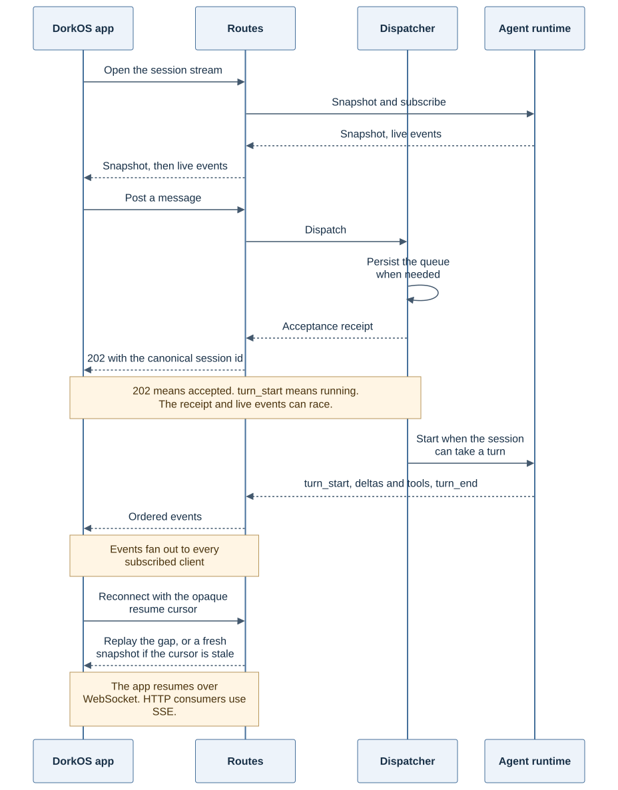](../apps/site/public/diagrams/architecture/session-flow.svg)

[Editable diagram](diagrams/architecture/session-flow.mmd)

The message POST returns a receipt, not a token stream. A busy session queues the message. `turn_start` is the reliable signal that execution began; `202` and `queuePosition: 1` cannot distinguish an immediate start from the first queued message. Queued messages survive server restarts. A turn that was running when the server stopped is lost today; the target is a run record per turn, an outbox and capped recovery ([Turns](architecture-target.md#5-turns), ADR `261124-150517`). The receipt and live events travel independently and may arrive in either order.

On a cold connection, the session stream sends a snapshot before live events. On reconnection it replays the missing range when possible, otherwise sends a fresh snapshot. Treat the full resume cursor as opaque: the app passes it as `?resume=` on its WebSocket, and an HTTP consumer passes it as the SSE `Last-Event-ID` header. A newly created session may receive a canonical runtime ID different from the requested ID; the client must follow that ID.

| Connection                          | Protocol / endpoint                                                                                       | Purpose                                                                                                                                                                                                            |
| ----------------------------------- | --------------------------------------------------------------------------------------------------------- | ------------------------------------------------------------------------------------------------------------------------------------------------------------------------------------------------------------------ |
| DorkOS client → local server        | HTTP JSON, `/api/*`; local uploads use multipart/XHR and Community uploads use raw bytes                  | Queries, commands, settings, uploads, and approvals                                                                                                                                                                |
| Local server → DorkOS client        | WebSocket at `/api/events`, `/api/sessions/:id/events`, `/api/rooms/:id/events`; qualified Community SSE  | Global changes, session turns, local-room changes, and remote Community updates. The global, session, and local-room paths also expose SSE to HTTP consumers.                                                      |
| Local server ↔ space server         | Approved-installation HTTP commands plus space channel SSE; an availability report every few minutes      | The local server retains personal and agent credentials, projects authorized space rooms, relays their resumable updates to the local app, and tells each space where its agents run and when they were last seen. |
| Your computer → its hub             | WebSocket at `/api/relay/computer`, dialed by the computer, framed and signed (`dorkos-session-relay/v1`) | The session relay: stream, send, approvals and interrupt, nothing else. Built; off until `sessionRelay.enabled` and a linked hub. The relayed caller is its own caller kind, never "at this computer".             |
| Other devices → local server        | The Wi-Fi listener (plain http, Mac only), the own tunnel, or managed remote ingress                      | Each is a route; a session records the route that made it and is refused on another. Wi-Fi sessions get a lower level. Managed remote is off until `DORKOS_MANAGED_REMOTE` is set.                                 |
| Terminal client ↔ local PTY         | WebSocket at `/api/terminal/:id/socket`                                                                   | Bidirectional terminal bytes; separate from durable app events                                                                                                                                                     |
| Space browser → space server        | Tenant HTTP `/api/v1/communities/:communityId/*`, plus host-wide `/api/auth/*`                            | Channel operations, sign-in, uploads and exports                                                                                                                                                                   |
| Space server → its browser          | SSE `/api/v1/communities/:communityId/channels/:id/events`                                                | Snapshot, replay and live channel updates; the browser uses `EventSource`                                                                                                                                          |
| Local server ↔ OpenCode sidecar     | SDK over local HTTP; global SSE subscription                                                              | Runtime operations and events. This is separate from the browser's WebSocket connection.                                                                                                                           |
| Local server ↔ Claude Code / Codex  | The Claude Agent SDK in process; one long-lived Codex `app-server` process per home                       | Agent turns; do not label all runtime links HTTP or SSE                                                                                                                                                            |
| Local server ↔ Doe                  | In-process engine/local tools, turn-bound loopback MCP for DorkOS tools; model HTTP(S)                    | Model calls support Anthropic Messages, OpenAI Chat Completions and Responses; configured local endpoints are supported. This is separate from client event delivery.                                              |
| External tool caller → local server | MCP Streamable HTTP at `/mcp`; A2A gateway under `/a2a`                                                   | Tool access and agent-protocol access, not the browser's chat transport                                                                                                                                            |
| Cloud-linked local server → Cloud   | HTTPS requests, polling, event pull/ack                                                                   | Device link, heartbeat and optional managed services; details below                                                                                                                                                |
| Messaging platforms ↔ Relay         | Platform-specific API, polling, webhook, or socket                                                        | Protocol belongs to the concrete messaging implementation                                                                                                                                                          |

See [SSE and WebSocket protocol](../docs/integrations/sse-protocol.mdx), [authentication](authentication.md), and [the terminal socket implementation](../apps/server/src/services/terminal/terminal-websocket.ts). WebSocket upgrades have their own credential, origin, and host checks because the Hono middleware chain does not run on an upgrade; one [upgrade router](../apps/server/src/services/core/streams/upgrade-router.ts) serves the main, Wi-Fi, TLS and tunnel listeners and checks admission before routing, after authorization and at completion.

### Local rooms and the space server

[](../apps/site/public/diagrams/architecture/community.svg)

[Editable diagram](diagrams/architecture/community.mmd)

Local rooms and spaces solve related problems but do not share a database or login, and that split is a decision, not a leftover (server-merge D2). A space server runs without a local DorkOS server or a Cloud account. It owns member and channel authorization, posts, files, and replay cursors. It never hosts an `AgentRuntime` or runs a member's agent (D9); an agent is a **member** of the space, of kind `agent` with an owner (migration `0042`, one-way), every message has one author, and the space records where each agent runs and when it was last seen (`runs_on`, `last_seen_at`), reported by the computer that runs it. A member can DM or mention another member's agent; the turn runs on the owner's computer at the agent's set level, like any other turn, and counts against the space's monthly teammate limit (DOR-2955, DOR-3440).

The `CommunityAdapter` seam is server-side. `GET /api/rooms` remains the caller-filtered local-room list and deliberately bypasses `LocalCommunityAdapter`: its single-identity model cannot express that route's per-caller permissions. An approved remote Community is addressed separately by community plus room ID through qualified `/api/communities/:ref/rooms/:roomId` routes. Its authorized rooms appear in the local app under that Community and update through the remote-room SSE stream; they are not copied into the generic local-room list.

Community pairing and agent credential routes are the admission path for native participation. A member approves an installation; that installation exchanges a verifier-bound code for a personal bearer. Agent enrollment issues a separate scoped agent bearer owned by that installation grant, and the local server uses those credentials for authorized channel reads, posts, files, membership changes, delivery control, and resumable updates.

One Community host can now serve many communities. Better Auth accounts and sessions belong to the host; memberships, roles, channels, entries, grants, files and exports belong to an immutable community UUID. Canonical HTTP routes use `/api/v1/communities/:communityId/*`; unqualified compatibility routes work only while the host has exactly one community. A second community makes an unqualified request fail with `COMMUNITY_SELECTION_REQUIRED`, rather than selecting a default.

Host operators manage community containers and lifecycle. Community owners and members govern ordinary content access. Separately scoped host takedown and evidence operations are exceptional moderation powers, not tenant membership. Scoped host API keys reach administrative operations under `/api/v1/host/*`, including limits, usage, legal holds and notice-gated community deletion. These keys do not grant ordinary tenant membership or authority to manage other API keys. A newly created community remains `pending_owner` until its intended owner uses a single-use claim link. Host operation does not silently grant membership. Personal account/member erasure uses the person’s own session and reauthentication, not a host key.

The app's switcher selects this local installation or a connected community. Switching changes the room scope and available actions; it does not move the agent runtime onto the host. Server-owned subscriptions continue receiving eligible remote messages without a browser. Authorized joined rooms have local mirrors for dispatch, while Community remains authoritative. Agent posts use a durable outbox with bounded retry and remote receipts. Stop, disconnection, and revocation are checked again at delivery boundaries.

An installation grant separates this computer's enrolled agents from another computer's agents, even for the same person and local agent ID. Disconnect attempts removal of only its enrolled agents and grant, then removes local credentials even if the remote cleanup is unconfirmed. The result reports incomplete remote cleanup; local withdrawal is not proof every remote credential disappeared.

Local mirrors are derived, revocable copies. Authoritative deletion, takedown or revocation stops applicable subscriptions/outbox/agent work and removes mirrored history, files and search entries. An unexplained 404, an outage or a suspension is not authoritative deletion; uncertain origins prompt an explicit removal choice. Failed orphan cleanup is retried rather than presented as synchronous erasure of all copies.

Host imports accept version 1 and 2 owner exports and restore through a leased worker into an unclaimed tenant. Historical people and agents do not gain live credentials or memberships; the new owner claims explicitly. Whole-community takedown has evidence retention and a reversal window; reversal returns a suspended tenant and does not restore old credentials. Owner replacement has its own scoped request, durable mail, waiting period, objection and signed-in claimant workflow. SMTP submission is not proof the owner read a notice.

Legal holds coordinate blob deletion through tenant row locks and a managed-blob inventory. Covered tenant files remain after hold placement commits; legacy deletion records without an inventory mapping need reconciliation before the tenant hold can cover them. The [IDs-only erasure journal](../apps/server/src/services/spaces/erasure/journal.ts) supports an off-server copy and reapplication after restoring an older backup. That is an operator recovery workflow, not proof of an automated production backup policy.

The guided `dorkos community deploy` launcher runs on the operator's machine, independently of the local server and Cloud. It provisions a separate deployment from a versioned, attested space image, built since October from the root `Dockerfile`'s `space` target under the same image name. The [hosting guide](../apps/space/FLY.md) and [published-release live gate](../specs/community-self-host-launcher/04-live-gate.md#published-release-gate-pass-dor-2169-dor-2606) describe the operational proof and its limits. The recorded v0.94.0 disposable-provider run proves owner setup, a second invited member, private-file integrity, anonymous denial and identity-checked cleanup without contacting DorkOS hosts. That run predates the merged image; ADR `261018-124422` asks for a rerun on it, which spends money and has not happened. It does not complete the separately tracked [two-desktop/agent launch acceptance](../specs/community-launch-acceptance/02-specification.md), or certify the current live Spaces deployment.

The [authority tests added in PR #2271](https://github.com/dork-labs/dorkos/pull/2271) exercise open-stream owner/origin isolation and grant-specific revocation. The [two-community backup/restore rehearsal](../apps/space/scripts/rehearse-backup-restore.mjs), added in [PR #2272](https://github.com/dork-labs/dorkos/pull/2272), verifies restored content, attachments and authorization on disposable local resources. It is operator-run source-build evidence, not proof of a particular production image, deployment or rollback path.

Slack and Telegram bridges project messages into **local** rooms. They are Relay paths, not remote space backends. Hand-offs between room seats and seat reports are held in process memory at this source; a restart drops a waiting one (DOR-3816, PR #4098). See [Community development](community-server.md) and [implementing the Community port](adding-a-community-adapter.md).

### Marketplace discovery and delivery

[](../apps/site/public/diagrams/architecture/marketplace.svg)

[Editable diagram](diagrams/architecture/marketplace.mmd)

“Marketplace” names three things: source repositories, a discovery surface on the website, and the local install/activation machinery. There is no required central package-execution server between an installed package and an agent.

The site reads registry metadata and package descriptions. Update checks now use the installer’s own resolve/stage/validate path and the package → marketplace entry → commit version fallback. An uncheckable package reports `unknown`, not `current`. The local installer resolves sources, fetches and caches content, validates it, prepares a permission preview, and installs through a file transaction. Activation depends on the package type. Harness Sync projects agent-facing assets into the layouts each supported harness reads; executable app extensions and messaging packages have their own activation paths.

Install, uninstall and update serialize per canonical target. Owner-stamped transaction records support recovery after a crash; recovery backups are excluded from package discovery, and preserved update siblings are excluded from scanning, execution and Harness projection. Ambiguous user files stay preserved for operator resolution. Failed messaging-package activation rolls back its own registration and retains an existing connection's settings, secrets and agent links. These protections do not make an uninstall/reinstall update one global transaction. Startup project recovery still enumerates Mesh agent projects; a known project without a registered agent is recovered at its next target operation, not by that sweep. See [the local recovery matrix](../research/20260926-local-marketplace-recovery-evidence.md).

The install path is covered end to end. That does **not** certify all Claude Code marketplace compatibility claims: full superset compatibility remains behind the project's verification gate. See [registry format](marketplace-registry.md), [installation](marketplace-installs.md), and [Harness Sync](harness-sync.md).

### Cloud public boundary

[](../apps/site/public/diagrams/architecture/cloud-boundary.svg)

[Editable diagram](diagrams/architecture/cloud-boundary.mmd)

Cloud is not required to build, test, or run the local app or Community host. The initial Cloud implementation does not change that boundary. Public schemas describe the agreement; public app code establishes which callers are implemented. Neither alone establishes the deployment's settings or end-to-end service availability.

#### App adoption is separate from service implementation

Two API families still coexist. `cloud-link-client.ts` calls `/api/auth/device/*` and `/api/instances/*` for device linking, heartbeats and managed services. `cloud/v1-client.ts` uses `@dork-labs/cloud-api/client`. They resolve different origins. The legacy calls use `resolveCloudBaseUrl()` (`DORKOS_CLOUD_URL`, default the website, which hands those paths to the service). `/v1` calls use `resolveCloudApiBaseUrl()` (`cloud/cloud-api-origin.ts`): `DORKOS_CLOUD_API_URL`, else a non-default `DORKOS_CLOUD_URL`, else the service's own origin, because the website has no `/v1` routes (DOR-2673). Review origin configuration and compatibility before retiring old routes.

The public contract covers accounts, linked instances, managed services, entitlements and billing, organizations/seats, remote access and enrolment, inference, hosted communities, and, since October, hub assignment, agent computers, computer start and stop, the viewer-open wake and the account directory with its spaces. Remote access describes command leasing and acknowledgements, address designation, credential replacement and idempotent event batches. The local managed command-stream consumer is built ([`services/core/remote/`](../apps/server/src/services/core/remote/command-stream.ts): stream, dispatcher, journal, acks, enrolment, edge proof, ingress; DOR-2086) and off until `DORKOS_MANAGED_REMOTE` is set, "until the live supplier proof passes". The hub families have two app consumers, hub assignment and the viewer-open wake (`services/core/hub/hub-relay-wake.ts`); the agent-computer, computer and directory families have none yet. The existing tunnel manager uses the ngrok SDK. Browser traffic through a tunnel is a data path to the local server, distinct from Cloud control requests, and the session relay is a third path that carries chats only.

Credits inference is authorized by a person's Runs on choice, with a recorded default for new conversations. A new account link can fill an unusable runtime choice with credits and tells the person; it does not silently replace a working choice. `DORKOS_CLOUD_CREDITS=0` disables credits; an environment variable cannot select the payer. The [credits service](../apps/server/src/services/core/cloud/credits-inference.ts) obtains service-issued instance identity from authenticated `/v1/session` before minting. Both calls share the [captured credential, origin and generation](../apps/server/src/services/core/cloud/v1-client.ts); absent identity or stale settlement cannot supply a usable token.

| Runtime     | Credits scope                                     | Boundary                                                                                                                                                                               |
| ----------- | ------------------------------------------------- | -------------------------------------------------------------------------------------------------------------------------------------------------------------------------------------- |
| Claude Code | Per-session launch choice                         | Checks expiry/current-link ownership after asynchronous credential resolution; no automatic fallback to another payer.                                                                 |
| Codex       | A new conversation in a DorkOS-owned credits home | Existing conversation payer stays bound to its home. Turn-specific provider configuration carries the token; credits turns disable vendor web search.                                  |
| OpenCode    | The whole managed sidecar                         | Its local credits relay holds the Cloud token outside the sidecar. Payer changes wait for running replies; unlink terminates relayed requests.                                         |
| Doe         | Inference source bound when the first turn starts | Durable session metadata preserves payer choice. Credentials resolve lazily, credits require the selected protocol and current link, and refusal never silently selects another payer. |

Codex and OpenCode are available on credits only when the minted token advertises their request format in `served`; endpoint presence alone is insufficient. See the [choice ADR](../decisions/261001-000811-credits-are-a-runs-on-choice-not-a-flag.md) and [runtime-format ADR](../decisions/261002-221210-codex-and-opencode-run-on-credits-by-request-format.md). Local launch fences and relay revocation have different cancellation scopes; do not describe them as universal cancellation of all existing turns. The ADR explicitly records untested Codex subagent requests and conditional real-binary evidence.

The account surface reads opaque offers and validated hosted billing URLs. Payment happens in a browser; the local app owns no commercial catalogue. Account deletion is owner-only. Export starts a service job; a not-ready response asks for email, while an already-ready export supplies its link. The public contract has no later job-status endpoint.

#### Ways in from another device

[](../apps/site/public/diagrams/architecture/remote-access.svg)

[Editable diagram](diagrams/architecture/remote-access.mmd)

Each route is its own listener or dial, and a session records the route that made it: the Wi-Fi listener (plain http, Mac only, a lower session level), the person's own tunnel (the ngrok SDK, an outbound connection, so the tunnel service only forwards app traffic), managed remote ingress (built, off until `DORKOS_MANAGED_REMOTE` is set), and the session relay (chats only, dialed to the pinned hub, off until `sessionRelay.enabled`). The hub is the same program in the hub role; it reads its assignment from Cloud and is built but not deployed. Cloud's command stream reaches the managed remote consumer only when that switch is on.

#### Website account handover

[](../apps/site/public/diagrams/architecture/accounts-handover.svg)

[Editable diagram](diagrams/architecture/accounts-handover.mmd)

`DORKOS_CLOUD_ACCOUNTS_ORIGIN` selects an implemented compatibility path in the public site. With it unset or invalid, account routes remain local. With a valid origin:

- Account pages and eligible browser navigations receive a temporary 307 redirect, putting the browser on the host that owns its session cookie. Query strings survive.
- Machine/bearer requests, bodies and background fetches use a rewrite that preserves method, body and authorization. This keeps released binaries' existing account and instance paths useful.
- Only the listed account paths and exact instance registry routes are forwarded. This is not a catch-all `/api` or `/v1` proxy. Managed connections forward only when the independent `DORKOS_CLOUD_MANAGED_CONNECTIONS_FORWARD=1` switch is also enabled. Otherwise they remain unavailable on the forwarding site; service availability and their migration evidence remain separate.
- Forwarding-aware site sweeps stand down. Public-site schema migrations have their own configuration/history. Deleting the remaining account implementation is a later cleanup ([DOR-2442](https://linear.app/dorkspace/issue/DOR-2442)), requiring a verified handover first.

This documents both supported configurations, not which is enabled in production. Do not equate a merged handover mechanism with completed traffic cutover or code retirement.

### Cloud-hosted communities: management and content paths

[](../apps/site/public/diagrams/architecture/hosted-communities.svg)

[Editable diagram](diagrams/architecture/hosted-communities.mmd)

The [public host-operator specification](../specs/community-host-operator-api/02-specification.md) defines optional hosting management over the same independently runnable Community software. Hosting manages lifecycle, limits and usage through the host API. It does not grant the hosting account ordinary community membership or route participation through Cloud. Content and its authorization remain with the Community host.

| Boundary                      | Public evidence at this snapshot                                                                                                       | Remaining boundary                                                                                                                                                          |
| ----------------------------- | -------------------------------------------------------------------------------------------------------------------------------------- | --------------------------------------------------------------------------------------------------------------------------------------------------------------------------- |
| Community host administration | Scoped keys, owner claims, lifecycle, short names, limits/usage, legal holds and notice-gated community deletion routes are registered | Import/restore, multipart upload, takedown/evidence, erasure journal and owner replacement now have public implementations; their production operations still need evidence |
| Hosted-service wire           | Schemas, route table and fixtures cover list/start/claim, keep/restore and moves                                                       | Runtime availability and completion must be checked; a schema is not deployment proof                                                                                       |
| Local app entry               | Start/move dialogs, `/api/cloud/communities/*` router and parsed contract client are implemented and mounted                           | Refusals and unavailable states remain possible; UI presence is not a hosted launch guarantee                                                                               |
| Sign-in                       | Host-wide accounts with community-scoped membership                                                                                    | Configurable OIDC is implemented; Cloud-listed sign-in origins guide browser entry, while membership remains tenant-scoped                                                  |
| Participation                 | Qualified local-server HTTP and Community SSE                                                                                          | Does not depend on routing posts or agent execution through the hosting control plane                                                                                       |

The local server stages an export, starts the move through Cloud, and uploads directly to the returned Community-server target. Multipart upload verifies held parts, sends missing or changed parts and completes against the full digest; capacity checks cover the destination and local staging space. Confirmed parts support retry, but do not imply arbitrary local-process restart recovery of staging files. The archive does not pass through the Cloud control plane. The installation credential and move upload token stay server-side. The one-time owner-claim URL reaches the browser only through the explicit claim-link action, with `no-store`; list, start and poll responses omit it. `GET /api/cloud/communities/sign-in` relays the origins whose single sign-on is the DorkOS account; the client opens a claim, invitation or approval on one of them with `?sign-in=single-sign-on` (`withCommunitySingleSignOnHint`), and the Community server's pages then lead with that sign-in. The hint grants nothing, and an unlisted server (every self-run one) is opened exactly as before. See [the local relay](../apps/server/src/routes/cloud-communities.ts) and [public contract](../packages/cloud-api/README.md#hosted-communities).

A move copies history; it is not transfer of live logins or proof that the old host stopped serving. Import restores history into a new unclaimed tenant; it does not transfer active sessions, credentials or membership authority. Keep the released launcher proof distinct from the broader hosted-product launch and move acceptance. The diagrams label the hosting relationship as a public contract rather than speculating about private service internals or rollout.

### Runtime tools and room publication

[](../apps/site/public/diagrams/architecture/runtime-tools.svg)

[Editable diagram](diagrams/architecture/runtime-tools.mmd)

Claude Code receives DorkOS tools in-process. Agent-bound Codex, OpenCode and Doe turns receive them through a loopback-only MCP Streamable HTTP listener with short-lived, turn-bound credentials; the `computer-local` experiment reaches the same tools through a fixed-target bridge into its guest. Doe separately assembles its local engine tools. This is separate from external `/mcp`; switching off public MCP access does not remove an agent's own tools. The [injection policy](../apps/server/src/services/runtimes/shared/dorkos-mcp-injection.ts) binds identity, runtime and working directory, and revokes the bearer when the turn ends. On an agent computer in the cloud, the design sends every DorkOS tool call back to the agent's hub over the relay channel, so permissions are read where the agent's `agent.json` lives (planned, A7). ADR `261116-065134` (proposed) would attach the same current-turn facts to every runtime's tool context through the existing turn ownership.

A room turn publishes by calling `post_to_room` or reacting; otherwise it stays silent. Its final text is not automatically a room post. Execution, session event delivery and shared-room publication are separate operations. See [the runner](../apps/server/src/services/rooms/room-turn-runner.ts).

An agent can also receive a signed-in Playwright browser through its managed MCP configuration. The local CLI owns the saved browser state; the server reports only site names and dates. That state grants website access and belongs in the credential inventory, separately from runtime keys and service accounts. Browser lifetime varies by runtime, and verification remains limited as described in the [signed-in browser guide](../docs/guides/agent-browser.mdx).

### Data ownership and trust boundaries

| Data               | Authority                                                                                                                                                                                                    | Architectural consequence                                                                                                                                                                                       |
| ------------------ | ------------------------------------------------------------------------------------------------------------------------------------------------------------------------------------------------------------ | --------------------------------------------------------------------------------------------------------------------------------------------------------------------------------------------------------------- |
| Session history    | Runtime-specific history: Claude Code transcripts; Codex thread bindings plus DorkOS-persisted event history; OpenCode sidecar storage; Doe SQLite model/display history                                     | There is no universal transcript store or automatic cross-runtime migration. The Codex SDK cannot list/read threads, so its DorkOS implementation keeps the history it observed.                                |
| Local coordination | Local SQLite and DorkOS files                                                                                                                                                                                | Room posts, durable message queues, schedules and app state do not become Cloud data merely because the app is linked.                                                                                          |
| Agent identity     | `.dork/agent.json` with a derived SQLite registry                                                                                                                                                            | File-first writes; discovery rebuilds the registry. On a cloud agent computer the design keeps identity and permissions on the hub and gives the computer a read-only copy (planned).                           |
| The record         | The hash-chained audit log in local SQLite; one row per tool call, per beat, per pause                                                                                                                       | The owner reads everything; an agent reads space rows and its own participant rows. A failed write is a logged gap, never a block.                                                                              |
| Heartbeats         | `heartbeat_state`, `heartbeat_beats`, `heartbeat_outbox`, `heartbeat_report_items` in local SQLite; `HEARTBEAT.md` beside the agent                                                                          | Beat rows are kept 90 days; the audit row stays. One process owns an agent's beats; there is no lease across servers.                                                                                           |
| Search             | Derived FTS index over rooms and the Claude Code, Codex, OpenCode and Doe histories                                                                                                                          | Rebuildable; not the source of conversation history.                                                                                                                                                            |
| Spaces             | The space store: host PostgreSQL and tenant-owned blobs, split from the machine store by kind of state (server-merge D2 as amended by ADR `261122-173853`): space data here, execution state on the computer | Host-wide sign-in; tenant-scoped membership, content, grants and exports. Agents are members with an owner; availability is reported, never inferred. Host administration is not content authority.             |
| A hub's data       | The same machine store, with no runtimes; the private space is its `LOCAL_COMMUNITY`                                                                                                                         | A Mac hub and a cloud hub are peers that do not sync (ADR `261015-042933`). A Mac's older rooms stay on the Mac until the private space becomes a tenant on the space store after launch (ADR `261122-173853`). |
| Marketplace        | Source repositories; installed files and local install metadata                                                                                                                                              | The website is not the authority for an installed package's execution.                                                                                                                                          |
| Cloud credentials  | Server-side Cloud client boundary                                                                                                                                                                            | Browser UI consumes app responses; server-side credentials stay out of diagrams, logs, and client payloads.                                                                                                     |

These are ownership boundaries, not a blanket promise that no content leaves the machine. Model calls, external service actions, opted-in telemetry, remote browser access, and Community posts cross different boundaries for different reasons.

## Anti-Patterns

| Avoid                                                                          | Use instead                                                                                              |
| ------------------------------------------------------------------------------ | -------------------------------------------------------------------------------------------------------- |
| ❌ One box called “backend” for local DorkOS, the space server, and Cloud      | ✅ Separate deployment and data-ownership boxes                                                          |
| ❌ "One program" drawn as one request chain or one database                    | ✅ One package and release; one entry, image, chain and store per role (server-merge D2, step 7)         |
| ❌ A role that exists in code drawn as a running service                       | ✅ Hub and agent computer marked role-gated until a Cloud receipt says they run                          |
| ❌ Every live arrow labeled SSE                                                | ✅ WebSocket for local app streams, SSE for Community and OpenCode events, with the exact boundary named |
| ❌ `202` drawn as the start of an agent turn                                   | ✅ Acceptance receipt followed by `turn_start` on the event channel                                      |
| ❌ A type or tested implementation drawn as a configured production connection | ✅ A dashed, labeled unfinished path; check composition-root registration                                |
| ❌ Marketplace drawn as a hosted execution service                             | ✅ Source → local transaction → activation/projection                                                    |
| ❌ Cloud inferred from private implementation details                          | ✅ Public contract plus verified app-side callers                                                        |
| ❌ A broad compatibility or platform claim inferred from a build               | ✅ The project's explicit verification status                                                            |

## Updating the diagrams

1. Change the `.mmd` sources in [diagrams/architecture](diagrams/architecture), then regenerate the SVGs. The [rendering instructions](diagrams/architecture/README.md) pin the renderer and configuration.
2. Check the corresponding implementation and startup registration, not just its interface. Record whether each changed path is implemented, optional, unwired, or contract-only.
3. Keep this guide, [the reader overview](../docs/concepts/architecture.mdx), and [the published developer reference](../docs/contributing/architecture.mdx) consistent. Reuse the SVG assets instead of copying diagram definitions.
4. Update the coverage map in [INDEX.md](INDEX.md), then run `node .claude/scripts/docs-coverage-map.mjs --regen` and `--check`.
5. Render and visually inspect every changed diagram. Check referenced paths and the docs build/MDX compilation before claiming the documentation is ready.

## Troubleshooting

**A diagram looks more complete than the feature.** Follow its code pointer to the startup wiring. A registered implementation, a conformance test, a public schema, and an end-user feature are four different kinds of evidence.

**An old document calls chat an SSE connection.** Check which caller it describes. SSE is still supported for HTTP consumers; the DorkOS browser's durable streams use WebSockets. Preserve correct SSE protocol guidance while correcting the browser claim.

**A schema and a deployed service disagree.** Record the discrepancy at the public contract boundary. Do not silently document private behavior as the contract.
