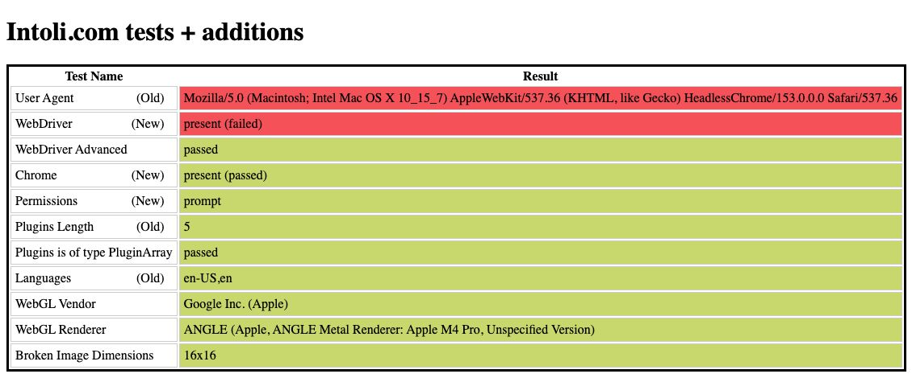
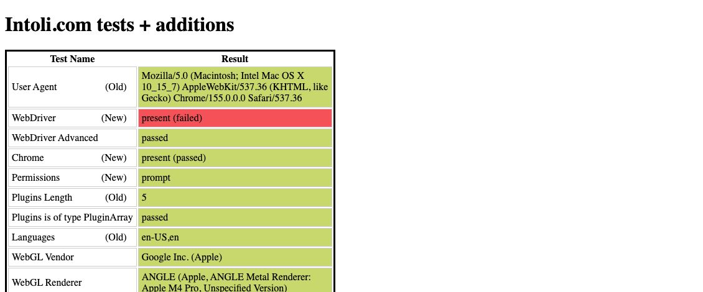
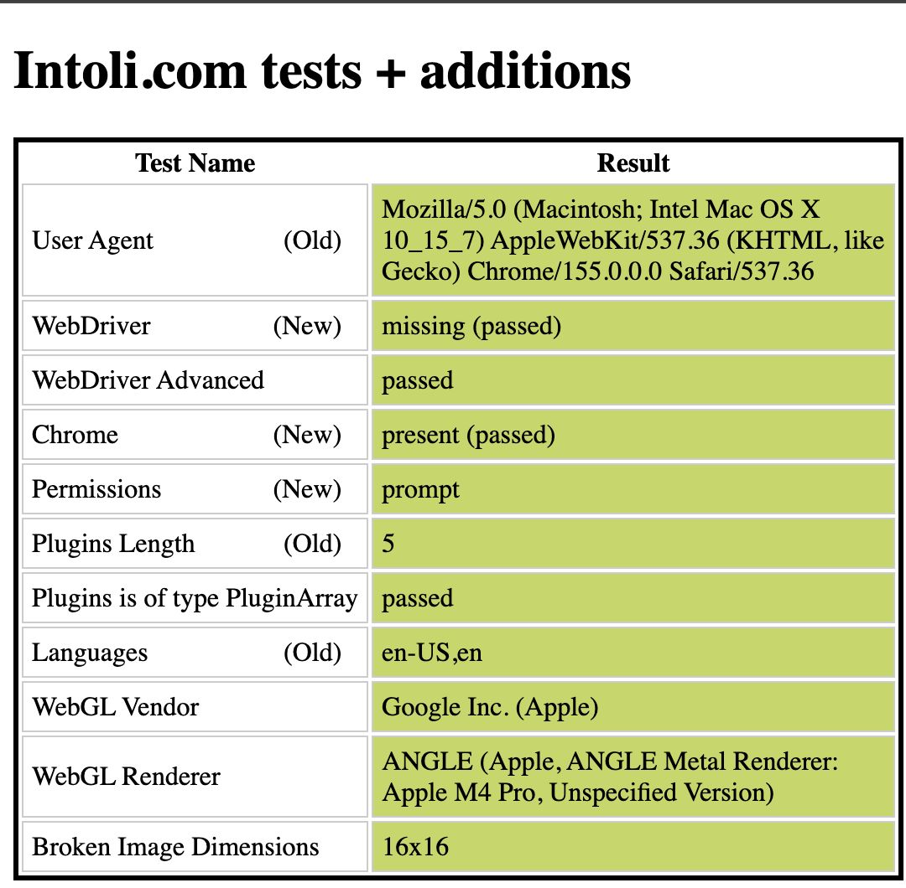
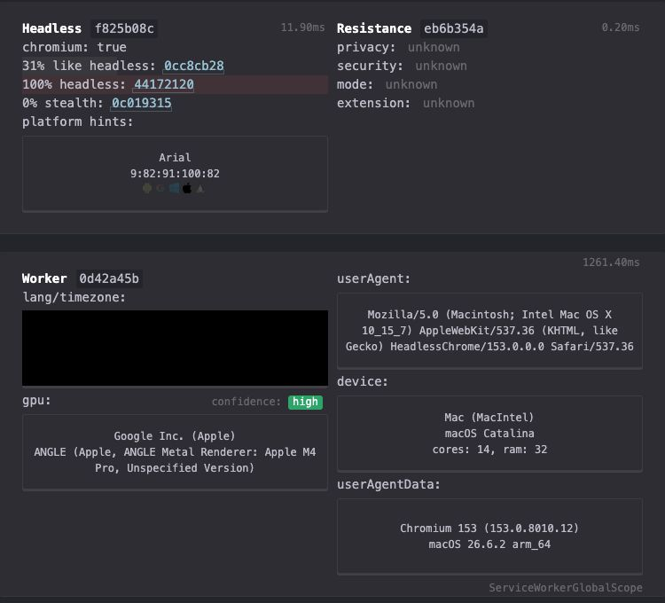
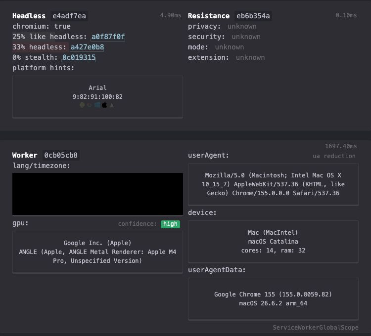
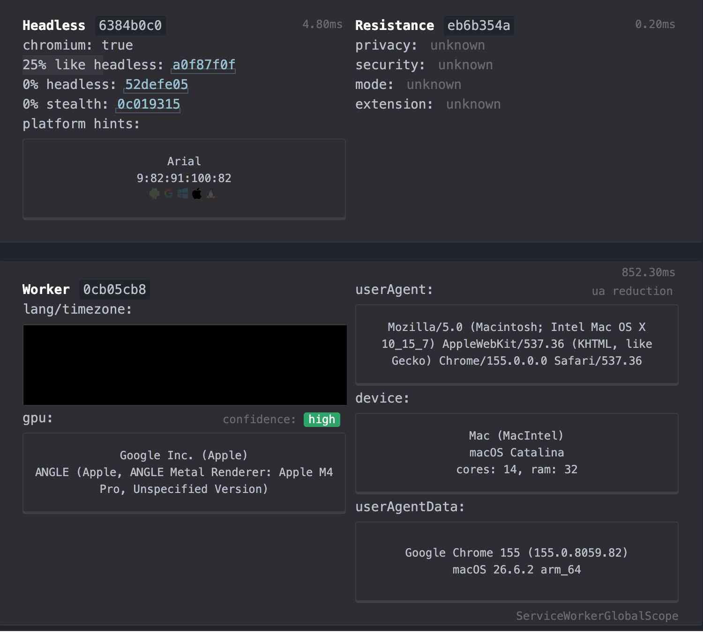
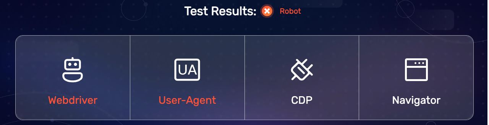
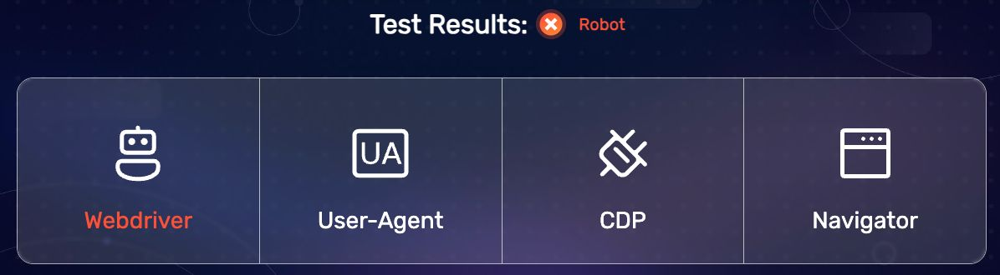
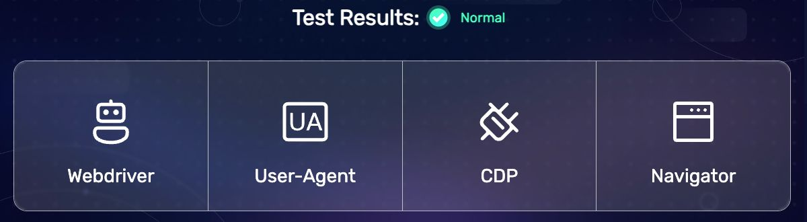

# Why sites block the agent browser as a bot

Measured on 2026-10-19 on one Mac (Apple Silicon, macOS 26.6), Google Chrome 155 and the bundled Chrome for Testing 153. No stealth plugins, no spoofing, no real sign-ins. Each test site was opened once per mode in a throwaway profile. Screenshots are cropped to the verdict, with the network address and timezone blacked out.

## The short answer

1. **One thing gives every DorkOS browser away: the debugging channel.** Starting Chrome with a debugging channel (`--remote-debugging-pipe` or `--remote-debugging-port`) sets `navigator.webdriver = true` on every page. That is the flag every bot check reads first. It does not need `--enable-automation` or headless mode. A clean A/B shows it: the same Chrome, profile flags and page, with and without `--remote-debugging-pipe`, flips BrowserScan from **Normal** to **Robot**.
2. **The managed agent browser adds a second, louder giveaway: headless mode.** It calls itself `HeadlessChrome` in its user agent, and CreepJS rates it **100% headless**.
3. **`dorkos browser login --plain` passes all three tests.** It is an ordinary Chrome. It can become the default sign-in, but it has a real bug first (below).
4. **"Launch it like a normal Chrome" (DOR-3104) cannot clear `webdriver` while agents drive Chrome through a debugging channel.** Hiding that flag is spoofing, which is Security's call. Everything else on the list can be cleared honestly.

## 1. What gives us away

Three modes, each tested on three sites:

- **Managed**: the browser agents use (`packages/browser`). The same argv as `darwin-supervisor-browser.ts` (headless, debugging port, the Playwright default flags, `LANG=C`, `--use-mock-keychain`), the same Chrome for Testing 153, driven by Playwright `connectOverCDP`. The DorkOS egress proxy was left out: it forwards from the same machine and does not touch what the page sees.
- **Login**: `dorkos browser login <site>`. The person's installed Chrome, with a window and `--remote-debugging-pipe`. Nothing else touches the page until the save step.
- **Plain**: `dorkos browser login --plain <site>`. The same Chrome with no debugging channel at all.

| Test              | Managed                                                                     | Login                               | Plain                              |
| ----------------- | --------------------------------------------------------------------------- | ----------------------------------- | ---------------------------------- |
| bot.sannysoft.com | **3 fails**: User Agent (`HeadlessChrome`), WebDriver present, `CHR_MEMORY` | **1 fail**: WebDriver present       | **0 fails**                        |
| CreepJS           | **100% headless**, 31% like headless                                        | **33% headless**, 25% like headless | **0% headless**, 25% like headless |
| BrowserScan       | **Robot**: Webdriver, User-Agent                                            | **Robot**: Webdriver                | **Normal**                         |

|             | Managed                                                        | Login                                                        | Plain                                                        |
| ----------- | -------------------------------------------------------------- | ------------------------------------------------------------ | ------------------------------------------------------------ |
| sannysoft   |    |    |    |
| CreepJS     |      |      |      |
| BrowserScan |  |  |  |

### Each giveaway, and the part of our launch that causes it

| Giveaway                                                              | Seen in        | Cause                                                                                                                                                                                                                  | Honest fix?                                                                                                                            |
| --------------------------------------------------------------------- | -------------- | ---------------------------------------------------------------------------------------------------------------------------------------------------------------------------------------------------------------------- | -------------------------------------------------------------------------------------------------------------------------------------- |
| `navigator.webdriver = true`                                          | Managed, Login | **Any debugging channel on the command line.** Proven by A/B: Login and Plain differ only by `--remote-debugging-pipe`. A third run of the managed flags with a window (no `--headless`) still had `webdriver = true`. | **No.** Only by not using a debugging channel (plain sign-in, or an extension, option d) or by spoofing it (evasion: Security's call). |
| `HeadlessChrome/153` in the user agent                                | Managed        | `--headless=new`                                                                                                                                                                                                       | Yes: run with a window. Gone in the windowed run.                                                                                      |
| `CHR_MEMORY` fail, 100% headless on CreepJS                           | Managed        | `--headless=new`                                                                                                                                                                                                       | Yes: run with a window.                                                                                                                |
| Outer window smaller than the page (756×556 outside, 1280×720 inside) | Managed        | Headless, plus Playwright setting the viewport                                                                                                                                                                         | Yes: a real window, no forced viewport.                                                                                                |
| `userAgentData` brands say only "Chromium 153", never "Google Chrome" | Managed        | Bundled Chrome for Testing, an older build than the computer's Chrome                                                                                                                                                  | Yes: the installed Chrome. That is DOR-3104's hardest part (below).                                                                    |
| WebRTC "blocked"                                                      | Managed        | `--webrtc-ip-handling-policy=disable_non_proxied_udp` (our egress policy)                                                                                                                                              | Keep it. It protects the person's network address. A weak signal on its own.                                                           |

**Not a giveaway here:**

- The **CDP check** passed in every mode, Playwright included. BrowserScan and CreepJS no longer catch the old `Runtime.enable` trick on Chrome 153 and 155.
- **Locale and timezone** matched the computer in every mode, even with `LANG=C` in the managed launch's environment.
- **A fresh profile** did not show up on these three tests. A real bot wall like Akamai also weighs network, TLS and behaviour, which these pages do not test. This spike could not measure that without visiting a real wall.
- CreepJS gave **Login and Plain the same fingerprint ID**. Apart from the automation flag, the person's own Chrome looks the same with or without a debugging channel.

## 2. Can `--plain` become the default sign-in?

**Yes, once one bug is fixed.** Saving the session does not need a debugging channel during sign-in. Today's `--plain` (`packages/cli/src/commands/browser-commands.ts`, `runPlainLogin`) quits Chrome, then reads the cookies with a hidden background Chrome on the same profile. The hidden Chrome read cookies the windowed Chrome wrote, so the keychain encryption is not a problem.

Tested with the real built CLI on a throwaway `DORK_HOME`, against httpbin.org (it sets one cookie that lasts a day and one that lasts the session; no account involved):

| Pressed Enter after | Saved                                                             |
| ------------------- | ----------------------------------------------------------------- |
| 20 seconds          | **Nothing.** "Saved, but no site is signed in yet."               |
| 50 seconds          | The day-long cookie: yes. The session cookie: no (as documented). |

**The bug: Chrome writes cookies to disk only every ~30 seconds, and the CLI's quit (SIGTERM) does not write them first on macOS.** The same result with Chrome alone: quit 20 seconds after the cookie was set, and the profile had no cookies; quit at 45 seconds, and it had them. So a person who signs in and presses Enter right away loses the sign-in, and the CLI says only that no site is signed in. That is the most likely sign-in to lose, because people press Enter right after they finish.

**What `--plain` gives up**, compared with today's default:

- Session-only cookies are dropped. Sites that only keep you signed in for the session need "keep me signed in". Already documented in the CLI's own text.
- Page storage (`localStorage`) is not saved. The background read passes `pageStorage: false`. Some single-page apps keep their sign-in there.

**Recommendation:** make plain the default. Fix the write first. The cheapest fix is to wait about 30 seconds after Enter before quitting, with a "Saving…" line. A cleaner one asks the person to quit the orange window themselves; a person's quit is a normal shutdown. I did not test whether a person's quit (⌘Q) writes cookies straight away; check that before choosing. Keep the debugging-channel mode behind a flag for sites that need session cookies or page storage.

## 3. Can the agent's window bring itself to the front?

**Sometimes. Keep a "Show window" button.**

Tested by launching Chrome with a window from a background process, then moving another app to the front and trying three ways back:

| Way                                                              | DorkOS desktop app in front | Finder in front   |
| ---------------------------------------------------------------- | --------------------------- | ----------------- |
| Just launching it                                                | Stayed behind               | Came to the front |
| The browser's own `Page.bringToFront` over the debugging channel | Stayed behind               | Came to the front |
| macOS `NSRunningApplication.activate` for Chrome's process id    | **Came to the front**       | Came to the front |

macOS 14 and later decides whether an app may take focus, and it protects the app the person is using. Asking macOS directly by process id worked both times, but my test process was itself a child of the DorkOS app, which may be why macOS allowed it. Someone using DorkOS in a browser tab runs the server under Terminal or launchd, and that case is not tested. So: try `activate` by process id (a tiny helper, no extra permission needed), and always show the "Show window" button as the sure way. Plain mode has no debugging channel, so asking macOS by process id is its only way to come forward.

## 4. Estimates

| Work                                                                         | Size | Days | Why                                                                                                                                                                                                                                                                                                                                                                                                                                                                |
| ---------------------------------------------------------------------------- | ---- | ---- | ------------------------------------------------------------------------------------------------------------------------------------------------------------------------------------------------------------------------------------------------------------------------------------------------------------------------------------------------------------------------------------------------------------------------------------------------------------------ |
| (a) Launch cleanup, DOR-3104: **window instead of headless, drop `LANG=C`**  | M    | 2–3  | Clears `HeadlessChrome`, `CHR_MEMORY`, the window size and 100% headless. The window has to live somewhere: behind the Browser panel, off-screen, or shown. The screencast stream needs checking with a real window.                                                                                                                                                                                                                                               |
| (a) DOR-3104: **the installed Chrome instead of bundled Chrome for Testing** | L    | 6–9  | The managed runtime is built around one pinned, checked build: `fresh-verifier.ts` requires exactly "Google Chrome for Testing 153.0.8010.12", and the supervisor and custody code (~4,500 lines in `packages/browser/src/runtime`) assumes it. The installed Chrome changes version on its own, may be missing, and since Chrome 136 refuses a debugging port on the person's default profile. It needs its own trust model. It clears only the "Chromium" brand. |
| (a) DOR-3104: **`webdriver`**                                                | n/a  | n/a  | Cannot be cleared honestly while driving Chrome through a debugging channel. List it as a leftover with this reason, or Security rules on it.                                                                                                                                                                                                                                                                                                                      |
| (b) Hand the wall to the person in the visible window                        | M–L  | 4–6  | Recognising block pages (Akamai, Cloudflare, PerimeterX; text and status code), the handoff card with Continue and Stop, bringing the window forward with the "Show window" fallback, and resuming the agent after. It depends on the window work in (a) and the designer's mockups (Oct 23).                                                                                                                                                                      |
| PATH shim, DOR-3105                                                          | M    | 3–4  | The desktop app ships no CLI today: only the server bundle is in `app.asar`. It needs a CLI entry in the app, a small `dorkos` script that runs it with the app's own Node (`ELECTRON_RUN_AS_NODE`), an opt-in install to `~/.local/bin` (or `/usr/local/bin` with a password prompt), a PATH check, the copyable command in Settings, signing for the new file, and a note for Windows.                                                                           |
| Block detection plus a plain retry, DOR-3103                                 | S–M  | 2–3  | Recognise the block page during `login`, quit, then rerun as plain. **If plain becomes the default (recommended), this shrinks to S, 1–2 days:** flip the default, fix the cookie write, and keep the old mode behind a flag. Detection is then only needed for agent sessions, which is (b).                                                                                                                                                                      |

## 5. What surprised me

1. **`webdriver` comes from the debugging channel itself**, not from automation flags or headless mode. That moves the main fix from "clean up flags" to "how do agents drive Chrome at all". It strengthens the case for option (d), an extension using `chrome.debugger`, which does not need a debugging channel on the command line. That still needs its own test.
2. **`--plain` silently loses a sign-in made in the last ~30 seconds.** It reports "no site is signed in yet", not an error.
3. **Two orange windows look exactly the same.** During my 50-second `--plain` test, the throwaway window ended up on www.godaddy.com. I never sent it there. At the time, a separate `dorkos browser login godaddy.com` was open on the real agent profile, from another chat or from Dorian. The likely story is that someone typed into the wrong orange window. I cannot prove it. If so, a sign-in can land in a profile the person did not mean. The handoff design should name the site or task in the window. Two side notes: GoDaddy loaded normally in that plain window (it got Akamai's cookies, not "Access Denied"), and the throwaway profile and its saved file were deleted after the spike.
4. **The CDP leak everyone writes about is gone.** Neither BrowserScan nor CreepJS caught Playwright on Chrome 153 or 155.
5. **The managed browser blocks WebRTC on purpose**, so CreepJS shows "blocked". That is our privacy choice, not a bug, and worth keeping.

## Out of scope, for Security (due Oct 22)

Where running Chrome normally ends and evasion begins. The question it turns on is whether hiding `navigator.webdriver` on a browser an agent drives is allowed. This spike did not try it.

## How it was measured

A throwaway Node script launched each mode, opened one test site, waited 25–30 seconds, then took a screenshot and read a few values from the page (`navigator.webdriver`, user agent, brands, languages, timezone, window sizes, WebGL). In login mode it attached over the existing pipe only after the tests had run, the way the save step would. Plain mode was captured by macOS `screencapture` of the window, since there is no channel to read it through. No ports 4242, 6242 or 6241 were used, and no DorkOS server was started. Every run used a throwaway data directory. The real saved sign-in file (`~/.dork/browser/storage-state.json`) kept its modification time; the real profile folder changed only because the other `browser login godaddy.com` was open on it.
