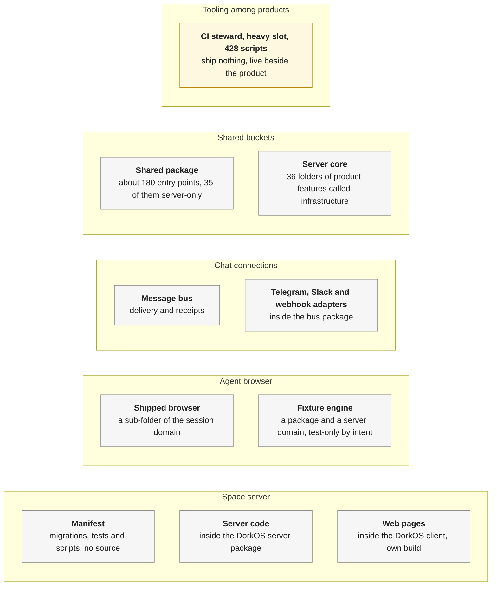
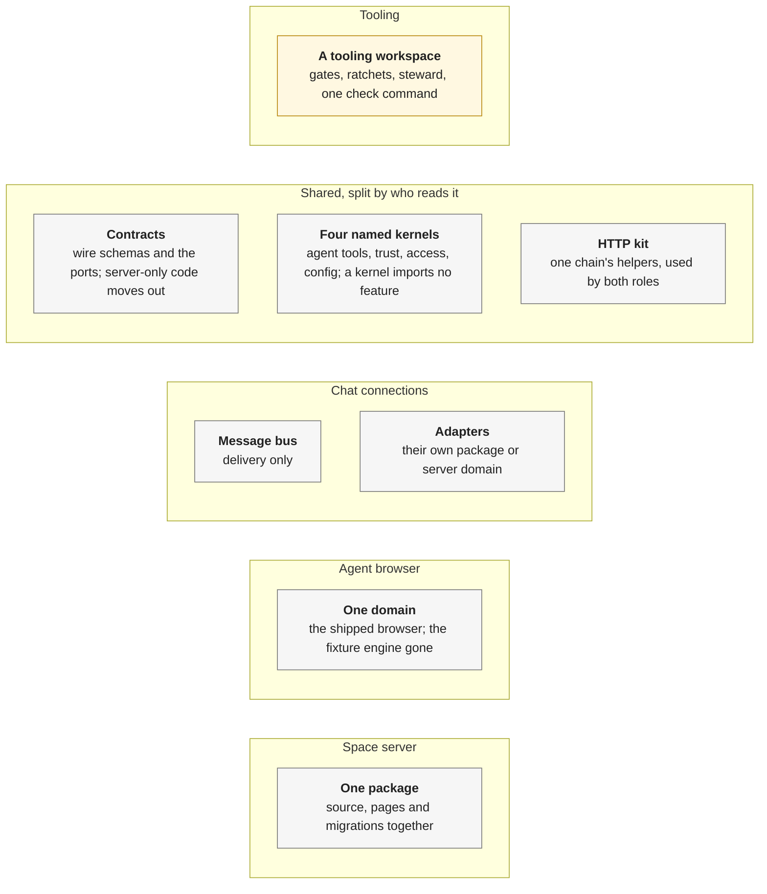

# Architecture target design, November 21, 2026

> **Superseded in part by ADR `261122-173853` (one space model), 2026-11-22.** The space code stays in `apps/server/src/services/spaces`; `apps/space` keeps only the image, the migrations and the test tiers. S1 ("the space server owns its folder"), ADR challenge 1, operator decision 1 and the spin-out row for the space server are retired, never adopted, and no `packages/space` is planned. The ADR also amends D2's line: a space holds its members' data (agents, conversations, rules, memory, schedules, connections, settings, documents, extensions), and only execution state (workspaces, runtime transcripts and sign-ins, running processes) stays on the computer that runs turns. The rest of this report stands as written.

**Reviewed public source:** `14434634ff15978f4acaa561a445ac0b88c6555a`, the tip of `origin/main` on 2026-11-21, plus the [November 21 rebaseline](20261121_architecture-rebaseline.md), which is today's truth about what is built, tested, released and planned. This document does not redo that work. It answers a different question, asked by the operator on 2026-11-21: **what is the ideal shape of this codebase, what confuses a developer today, what should be split out or spun out, what belongs in code instead of prose, and above all what cuts the cognitive load of working here.** Everything stays a space. Accepted decisions may be challenged here, but every challenge is marked **proposed**, names the ADR it would change, and says why. Nothing in this document is a decision.

**Method.** Seven read-only traces, each checked by hand at the paths cited: workspace packages and apps; server service domains and their import edges; the React client and its three UI trees; every rule that lives in prose (`AGENTS.md`, `.claude/rules/`, `contributing/`, skills); the gate ladder and test tooling; the space server and the Cloud boundary; the canon, the vision-reset plans and the accepted ADRs. Linear was read on 2026-11-21 through the configured tracker adapter: all 61 open projects (team DOR and team CLD, including the shared "DorkOS Cloud" project) and their open issues. No build, typecheck, test, paid run or deployment was run. Line counts are non-test `.ts`/`.tsx` under `src/` unless a row says otherwise; counts exclude `__tests__/`, `*.test.*` and `__fixtures__/`. Import edges are counted between service domains; where a sentence says so, each `core/` sub-directory is its own node.

**How to read the labels.** **current** describes the tree at the reviewed source. **proposed** is this document's suggestion, with a cost (S: under a day, M: days, L: weeks) and what breaks. A proposed row that changes an accepted ADR says so in the [ADR challenges](#adr-challenges-all-proposed) section.

## The judgment

The one-program decision was right and it landed: one package, one release, one Dockerfile, three roles and a space entry. **The load on a developer does not come from the shape. It comes from the seams between the folders, and from the prose that holds those seams up.** Three facts carry most of it:

1. **One product lives in three places, three times over.** The space server is a manifest in `apps/space` (named `@dorkos/community`, with no `src`), code in `apps/server/src/services/spaces` and pages in `apps/client/src/space`, stitched by a Docker stage, five turbo input globs and a lint rule whose whole job is to keep the pieces apart. The agent browser is a shipped 10,411-line domain under `session/local-browser` beside a 6,860-line fixture-only `services/browser` and a 24,444-line fixture-only `packages/browser` that the CLI build still bundles. The platform adapters (Telegram, Slack, webhook, Claude Code) are 11,502 of the message bus package's 25,336 lines.
2. **The two biggest buckets are the two least named.** `@dorkos/shared` has about 180 export subpaths, 35 of them Node-only, and its `Transport` port declares about 520 methods on one object. `apps/server/src/services/core` is about 110k lines in 36 sub-directories with 784 imports in and 235 imports out: "misc with high fan-in", not a kernel. 74 pairs of service domains import each other (111 pairs when each `core/` sub-directory counts as its own node).
3. **About 115 things can say no to a change, described in at least 12 documents.** Four ratchets, four scripts, four `--update` flags, three enforcement points. The repo tells you to arm a merge two different ways. Of 136 imperative rules found in prose, about 60 are enforced by code, about 50 could be, and the rest are judgment. One check that exists runs nowhere, and another runs only as an advisory job.

So the target is not a new architecture. It is the same three roles with **one folder per product, a boundary the compiler holds wherever a rule now says "may not import", the two shared buckets split by who reads them, tooling out of the product tree, and prose turned into lint, census tests or deletions.** Most of it is mechanical. The three moves that change an accepted decision are listed last, with two options each.

## Confusion map

Ranked by how much a developer has to hold in their head to do ordinary work. Every row is **current**; the fix column is **proposed**.

| #   | Confusion                                                                                                                                                                                             | Evidence                                                                                                                                                                                                                                                                                                                                                                                                                                                            | Smallest fix                                                                                                                                             |
| --- | ----------------------------------------------------------------------------------------------------------------------------------------------------------------------------------------------------- | ------------------------------------------------------------------------------------------------------------------------------------------------------------------------------------------------------------------------------------------------------------------------------------------------------------------------------------------------------------------------------------------------------------------------------------------------------------------- | -------------------------------------------------------------------------------------------------------------------------------------------------------- |
| 1   | The space server is three folders and one misnamed package. Changing one space route touches about 10 files across 4 packages.                                                                        | `apps/space/package.json:2` (`@dorkos/community`), `:8` (`tsx watch ../server/src/services/spaces/main.ts`); `apps/space/tsconfig.build.json:5` (`rootDir: ../server/src/services/spaces`); `Dockerfile:240-246`; `turbo.json:118-152`; `apps/server/eslint-rules/space-boundary.js`                                                                                                                                                                                | First line of `apps/space/README.md` says where the code is (the one-folder move is retired by ADR `261122-173853`; the code stays in `services/spaces`) |
| 2   | `core/` is 36 sub-directories of product features called "infrastructure".                                                                                                                            | `.claude/rules/server-structure.md:26`; `services/core/operator` 9k lines, `core/auth` 8.8k, `core/remote` 6.6k, `core/session-relay` 6.4k; 25 loose files at the root; 784 imports in, 235 out                                                                                                                                                                                                                                                                     | Four named kernels; everything else leaves ([server target](#server-domains))                                                                            |
| 3   | `transport.` autocompletes about 520 methods from one object. A file's server dependencies are invisible in its imports.                                                                              | `packages/shared/src/transport.ts:667` (`interface Transport extends TransportSlices`): 337 methods declared directly under 40 comment banners, plus 184 in 34 `transport-*.ts` slices; 58 `*-methods.ts` factories (7,727 lines) in `apps/client/src/layers/shared/lib/transport/`                                                                                                                                                                                 | Expose the slices as accessors (`transport.rooms`), one codemod                                                                                          |
| 4   | Four names for one thing: `spaces/` is the space server, `communities/` is the Mac's client of a space, `rooms/` is the local room store, and `hub` means both a server role and a live-stream class. | `services/communities/index.ts:1-6,13-16` (header still says "two adapters" and calls `apps/space` the third); `lib/server-role.ts:22` vs `services/spaces/live/hub.ts:183` (`class LiveHub`); `communities/local/register-local-community.ts:31,37` (`LOCAL_COMMUNITY_LABEL`, `HUB_LOCAL_COMMUNITY_LABEL`)                                                                                                                                                         | `space/`, `space-client/`, `rooms/`, `hub/`; inside names may say space ([ADR challenge 2](#adr-challenges-all-proposed))                                |
| 5   | "Shared" is also a server utility belt and it depends on two published packages beneath it.                                                                                                           | 35 Node-only subpaths (`atomic-write`, `safe-git`, `instance-lock`, `node-pty-spawn-helper`, `logger`, …) and 6 subpaths nobody imports; `packages/shared/package.json` depends on `@dork-labs/cloud-api` and `@dork-labs/connector-providers`; a client test already has to forbid one server helper leaking in (`apps/client/src/layers/features/continue-on-account/__tests__/no-client-ranking.test.ts:67` bans `@dorkos/shared/account-rank`)                  | Move the Node-only modules to the server; delete the 6 dead keys; record the inversion                                                                   |
| 6   | The repo says to arm a merge two ways.                                                                                                                                                                | `AGENTS.md` CI section: "Agents arm only through `arm.sh`; never `gh pr merge`"; `.claude/hooks/merge-guard.mjs:157`: "Do this instead: gh pr merge --auto <number>, or let merge-tail arm the PR"; `contributing/ci.md` and the `creating-pull-requests` skill still describe `--auto` and a live merge-tail                                                                                                                                                       | Point all three at one arming path; bring the arming gate into the repo ([tooling](#tooling-and-the-developer-loop))                                     |
| 7   | "typecheck" is thirteen gates. A red `typecheck` can be a banned word, a copy length, a boundary or a ratchet.                                                                                        | `.github/workflows/typecheck.yml:258-530` runs banned-words, vocab-gate, copy-length, one-shot-routes, boundary, max-lines, design-tokens, NUL bytes, dead doc paths, the repo-wide scripts suites, the census and the ledger check before `tsc`                                                                                                                                                                                                                    | Name the job `policy` and keep `typecheck` for types (a required-set change, so a ledger entry)                                                          |
| 8   | The fixture-only browser is not fixture-only, and three browser code bases share two names.                                                                                                           | `contributing/system-architecture.md` says `packages/browser` is "called only from their own tests"; the CLI imports it at runtime (`packages/cli/src/commands/browser-runtime-commands.ts`, `packages/cli/src/lib/agent-browser/browser-runtime-deps.ts`) and `packages/cli/scripts/build.ts:256,325` bundles its verifier and workers; `session/local-browser` (10,411 lines) is the shipped browser; DOR-4284 (Todo) already asks to delete the parked engine    | Do DOR-4284; then `browser/` means the shipped browser                                                                                                   |
| 9   | The runtime adapter for Claude Code hosts the tool composition root (the one place that assembles the agent tools every runtime gets), and tools register two ways.                                   | `services/runtimes/claude-code/mcp-tools/index.ts:1-5`; `core/self-description/dorkos-registry.ts:1-2` ("the single composition root for DorkOS's Capability Registry"); legacy definition arrays still register through `core/external-mcp/register-from-definitions.ts:95`; the census pins only "more than 100 actions" (`core/capabilities/__tests__/permission-area-census.test.ts:154`)                                                                       | One `agent-tools/` kernel; finish the registry migration; pin the exact count                                                                            |
| 10  | Five packages own "skills and plugins" and the one authors import is private.                                                                                                                         | `packages/skills`, `operating-skills`, `harness`, `marketplace`, `extension-api`; `packages/extension-api/package.json:3,5` (`2.0.0-alpha.1`, `private: true`) while `docs/integrations/extensions.mdx:13` tells authors to import it; DOR-3544 (Backlog) asks to publish it                                                                                                                                                                                        | A five-row table in `AGENTS.md`; publish or rename `extension-api`                                                                                       |
| 11  | The role is one source and about 100 scattered `if`s. Named predicates exist, and 15 files still compare the raw role inline.                                                                         | `lib/server-role.ts:22-27`; 102 role branches in 65 files; `services/core/server-role/role-checks.ts:20,28,37` (`isHub`, `isAgentComputer`, `isPersonalComputer`) imported in 22 files, while 15 files still compare `currentServerRole() ===` inline at 17 sites (and 8 more files compare `!==` at 11 sites); routes define their own `deps.isHub` (`routes/hub-computers.ts:102`, `routes/hub-link.ts:85`); no Dockerfile target or script sets `agent-computer` | One role policy object built once in `startup/`, consumed everywhere; an entry per role                                                                  |
| 12  | The relay package is also the Telegram and Slack code.                                                                                                                                                | the four adapter folders under `packages/relay/src/adapters/` are 11,502 lines (claude-code 4,454, slack 3,742, telegram 2,712, webhook 594; the folder is 12,340 with `test-mode` and its shared pieces) of 25,336                                                                                                                                                                                                                                                 | Adapters move out of the bus                                                                                                                             |
| 13  | Dev tooling sits among product packages, and `scripts/` is 428 files with no index.                                                                                                                   | `packages/ci-steward` (14k lines, ships nothing), `packages/heavy-slot` (one `package.json`), `packages/evals`, `packages/test-utils` (17k); root `test:scripts` is a 54-term `&&` chain in `package.json:20`; `.claude/rules/ci-pipeline.md:2` summons the CI-change protocol for any edit under `scripts/**`, benchmarks included                                                                                                                                 | A `tooling/` workspace glob; one `pnpm check` runner                                                                                                     |
| 14  | Four homes for UI primitives, and `Button` exists in four places on screen.                                                                                                                           | `packages/ui/src` (25 components), `apps/client/src/layers/shared/ui` (facade: `button.tsx` is 2 lines), `apps/design-system` (1,213 lines, imported by nobody, excluded from `pnpm dev`), `apps/client/src/dev/showcases/*`; 25 names present in more than one tree                                                                                                                                                                                                | Fold `design-system` into `packages/ui`; generate the facade from the package's export map                                                               |
| 15  | The space server re-implements the DorkOS server's request chain because nothing lets it share one.                                                                                                   | 12 duplicated concepts: `spaces/caller-address.ts` vs `http/request-facts.ts`; `spaces/http.ts:71 readJson` vs `http/request-body.ts:167 readJsonBody`; `spaces/http.ts:87 handleError` (`{code,message}`) vs `middleware/error-handler.ts` (`{error,code}`); two Better Auth instances; two rate limiters; two SSE stacks; two health routes; two shutdowns                                                                                                        | A small `packages/http-kit` both chains import ([Spaces target](#spaces-and-cloud))                                                                      |
| 16  | Two Cloud clients, two origin rules, and contract families nobody in the app calls yet.                                                                                                               | `services/core/auth/cloud-link-client.ts` (1,104 lines, `/api/auth/device/*`, `/api/instances/*`, `resolveCloudBaseUrl`) and `services/core/cloud/v1-client.ts` (291 lines, `resolveCloudApiBaseUrl`); the `connections` family (9 keys) is served by the legacy client, `directory` (4) and `computers` are planned and not yet consumed, and most `orgs`/`seats` keys have no caller; adding one call is 8 steps across 3 packages, documented nowhere            | One client; the contract says which families the app serves today                                                                                        |
| 17  | `apps/client/src/dev` (59,039 lines) outweighs `widgets/` and is exempt from every gate; `src/space` (15,554 lines) is a second site inside the client.                                               | `apps/client/src/main.tsx:76-77` (dev lazy-loaded only under `import.meta.env.DEV`); `apps/client/vite.space.config.ts:20-27`; 8 of the 12 largest client files in the max-lines baseline are in these two trees                                                                                                                                                                                                                                                    | A first-line README in `src/dev`; the space pages move with the space ([client target](#client))                                                         |
| 18  | Tiny domains that exist for one or two files, while the rule says never to make one for an orphan.                                                                                                    | `services/core-extensions` (2 files), `mcp-apps` (2), `health` (2, and it is Claude sign-in policy), `decisions` (3), `activity` (3); `.claude/rules/server-structure.md:26`                                                                                                                                                                                                                                                                                        | Fold them ([server target](#server-domains))                                                                                                             |
| 19  | Ratchets are declared but not enforced, or enforced in one place only.                                                                                                                                | `scripts/check-knip.ts:3` ("CI activation is staged"), 5,713 baseline keys, no workflow runs it (DOR-4629); own-mocks (4,377) runs only at pre-push; `scripts/check-copy-spec-drift.ts` runs only as an advisory job (`browser-test.yml:1323`), not required and not at pre-push; `ci/ratchets.yaml` says "enforced from phase 2", which `contributing/ci.md` says is not built                                                                                     | One `ratchets.json`, one runner, one CI step and pre-push                                                                                                |
| 20  | Counts and rules disagree with themselves.                                                                                                                                                            | `AGENTS.md` says six `os.homedir()` carve-outs in one place and seven in another; `.claude/rules/server-structure.md:13-17` lists 14 domains of 38; `contributing/project-structure.md:215` forbids feature-to-feature imports that `.claude/rules/fsd-layers.md:34` allows; `AGENTS.md` says 48 guides, `.claude/README.md` says 29, the folder holds 56                                                                                                           | Generate the counts; delete the duplicates ([prose list](#prose-to-code))                                                                                |
| 21  | The API document is partial and uneven: 53 of 76 mounted route groups, 29 error shapes, two paths for one action, no `operationId` or `securitySchemes`.                                              | `docs/api/openapi.json` (419 paths, 473 operations); `http/hono-api.ts` (76 `/api` groups, 23 absent from the document); `services/core/openapi-registry.ts:7-23` (two sources of paths); `DELETE /api/marketplace/sources?name=` beside `DELETE /api/marketplace/sources/{name}`                                                                                                                                                                                   | A1 to A6 under The REST API: a route census, one error contract, ids and security schemes, a generated client, normalised resources, a stability policy  |

## Target shape

### Principles

1. **One product, one folder.** If a lint rule's only job is to keep two folders apart, they are one thing in the wrong place or two things in the wrong folder.
2. **A package is a boundary the compiler holds.** Where prose says "X may not import Y", make X a workspace package or a TypeScript project reference, so pnpm's strict `node_modules` and `tsc` refuse the import. Lint with a ratchet is the step before that, never the end state.
3. **Shared means both sides read it.** A module only the server imports is not shared.
4. **Ports are per domain.** A port with 500 methods is a remote-procedure bag.
5. **Tooling is not product.** What never ships lives under `tooling/`, and the gate ladder is one command away.
6. **A rule is code or it is deleted.** Prose explains why; lint, types, census tests and structure say what.
7. **Roles are a seam object, not a scatter of `if`s.**

### Before and after

Two small diagrams, one idea each, drawn to the diagram restyle rules (a bold title line, a plain detail line, short group titles, no paths in boxes; paths are in the tables below). They are not rendered to SVG here; if either is promoted to the atlas, it follows the diagrams README's renderer and layout.

**Today: one product, several folders.**

**Target: one folder per product, tooling apart (all proposed).**

Both diagrams are maps of moves, not deployment views. Everything stays one repo, one release train and one program with three roles plus the space entry. The current and planned deployment shape is the atlas's "One program, three roles" view; this document does not add a second atlas.

### Workspace: packages, apps and tooling

| Unit                                                                                                  | Today (current)                                                                                                                                                                         | Target (proposed)                                                                                                                                                    | Cost | What breaks                                                                                                                                                                                                                                                                                                           |
| ----------------------------------------------------------------------------------------------------- | --------------------------------------------------------------------------------------------------------------------------------------------------------------------------------------- | -------------------------------------------------------------------------------------------------------------------------------------------------------------------- | ---- | --------------------------------------------------------------------------------------------------------------------------------------------------------------------------------------------------------------------------------------------------------------------------------------------------------------------- |
| `apps/space` + `services/spaces` + `client/src/space`                                                 | three folders, Docker symlinks, lint boundary                                                                                                                                           | **Retired by ADR `261122-173853`:** the code stays in `services/spaces`; `apps/space` keeps the image, migrations and test tiers. Was: `apps/space/src/{server,web}` | M    | `Dockerfile:210-268`, `turbo.json` space inputs (they get simpler), `eslint-rules/space-boundary.js` (deleted), `scripts/space-image/*` (kept), `ci/space-server.env`, the promises census paths, the AGENTS.md domain census; this changes an accepted ADR's placement ([challenge 1](#adr-challenges-all-proposed)) |
| `apps/community`                                                                                      | 5 pointer READMEs                                                                                                                                                                       | deleted; git history keeps them                                                                                                                                      | S    | nothing (no `package.json`, so the workspace glob already skips it)                                                                                                                                                                                                                                                   |
| `packages/browser` + `services/browser`                                                               | 24,444 + 6,860 lines of fixture, imported at runtime by the CLI and bundled into it as a verifier and workers                                                                           | deleted or re-scoped as the streaming engine for ADR `261119-190201`; `browser/` then names the shipped browser                                                      | M    | `packages/cli/scripts/build.ts:256,325`, `browser-native-release-artifact.yml`, `agent-browser-doc-versions.test.ts`, the vitest projects list; owned by DOR-4284                                                                                                                                                     |
| `packages/relay`                                                                                      | bus + about 12k lines of platform adapters                                                                                                                                              | bus only; adapters under `apps/server/src/services/relay/adapters` or `packages/relay-adapters`                                                                      | M    | `harness-windows.yml`, `cli-smoke-test.yml`, the own-mocks baseline, 3 docs-map patterns                                                                                                                                                                                                                              |
| `packages/shared`                                                                                     | ~180 subpaths; 35 Node-only; 6 unused; depends on two published packages                                                                                                                | wire schemas and the four ports; Node-only modules move to `apps/server/src/lib`; the 6 dead keys go; the inversion is recorded in the atlas or fixed                | M    | 35 import paths in the server (mechanical); `vitest-projects`, knip entries                                                                                                                                                                                                                                           |
| `packages/test-utils`                                                                                 | 20 subpaths; mocks and HTTP harness (1,800+ import sites) beside 11k lines of port conformance suites imported by at most 4 files each; pins OpenCode binaries as optional dependencies | `test-utils` (mocks, db, supertest, listening-server, sse, react) and `port-conformance` (suites + fakes)                                                            | M    | about 20 import sites; `turbo.json:210-227`                                                                                                                                                                                                                                                                           |
| `packages/ci-steward`, `heavy-slot`, `scripts/` gates, `verify-proof`, `sharding`, the four baselines | product packages and a flat 428-file folder                                                                                                                                             | `tooling/` workspace glob; benchmarks and prototypes to `research/` or deleted                                                                                       | M    | `pnpm-workspace.yaml`, about 20 path references in `lefthook.yml`, workflows and root scripts; `turbo.json` input globs (29 lines name `scripts/`)                                                                                                                                                                    |
| `packages/ui`, `icons`, `apps/design-system`                                                          | three packages plus a facade                                                                                                                                                            | `packages/ui` absorbs `icons` at its next minor and `design-system` as its dev catalog; the facade is generated                                                      | S    | `check-design-tokens.test.ts` paths, `site-build.yml`, `typecheck.yml` names                                                                                                                                                                                                                                          |
| `packages/doe`                                                                                        | `private: false`, `files` and `test:pack` set, never published, no `publishConfig`                                                                                                      | publish from this repo like `cloud-api`, or set `private: true`; the `@dork-labs` (published) / `@dorkos` (private) rule written down once                           | S    | `cli-smoke-test.yml`, knip entry; a lockstep edit to `services/runtimes/doe` and the engine becomes two PRs                                                                                                                                                                                                           |
| `packages/extension-api`                                                                              | `private: true` at `2.0.0-alpha.1`; docs tell authors to import it                                                                                                                      | published (DOR-3544) or renamed to say it is internal                                                                                                                | S    | docs                                                                                                                                                                                                                                                                                                                  |
| `packages/a2a-gateway`, `decisions`, `keep-awake`, `memory`, `mesh`                                   | small, one or two importers                                                                                                                                                             | keep; `a2a-gateway` may fold into the server's mesh domain (one importer, `routes/a2a.ts:25`)                                                                        | S    | knip `ignoreDependencies`, `cli-smoke-test.yml`                                                                                                                                                                                                                                                                       |
| `packages/cloud-api`, `connector-providers`                                                           | published, lockstep, contract-first                                                                                                                                                     | keep in this repo; an own repo would make every contract change a three-repo PR                                                                                      | —    | —                                                                                                                                                                                                                                                                                                                     |
| `apps/site`, `apps/desktop`, `apps/e2e`, `packages/evals`                                             | own release or test rigs that import the product                                                                                                                                        | keep; one cut: `@dorkos/site#test` stops depending on relay, extension-api and keep-awake builds and stops reading `apps/server/src/**` (`turbo.json`)               | S    | the turbo graph only                                                                                                                                                                                                                                                                                                  |

**Spin out to another repository: nothing today.** Every candidate that could leave either imports the product (`evals`, `desktop`, `e2e`), is the contract the private repo depends on (`cloud-api`, `connector-providers`) or has one importer and no outside demand (`keep-awake`, `decisions`, `a2a-gateway`). `ci-steward` is the only strong own-repo candidate and its census reads this repo's workflows, so it would have to clone what it checks; a `tooling/` glob gives most of the benefit for a tenth of the cost. `packages/doe` is the one library with an outside life written into its README; publishing it from here is the step before any repo move.

### Server domains

**Current.** 38 domains, 2,622 non-test files; between them, 243 distinct import edges and 74 mutual pairs (549 edges and 111 pairs when each `core/` sub-directory counts as its own node, which is how the heaviest edges below are read). The heaviest: runtimes → session 93 (and session → runtimes 19), runtimes → tasks 82, marketplace-mcp → marketplace 41, rooms → session 39, communities → rooms 33. `core/` takes 784 imports and sends 235 back out. Five services import routes by value (`services/runtimes/claude-code/mcp-tools/extension-tools.ts:6`, `services/canvas/doc-channel/http-composition.ts:18`, `services/extensions/inbox/extension-inbox-context.ts:15`, `services/todos/todo-wiring.ts:12`, `services/runtimes/test-mode/compose-test-cloud.ts:24`) and twelve import middleware. Composition is 23 ordered startup steps that each add to one shared object, plus 120 `set*` injector functions, 36 module-level singletons and about 160 nullable module variables; there is no dependency container, so who owns what is learned by reading the steps. Routes are 247 files and 51,753 lines; 218 import services directly; six import `@dorkos/db`. The HTTP surface is 419 paths and 473 operations (`docs/api/openapi.json`); 155 capability ids are declared in service files; 73 environment keys are read in `env.ts`.

**Proposed grouping.** About 18 domains instead of 38, and `core/` becomes four named kernels with one rule: **a kernel imports no feature domain.**

| Proposed domain         | Moves in                                                                                                                                                                                                                                                                           | First safe step                                                                                              |
| ----------------------- | ---------------------------------------------------------------------------------------------------------------------------------------------------------------------------------------------------------------------------------------------------------------------------------- | ------------------------------------------------------------------------------------------------------------ |
| `agent-tools/` (kernel) | `core/capabilities`, `core/external-mcp`, `core/mcp-resources`, `core/self-description`, `core/mcp-tool-gate.ts`, `core/mcp-tool-tiers.ts`, the in-session composition root from `runtimes/claude-code/mcp-tools/index.ts`                                                         | finish the legacy-definition migration so the registry is the only list; pin the exact tool count            |
| `trust/` (kernel)       | `core/permissions`, `core/approvals`, `core/turn-power`, `core/safe-defaults`                                                                                                                                                                                                      | lint: trust imports no feature domain (today `permissions → activity` 8)                                     |
| `access/` (kernel)      | `core/auth`, `core/lan-access`, `core/sign-in-landing`, `core/onboarding`, `core/lifecycle`, and the six caller-identity files from `lib/` (`trusted-origins`, `caller-authority`, `caller-principal`, `request-classifier`, `person-without-session`, `server-role`; 1,672 lines) | move the six `lib/` files                                                                                    |
| `config/` (kernel)      | `core/config`, `core/config-manager.ts`, `core/config-migrations`, `core/operator/config-*`, `core/usage`, `core/cloud`                                                                                                                                                            | rename `core/config-*` first                                                                                 |
| `turns/`                | `session` (minus the browser dirs), `core/runtime-seam`, `core/streams`, `core/runtime-registry.ts`                                                                                                                                                                                | invert the 19 session → runtimes imports, starting with `session/index.ts`'s re-export of `build-task-event` |
| `runtimes/`             | the adapters only; `connect/`, `connectors/`, `connector-mcp/`, `context-preview/`, `shared/` are not runtimes and move to `runtime-shared/`                                                                                                                                       | move the composition root out                                                                                |
| `remote-access/`        | `core/remote`, `core/session-relay`, `core/hub-relay`, `core/hub`, `core/tunnel-manager.ts`                                                                                                                                                                                        | rename only; all default-off or role-gated                                                                   |
| `agents/`               | `mesh`, `identity`, `core/agent-identity`, `agent-home`, `agent-templates`, `agent-observation`, `agent-creator.ts`, `agent-created-hook.ts`, `operator/agent-*`                                                                                                                   | fold `identity` into `mesh`                                                                                  |
| `rooms/`                | `rooms`, `communities/local`, `canvas`                                                                                                                                                                                                                                             | fold `communities/local` (it wraps `RoomService`)                                                            |
| `space-client/`         | `communities/remote`, `communities/registry`                                                                                                                                                                                                                                       | rename                                                                                                       |
| `installs/`             | `marketplace`, `marketplace-mcp`, `harness`, `core-extensions`, `projects`                                                                                                                                                                                                         | fold `marketplace-mcp` into `marketplace` (41/1 edge)                                                        |
| `extensions/`           | `extensions`, `mcp-apps`                                                                                                                                                                                                                                                           | fold the 2 files                                                                                             |
| `beats/`                | `heartbeats`, `decisions`, `todos`, `work-queue`                                                                                                                                                                                                                                   | fold `decisions` (3 files)                                                                                   |
| `record/`, `telemetry/` | `audit` + `activity`; `observability` + `core/telemetry` + the five loose `*-reporter.ts` files at the core root                                                                                                                                                                   | move the reporters                                                                                           |
| `browser/`              | `session/local-browser` (shipped) + `core/browser-registry`; the fixture engine deleted (DOR-4284)                                                                                                                                                                                 | swap the names once DOR-4284 lands                                                                           |
| keep                    | `connectors`, `tasks`, `relay`, `notifications`, `search`, `memory`, `workspace`, `terminal`, `diff`, `docs`, `shapes`, `computers`, `workbench-serve`                                                                                                                             | —                                                                                                            |

**The boundary that makes it stick (proposed, S).** A `services/*` import-boundary ESLint rule in the shape of `space-boundary.js`, with a per-edge allowlist that may only shrink (the `scripts/own-mocks/baseline.json` pattern). It starts by freezing today's edges (549 with `core/` split by sub-directory) and refusing new ones. Two rules need no allowlist on day one: services never import `routes/**` or `middleware/**` (17 lines to lift), and routes never import `@dorkos/db`, `drizzle-orm` or a concrete runtime adapter (7 route files to fix). Once the runtimes ↔ turns cycle is inverted, each runtime adapter can become a workspace package and Hard Rule 2 (SDK confinement) disappears, because pnpm will not resolve the SDK anywhere else.

**The real choice:** `core/` becomes four named kernels (a lint target and a place for genuinely shared code), or `core/` dissolves entirely and the four become ordinary domains. This document picks the kernels: they give the rule something to point at, and they remove the attractor that made `core/` about 110k lines.

### Client

**Current.** 144 slices, 391,643 lines in the four layers; features alone are 76 slices and 246,817 lines, with 118 feature-to-feature import lines (allowed for UI composition, forbidden for model). `shared/` is three of the seven largest "slices" (`lib` 24,963, `ui` 21,269, `model` 12,068) though FSD calls it the base. The widgets layer has no lint block at all, and one widget imports another (`layers/widgets/one-bar/ui/OneBar.tsx:4`). 58 Zustand stores; `app-store` is 15 files and 4,379 lines. 25 query-key factories beside 44 inline key literals; only `['config']` is pinned by a test. Query hooks live in both `entities/*/api` (11 directories) and `features/*/model` (80 files), while `contributing/project-structure.md:511` says only the first. The test double for `Transport` is 1,040 lines with 212 stubs for a port of about 520 methods.

**Proposed.**

| Option                                                                                                                                                                                                                                                                                                 | Cost | Benefit                                                                                                                 | What breaks                                                                                                                                                                                                                                         |
| ------------------------------------------------------------------------------------------------------------------------------------------------------------------------------------------------------------------------------------------------------------------------------------------------------ | ---- | ----------------------------------------------------------------------------------------------------------------------- | --------------------------------------------------------------------------------------------------------------------------------------------------------------------------------------------------------------------------------------------------- |
| **A. Keep FSD, split the port by domain.** The 40 comment banners become slice interfaces (34 already exist as `transport-*.ts`), exposed as `transport.rooms`, `transport.sessions`, or `useTransport('rooms')`. Move the 80 feature-owned query files into entity `api/` segments in the same sweep. | M    | a feature's server dependencies show in its imports; the mock shrinks to per-domain files; `transport.ts` stops growing | about 389 call-site files (codemod), `createMockTransport`, `Partial<Transport>` test overrides, `playground-transport.ts`'s Proxy, `contributing/architecture.md:157-174`; routes gen, FSD lint, Playwright and the capture pipeline are untouched |
| **B. Move the space pages to `apps/space/src/web`.** They import nothing from `@/` today (0 lines); the move is a path move plus five turbo inputs collapsing to the default.                                                                                                                          | S/M  | one product in one folder; `eslint-rules/space.js` and its test go away                                                 | `Dockerfile` space-build stage, `ci/space-server.env`, the packaged-scope scripts, 29 vitest files' project, `scripts/__tests__/space-page-versions.test.ts`                                                                                        |
| **C. Mark and fence the dev playground; move only the pure-primitive pages to the design catalog.** Moving it whole would need the client's layers published as a package.                                                                                                                             | S    | a newcomer stops mistaking a showcase for the app                                                                       | `apps/e2e/tests/dev-playground/*` (6 specs) and `apps/e2e/playwright.widgets.config.ts:13` if the route moves (so the route stays)                                                                                                                  |
| **D. Feature packages under `packages/`.** Not now: 76 features with 118 cross-feature imports is a web, and any one drags `shared/lib` with it. Revisit after A and B for the three or four features with zero sibling imports.                                                                       | L    | —                                                                                                                       | routes gen, every path-scoped FSD rule, the e2e dev server                                                                                                                                                                                          |

The lint gaps worth closing now (S each): a widgets block in `apps/client/eslint.config.js`; barrel-only imports extended from entities to features and widgets (98 deep imports today, as a ratchet); `forwardRef` and `Math.random` bans; a bare `focus:` hard rule in `check-design-tokens.ts`; a test that a `queryKey` literal must have no factory for the same root.

### Spaces and Cloud

**Current.** `apps/space` holds 50 migrations, 20 browser specs, the load harness, operator scripts and six docs that all still say "Community", and no source; it runs `../server/src/services/spaces/main.ts`. `services/spaces` is 46,921 lines (routes 12,414; `schema.ts` 1,940 with 47 tables; imports 4,553; exports 2,626; takedown 2,230). It imports nothing from the server (lint-enforced) and nothing imports it; its census pins 318 routes, 23 sign-in routes, 11 host-key scopes, the image target and the migration id. The space server has its own Hono app and chain (`spaces/app.ts:91 createCommunityApp`) and re-implements twelve concepts the DorkOS chain already has, because the only package both may import is `@dorkos/shared`, which holds wire schemas, not HTTP helpers. One space route change touches about ten files in four packages. The Mac-side client of a space is `services/communities/remote` (13,739 lines, 27-method `CommunityAdapter`); `services/communities/buzz` (2,527 lines) is implemented and never registered.

On the Cloud side, `packages/cloud-api` (7,892 lines, 19 modules) has 47 non-test importers in the server, 15 in the client (display helpers and types) and none in the CLI. On the app side, the `connections` family is the legacy client's job today, the `directory` and `computers` families are planned and not yet served or consumed (B6, A8), and most of `orgs`, `seats` and the `remote` extras have no caller yet. The legacy client (`cloud-link-client.ts`, 1,104 lines) owns device link, heartbeat, revoke and every managed-connector call under `/api/instances/connectors/*`, and resolves its origin by a different rule than the `/v1` client. Adding one Cloud call is eight steps across three packages and no guide names them.

Three ways reach a Mac from the web (the own tunnel, managed remote access, the hub session relay) plus Wi-Fi, and the tunnel manager, the managed stream and the relay are coupled: the relay dials only on a `viewer_open` that arrives over the managed command stream (`services/core/remote/command-dispatcher.ts:31-32`). The `agent-computer` role is built behind `DORKOS_SERVER_ROLE` with no Dockerfile target, script or CLI command that sets it.

**Proposed.**

| Move                                                                                                                                                                                                                                                                                                                                                                                                                                                     | Cost | Benefit                                                                                                                           | What breaks or changes                                                                                                                                                                                                                                                                                                                                    |
| -------------------------------------------------------------------------------------------------------------------------------------------------------------------------------------------------------------------------------------------------------------------------------------------------------------------------------------------------------------------------------------------------------------------------------------------------------- | ---- | --------------------------------------------------------------------------------------------------------------------------------- | --------------------------------------------------------------------------------------------------------------------------------------------------------------------------------------------------------------------------------------------------------------------------------------------------------------------------------------------------------- |
| **S1. The space server owns its folder.** _Retired, never adopted (ADR `261122-173853`): the code stays in `services/spaces`._ `apps/space/src/server` (today `services/spaces`), `apps/space/src/web` (today `client/src/space`), migrations beside them; `apps/space` depends on `shared`, `decisions`, `ui`, `icons`, `http-kit`; the server package depends on nothing from it. The image guard stays; the lint boundary becomes a package boundary. | M    | one folder, one `package.json`, one `tsconfig`, one test project; developers on the app never see the space server and vice versa | the `Dockerfile` space stages (simpler), five turbo blocks (simpler), the promises census paths, `ci/space-server.env`, the AGENTS.md census; **changes the placement in ADR `261018-124422` step 7** ([challenge 1](#adr-challenges-all-proposed))                                                                                                       |
| **S2. `packages/http-kit`.** Request facts and client address, bounded body and JSON reader, one error shape, rate limiter, SSE sink and replay cursor, security headers, health and metrics routes, graceful shutdown. Both chains import it. Server-merge D2 ("one chain per role") stands: two chains, one kit.                                                                                                                                       | M    | the twelve duplicates become one; a fix lands once; the space's ad hoc `console.*` logging gets the server's logger               | `spaces/http.ts`, `spaces/caller-address.ts`, `spaces/limits/*`, `spaces/headers/*`, `spaces/live/monitoring.ts`, `spaces/shutdown.ts` on one side; `http/request-body.ts`, `middleware/error-handler.ts`, `http/rate-limiter.ts` on the other; the wire error shape must be reconciled (`{code,message}` vs `{error,code}`), which the census will catch |
| **S3. One Cloud client.** `v1-client` grows the legacy routes behind the same context, credential and origin rule; `cloud-link-client` shrinks to the device-link helpers and then goes (DOR-2348, DOR-2442, DOR-1798 own the retirement criteria).                                                                                                                                                                                                      | M    | one origin rule; one error mapping; a `contributing/cloud-calls.md` that fits on a page                                           | `cloud-link.ts` and the CLI's `cloud-commands.ts` call sites; the site handover switches are unchanged                                                                                                                                                                                                                                                    |
| **S4. The contract names what the app serves.** A `served` flag per route family in `packages/cloud-api` (the app serves it today / planned, with the owning ticket), checked by a test in `apps/server`, so a planned family reads as planned, not as missing.                                                                                                                                                                                          | S    | a new developer reads the contract and knows which families are live                                                              | nothing; additive                                                                                                                                                                                                                                                                                                                                         |
| **S5. One role policy object.** `startup/roles/` builds a `ServerRolePolicy` (runtimes allowed, listeners, routes mounted, writes refused, sign-in path) once; the 102 scattered checks read the object; a lint forbids `currentServerRole()` outside `startup/`. Each role gets an entry: a Dockerfile target and a documented command for `agent-computer`.                                                                                            | M    | a role is one file to read; "what does a hub refuse" has one answer                                                               | 65 files, mechanical; the 28 inline `currentServerRole()` comparisons (17 `===`, 11 `!==`) go through the predicates in `core/server-role/role-checks.ts`; no ADR change (`261015-042933` stands)                                                                                                                                                         |
| **S6. `space-client/` and `rooms/`.** `communities/remote` becomes `space-client/`; `communities/local` folds into `rooms/`; `communities/buzz` is deleted or registered (it has been neither since it was written).                                                                                                                                                                                                                                     | S    | the Mac-side client of a space is named for what it is                                                                            | paths; the `CommunityAdapter` port and conformance suite are unchanged                                                                                                                                                                                                                                                                                    |

Everything above is compatible with "everything stays a space": the three roles, pairing between servers, the space store split from the machine store (D2), the frozen outside names (D5) and the relay for chats all stand. (ADR `261122-173853` moves D2's line: the machine store keeps execution state only, and the space store holds space data, agents included, once the private space becomes a tenant after launch.)

### The work graph: agents, chats and work items

Added at the operator's request on 2026-11-21: an agent should list all its chats, ended ones too; each chat should know who created it; each chat should know its projects, tasks and to-dos, PRs, tickets, branches and worktrees; and there should be quick views: a chat tree (chat 1 → 2, 3 → 4, 5), all PRs for an agent, all PRs for a chat and its children.

**Current.** The parent link of a chat is durable: `session_started_by` holds one row per chat another chat or an extension started, kept for the chat's life (`packages/db/src/schema/session/session-started-by.ts`), and `session_metadata.launch_origin` and `launched_by` are written first-write-wins (`packages/db/src/schema/sessions.ts:39,45`). Children are read one level deep (`services/session/origin/session-started-by-store.ts:215`, `childrenOf`); the origin is overlaid at read time (`services/session/origin/session-origin-overlays.ts`); the chat list folds spin-offs under their parent, one level (`apps/client/src/layers/features/chat-list/model/build-chat-list.ts`). The `running_chats` agent tool lists live chats only. The registry can list every chat of an agent's folder (`services/core/runtime-registry.ts:523`, `listSessionIdsForAgentPath`), but only one startup step calls it and no tool or route exposes it. To-dos, the work queue and task runs each carry their own session id column, so each domain knows its chat and nothing knows them all. Claims are one row per live claim keyed by normalised text such as `DOR-1234` or `PR #42`, deleted on release or after two idle hours, with no history in the table (`packages/db/src/schema/session/work-claims.ts`; `services/session/claims/work-claim-service.ts:28`). **Nothing records which PR, ticket, branch or worktree a chat opened or works on**: the only durable chat-to-PR link is the provenance line `open-pr.sh` appends to the PR body, and it lives on GitHub. There is no general link store.

**Proposed (filed as Should; on 2026-11-21 the PM kept it after launch, as the roadmap has it, and will look again at the Monday grooming if the operator wants it pulled forward).** One small graph, written at the moment of action, read by a recursive query, shown as a tree.

| Move                                                                                                                                                                                                                                                                                                                                                                                                                                                           | Cost | What it gives                                          | What breaks                                                                            |
| -------------------------------------------------------------------------------------------------------------------------------------------------------------------------------------------------------------------------------------------------------------------------------------------------------------------------------------------------------------------------------------------------------------------------------------------------------------- | ---- | ------------------------------------------------------ | -------------------------------------------------------------------------------------- |
| **W1. One entity reference type** in `packages/shared`: kind (`chat`, `agent`, `pr`, `ticket`, `branch`, `worktree`, `project`, `todo`, `task-run`, `room`), id, optional label and url, with parsers for the spellings already in use (claim keys, provenance lines, `Refs DOR-1234`, `owner/repo#42`).                                                                                                                                                       | S    | every domain names a thing the same way                | nothing; additive                                                                      |
| **W2. A durable edge store** `work_links` in the machine store: from-ref, to-ref, relation (`started`, `claims`, `opened`, `works_on`, `belongs_to`, `produced`), recorded-at, recording chat, source. Append-only. Written where the action happens: a spin-off start, a PR opened by `open-pr.sh` or flow, a claim, a to-do or promise, a worktree created, a ticket referenced in a PR body. In the roles model the hub owns it, like the agent's identity. | M    | the one place that knows what a chat made and works on | nothing today; the audit trail keeps recording actions, the graph records their result |
| **W3. A lineage query**: a recursive query over `started` edges (seeded from `session_started_by`) giving a chat's ancestors and its whole subtree; `childrenOf` becomes any depth.                                                                                                                                                                                                                                                                            | S    | chat trees and roll-ups                                | `build-chat-list.ts`'s one-level fold becomes a tree                                   |
| **W4. Read tools and routes**: `agent_chats` (every chat of an agent, ended ones included, from the registry listing), `chat_tree`, `work_for` (all PRs or tickets for an agent, or for a chat and its children); HTTP under one `work-graph` route group, with the audit read side's visibility rules (the owner reads everything, an agent reads its own).                                                                                                   | M    | the four quick views exist as data before any screen   | `running_chats` gains a sibling; nothing changes                                       |
| **W5. Views**: a chat tree in the chat list, "PRs for this agent" on the agent page, "PRs for this chat and its children" in the chat header.                                                                                                                                                                                                                                                                                                                  | M    | what the operator asked to see                         | the chat list's fold; Playwright specs that assert it                                  |
| **W6. Claims become edges with history**: `work_claims` stays the exclusivity lock; each claim and release also writes a `claims` edge, so "who worked on DOR-1234, when" is a query, and the coordinator's free-text claims file retires.                                                                                                                                                                                                                     | S    | one record of who worked on what                       | nothing; the lock's semantics are unchanged                                            |

**Proposed ADR (draft, not a decision).** _Context:_ chats start chats, open PRs, claim tickets and make worktrees, and each fact is written in a different place or not at all; the parent link is the only durable edge. _Decision:_ one append-only edge store in the machine store, keyed by one entity reference type, written at the moment of action by the code that performs it; reads go through a recursive lineage query and visibility follows the audit read side. _What it does not change:_ transcripts stay runtime-owned (ADR-0310); agent identity stays file-first (ADR-0043); the audit trail stays the record of actions; `work_claims` stays the lock. _Consequences:_ the sidebar fold becomes a tree; `running_chats` gets `agent_chats` beside it; coordinator files that track claims and lanes by hand can retire. _Open:_ whether the hub mirrors a Mac's edges when the relay is on (B6's directory would want the PR and ticket edges, not the chats).

**How the data is exposed (added 2026-11-21, proposed).** Canon promises "everything programmable: a CLI, an SDK and API, GraphQL queries and live event subscriptions" (`meta/ROADMAP.md:40`; `meta/dorkos-litepaper.md:211`). The epic it cites, DOR-2754, was canceled in the November 10 grooming, and the roadmap still names it; the vision-reset decisions left the surface to its own record, which does not exist. Today each surface is built by hand: 419 HTTP paths registered in an 8,658-line file plus 37 domain files, 155 capability ids composed at boot for MCP, and a CLI with its own commands. Nothing generates one from another, and no GraphQL exists in the server.

| Move                                                                                                                                                                                                                                                                                                                                                                                                                                                                                                        | Cost | What it gives                                                                          | What breaks                                                                               |
| ----------------------------------------------------------------------------------------------------------------------------------------------------------------------------------------------------------------------------------------------------------------------------------------------------------------------------------------------------------------------------------------------------------------------------------------------------------------------------------------------------------- | ---- | -------------------------------------------------------------------------------------- | ----------------------------------------------------------------------------------------- |
| **W7. One source of truth, many projections.** The capability registry (actions) plus the entity-and-edge model above (data) is the source. REST and OpenAPI, MCP, the CLI and, last, a read-only GraphQL (queries and subscriptions) are projected from it, never hand-built. Actions stay capabilities, so approvals, levels and the audit trail still apply. No raw SQL access from outside. Order: the link data (W1, W2), then REST and MCP reads (W3, W4), then GraphQL when an outside SDK needs it. | L    | one place to add a thing and every surface learns it; the canon promise becomes a plan | the hand-kept OpenAPI registry becomes generated output (its census tests pin the result) |

**Proposed ADR (draft, not a decision): how DorkOS data is exposed.** _Context:_ four surfaces (HTTP, MCP, CLI, a promised GraphQL) describe the same things by hand; the audit read side and permission levels are enforced per surface. _Decision:_ the capability registry and the typed entity-and-edge model are the single source; every outside surface is a projection generated from them; reads obey the same visibility rules as the audit read side; GraphQL is read-only (queries and subscriptions) and arrives last, once an outside SDK needs it; raw database access is never a surface. _Why no raw SQL:_ it would bypass permission levels and private-chat hiding, the schema is internal and split across two stores by design (server-merge D2), and exposing it would break the 20-minor upgrade promise. _Consequences:_ adding a capability or an entity kind updates every surface in one change; the hand-registered OpenAPI file shrinks to overrides; DOR-2754's intent returns in smaller, ordered pieces. _History:_ DOR-2754 (canceled 2026-11-10) is the earlier shape of this; the roadmap line that still cites it is a reconciliation for the PM.

Existing tickets this serves, linked not duplicated: DOR-3690 (a spin-off for a ticket the agent already works on should return that chat: a `claims` and `works_on` lookup), DOR-3578 (a chat with open spin-offs idle too long: the subtree query), DOR-3590 (usage by agent and chat with spin-offs rolled up to their parent: the same query), DOR-3784 (a scheduled run's chat-send hop is lost on restart: a durable `started` edge), DOR-4516 (gate labels cannot say which chat added them: a `produced` edge written by the labelling chat).

### The REST API

Asked through DorkOS Code on 2026-11-21: how good is the REST API. Counts are from `docs/api/openapi.json` at this report's base commit; a November 19 `main` has 404 paths and 458 operations, so a count taken there is two days behind, not wrong.

**Current.** 419 paths, 473 operations, 56 top-level prefixes; 222 operations (47%) are POST, many of them verbs on a resource (`/pause`, `/resume`, `/remove`, `/refresh`). The document has two sources (`services/core/openapi-registry.ts:7-23`): hand-written `registerPath` calls across the 8,658-line file and 37 domain files, and the 21 capabilities that declare an `http` surface; the file's own header calls moving the rest onto the registry "a tracked hygiene follow-up", and no ticket tracked it. A capability's `http` surface projects only the document entry and reserves the path (`core/capabilities/registry.ts:631`); the route stays hand-written and the two can disagree (`routes/agent-pause.ts:101` mounts `/agents/:id/pause` while its capability documents `{agentId}`), and all 17 projected operations with a path template leave their path parameters undeclared. Of the 76 route groups `http/hono-api.ts` mounts under `/api`, 23 have no path in the document: `admin`, `browser-viewers`, `communities`, `debug`, `diff`, `discovery`, `errors`, `events`, `ext`, `extension-frame`, `feedback`, `git`, `mcp-config`, `mcp-servers`, `person-session`, `sign-in-landings`, `subagents`, `system`, `templates`, `terminal`, `test`, `todos`, `uploads` (`todos` is documented only behind its flag, `services/core/openapi/domains.ts:44`; some, `test` for one, belong out of a public document on purpose, which is a different statement from being absent). Documented groups have gaps too: `GET` and `PATCH /api/agents/current`, `POST /api/agents/resolve` and `POST /api/agents` (`routes/agents.ts:216-280`) are mounted and absent. Errors: 29 distinct error-response schemas (8 named components; 26 of the 29 carry `error: string`, so this is one envelope with variant extras, a convergence rather than a rewrite), 131 error responses with no schema at all, and 60 operations that declare no error response; the Cloud contract has a problem shape (`packages/cloud-api/src/problem.ts:103`) that no local error response uses. Naming: 46 path-parameter names in the templates for far fewer resources (`/api/agents/{id}/permissions` beside `/api/agents/{agentId}/pause`); an agent is created at `POST /api/agents/create` and at the undocumented `POST /api/agents`, registered at `POST /api/mesh/agents`, listed at `GET /api/mesh/agents`; `DELETE /api/marketplace/sources?name=` beside `DELETE /api/marketplace/sources/{name}`, and the same pair for `/refresh` (the query form exists because Remote Access refuses an encoded slash); `/api/devices/sign-out-all` repeats Better Auth's `/api/auth/revoke-other-sessions` (the three `/api/auth/revoke-*` names are the library's, not ours); two approval systems under one word, a session's tool-call approval at `/api/sessions/{id}/approve` and a capability-approval token at `/api/approvals/{id}/grant`, which the paths do not tell apart. Pagination comes in three styles: 9 operations page by `cursor`, 5 by a `before` key, 1 by `offset`; 21 take a `limit`; the rest are unbounded. Nothing is versioned or marked: 0 `operationId`, 0 `securitySchemes` (the chain enforces a session gate and agent identity, `http/api-chain.ts:21-22`; the document does not say so), 0 `deprecated` (two endpoints are deprecated in prose only, `contributing/api-reference.md:797,1608`), no stability marker, no versioned path, and `info.version` reads `0.2.0` under a description about "Claude Code sessions". No generated client: the web client's `Transport` (row 3 above) is written by hand against these paths, and no package in the workspace uses an OpenAPI generator.

**Proposed.** The REST leg of W7, in the order the risk allows.

| Move                                                                                                                                                                                                                                                                                                                                                                                                                                                                                                                                                                                                                                                                        | Cost | What it gives                                                               | What breaks                                                            |
| --------------------------------------------------------------------------------------------------------------------------------------------------------------------------------------------------------------------------------------------------------------------------------------------------------------------------------------------------------------------------------------------------------------------------------------------------------------------------------------------------------------------------------------------------------------------------------------------------------------------------------------------------------------------------- | ---- | --------------------------------------------------------------------------- | ---------------------------------------------------------------------- |
| **A1. Every mounted route in the document, then documentation moves onto capabilities.** First a census test over the Hono route table (every registered method and path, not first segments: the agents group is documented and still hides four routes) against the document, with a reasoned allowlist for routes kept out on purpose, plus a check that every capability `http` path matches a mounted route. Then the migration the registry header names: hand-registered entries move onto capability definitions domain by domain, and the hand registry shrinks to overrides. Generating the route itself from the capability is the W7 step after that, new work. | L    | one place to describe a route; the document stops lying by omission         | the 37 domain openapi files retire as their domain migrates            |
| **A2. One error contract.** `application/problem+json` (RFC 9457) with a stable code list, one `Problem` schema shared with `packages/cloud-api`, emitted by `http-kit` (DOR-4954) so a route cannot invent a shape; every operation declares its error responses.                                                                                                                                                                                                                                                                                                                                                                                                          | M    | clients handle one shape; codes are greppable                               | 29 schemas converge on one; the client's error parsing is touched once |
| **A3. `operationId` on every operation, `securitySchemes` for the ways in the chain enforces, and the projection declares the path parameters it leaves out today.**                                                                                                                                                                                                                                                                                                                                                                                                                                                                                                        | S    | generators and the docs page work; the document says how to authenticate    | nothing                                                                |
| **A4. A generated TypeScript client from the document, and the web client uses it.** `HttpTransport` becomes a thin adapter over generated calls, one feature slice at a time, alongside the Transport split (Client, option A).                                                                                                                                                                                                                                                                                                                                                                                                                                            | L    | the client cannot drift from the server; an outside SDK is the same package | the hand-written transport methods, slice by slice                     |
| **A5. Normalise resources.** One parameter name per resource, one path per action (the marketplace and agent-creation pairs collapse; `sign-out-all` becomes a call to the library's endpoint), the two approval systems named so the paths tell them apart, cursor pagination on every list. Old paths stay as `deprecated` with a `Sunset` header until the window in A6 closes.                                                                                                                                                                                                                                                                                          | M    | a client written today keeps working                                        | the aliases, after their sunset                                        |
| **A6. A stability policy.** One page in `contributing/api-reference.md` and a census test: every operation carries `x-stability` (`stable`, `preview`, `internal`); internal groups are hidden from the public document; a change to a stable operation goes through `deprecated` plus `Sunset` for a window matching the 20-minor upgrade promise (the two prose-only deprecations get the flag first); `info.version` tracks the product version.                                                                                                                                                                                                                         | S    | a rule a client can plan on                                                 | nothing; it binds the moves above                                      |

Order: A3 and the A1 census now (Wave 0); A2 and A6 with `http-kit` (Wave 1); A4 and the A1 migration with the first W7 projections (Wave 2); A5's removals after their sunset (Wave 3).

## Spin-out candidates

The full table is in [Workspace](#workspace-packages-apps-and-tooling). The short answer, all **proposed**:

| Candidate                                                              | Recommendation                                                                          | Why                                                                                                                               |
| ---------------------------------------------------------------------- | --------------------------------------------------------------------------------------- | --------------------------------------------------------------------------------------------------------------------------------- |
| Space server                                                           | **stays in `services/spaces`** (ADR `261122-173853`; the own-package option is retired) | already lint-isolated; one model for a space, one placement                                                                       |
| `packages/browser` + `services/browser`                                | **delete** (DOR-4284) or re-scope under ADR `261119-190201`                             | 31k lines of fixture with four production importers; a release cadence for a fixture is the wrong fix                             |
| Relay adapters (Telegram, Slack, webhook, Claude Code)                 | **own package or server domain**, out of the bus                                        | connection work should not touch the message-bus package                                                                          |
| `packages/doe`                                                         | **publish from this repo**, own repo later                                              | the README is already a library's; only `@dorkos/*` package marked publishable and never published                                |
| `packages/ci-steward`, `heavy-slot`, gates, `verify-proof`, `sharding` | **`tooling/` workspace glob** in this repo                                              | an own repo would have to clone what it checks; the glob removes them from the product tree today                                 |
| `packages/test-utils`                                                  | **split** into `test-utils` and `port-conformance`                                      | the ubiquitous package stops carrying relay, Hono and OpenCode binaries                                                           |
| `apps/design-system`, `packages/icons`                                 | **fold into `packages/ui`**                                                             | 1,213 lines nobody imports; four homes for one `Button`                                                                           |
| `packages/cloud-api`, `connector-providers`, `ui`                      | **keep publishing from here**                                                           | contract-first and lockstep depend on it                                                                                          |
| `apps/site`, `apps/desktop`, `apps/e2e`, `packages/evals`              | **keep**                                                                                | each imports the product or holds `docs/` and `blog/` that live at the root                                                       |
| Mini apps as the spin-out mechanism                                    | **not for any of the above**                                                            | none of them is a product feature an agent builds; the A2A gateway and the relay need internals the extension API does not expose |

## Prose to code

**Counts (current).** `AGENTS.md` is 250 lines and 7,310 words. `.claude/rules/` is 1,957 lines in 15 files (`room-conduct.md` 642, `testing.md` 382, `fsd-layers.md` 215). The guide coverage map lists 114 rows. There are 42 entries in `.claude/skills` (28 are symlinks into `.agents/skills`). 14 `scripts/check-*` files, 74 guard tests under `scripts/__tests__`, 43 workflows, 11 required check contexts, 8 custom ESLint rules, 16 `.claude/hooks` scripts. Of the 14 check scripts, `typecheck.yml` runs nine; `check-knip.ts` runs nowhere, `check-copy-spec-drift.ts` runs only as an advisory job in `browser-test.yml`; `check-dir-size.sh` runs only at pre-commit.

**The ledger.** 136 imperative rules were found and classified. About 60 are enforced by a lint rule, a script, a test or a hook. About 50 could be, at S or M effort. The rest are judgment or canon. The top 30 to move into code, ranked by how often the rule has been broken (the incidents the prose itself records) and how much code it covers, against the effort to enforce it, all **proposed**:

| #   | Rule                                                                         | Mechanism                                                                                                                                                                     | Runs in                   | Prose it lets us delete                                                                        |
| --- | ---------------------------------------------------------------------------- | ----------------------------------------------------------------------------------------------------------------------------------------------------------------------------- | ------------------------- | ---------------------------------------------------------------------------------------------- |
| 1   | Grep `apps/e2e` before changing copy                                         | make the existing `scripts/check-copy-spec-drift.ts` job required (today an advisory job, `browser-test.yml:1323`) and add it to pre-push                                     | required check + pre-push | `.claude/rules/app-copy.md:13`, `writing-app-copy` skill                                       |
| 2   | Read bodies with `readJsonBody`, never raw                                   | `no-restricted-syntax` on `c.req.json()` outside `http/request-body.ts` (6 raw reads today, in the `http/` sign-in handlers and the space server; none under `src/routes/**`) | lint                      | `.claude/rules/api.md:13`                                                                      |
| 3   | The `os.homedir()` carve-out list is single-sourced                          | a census test diffing `.claude/rules/dork-home.md` against the ESLint ignores; drop the enumeration from `AGENTS.md`                                                          | scripts suites            | the two disagreeing counts in `AGENTS.md`                                                      |
| 4   | Import a slice only through its barrel                                       | extend the entities pattern in `apps/client/eslint.config.js:172-176` to features and widgets, as a ratchet (98 deep imports today)                                           | lint                      | `.claude/rules/fsd-layers.md:152-160`, `.claude/rules/components.md:20`                        |
| 5   | Never a bare `pnpm vitest run` for a full run                                | root `vitest.config.ts` refuses an unscoped run outside turbo                                                                                                                 | tool                      | three of the four copies of the rule                                                           |
| 6   | Services never import routes or middleware                                   | `no-restricted-imports` `**/routes/**`, `**/middleware/**` in `src/services/**` (17 lines to lift first)                                                                      | lint                      | locks `.claude/rules/server-structure.md:13-20`                                                |
| 7   | Routes never name a concrete runtime                                         | `no-restricted-imports` in `src/routes/**`                                                                                                                                    | lint                      | `contributing/project-structure.md:450`, `contributing/architecture.md:391`                    |
| 8   | Routes never touch files or the database                                     | `no-restricted-imports` `fs`, `node:fs`, `@dorkos/db`, `drizzle-orm` in routes, with an allowlist that shrinks (18 route files import `fs`)                                   | lint                      | `.claude/rules/api.md:52-63`, `server-structure.md:35`                                         |
| 9   | Domain-to-domain imports are deliberate                                      | the `services/*` boundary rule with a shrinking per-edge allowlist ([server target](#server-domains))                                                                         | lint                      | `server-structure.md:26`                                                                       |
| 10  | `ref` is a prop, never `forwardRef`                                          | `no-restricted-imports` `react` importNames (9 files left)                                                                                                                    | lint                      | `components.md:38`                                                                             |
| 11  | `focus-visible:`, never bare `focus:`                                        | a hard rule in `check-design-tokens.ts` (9 uses today)                                                                                                                        | `typecheck`               | `components.md:36`                                                                             |
| 12  | Never `Math.random()` in components                                          | `no-restricted-properties` in `src/layers/**` (5 uses)                                                                                                                        | lint                      | `components.md:37`                                                                             |
| 13  | Every runtime adapter has a conformance file                                 | a census test: every `services/runtimes/<x>/` has `__tests__/conformance.test.ts` importing `runtimeConformance` (it would have caught DOR-4902)                              | scripts suites            | `server-structure.md:27`, half of the `AGENTS.md` sentence                                     |
| 14  | Tests live in `__tests__/`                                                   | a test failing on any `*.test.ts` outside `__tests__` (today the server's vitest `include` silently skips them, `apps/server/vitest.config.ts:425`)                           | scripts suites            | `.claude/rules/testing.md:9-25`                                                                |
| 15  | Research files are `YYYYMMDD_slug.md`                                        | a name test with a grandfather set (7 dash-dated files, 13 undated notes and 4 folders today)                                                                                 | scripts suites            | half of the `AGENTS.md` Research line                                                          |
| 16  | Design floors (20px icons on phone, 44px targets, 16px inputs)               | `check-design-tokens.ts` hard rule on raw `text-[NNpx]` under the floor, ratchet on raw icon sizes ("about 660 today", `contributing/design-review.md:68`)                    | `typecheck`               | `design-review.md:137` ("a follow-up PR makes them real, with a lint")                         |
| 17  | No inline styles                                                             | a design-tokens ratchet on `style={{` (112 occurrences; many are dynamic sizes, so a ratchet, not a ban)                                                                      | `typecheck`               | `components.md:94-96`                                                                          |
| 18  | Never an empty commit or `update-branch` to satisfy a gate                   | `git-guard.mjs` refuses `--allow-empty` and `gh pr update-branch`                                                                                                             | hook                      | the last clause of the CI "red" paragraph in `AGENTS.md`                                       |
| 19  | Never `gh pr merge --auto` on a stacked layer                                | `merge-guard.mjs` checks the base                                                                                                                                             | hook                      | the second sentence of the stacking rule                                                       |
| 20  | Complexity under 15, functions under 50 lines, depth under 4, params under 4 | enable `complexity`, `max-depth`, `max-params`, `max-lines-per-function` with a ratchet, or delete the table (nothing measures it today)                                      | lint                      | `.claude/rules/conventions.md:57-66`                                                           |
| 21  | No nested ternaries                                                          | `no-nested-ternary` at error                                                                                                                                                  | lint                      | `conventions.md:74`                                                                            |
| 22  | No "we", "please", "sorry", "OK", "Submit" in app copy                       | `banned-terms.json` entries scoped to client string literals and JSX button text                                                                                              | `typecheck`               | `app-copy.md:9`, `writing-app-copy` skill lines 44-46, 69                                      |
| 23  | No em dashes in user-facing prose                                            | extend the vocab-gate prose scan                                                                                                                                              | `typecheck`               | `user-facing-writing.md:9`                                                                     |
| 24  | Every config field is documented                                             | a test: every `UserConfigSchema` leaf appears in the `contributing/configuration.md` table                                                                                    | scripts suites            | `adding-config-fields` skill lines 237-249                                                     |
| 25  | `projectVersion` comes from `SERVER_VERSION`, never a literal                | `no-restricted-syntax`                                                                                                                                                        | lint                      | `configuration.md:715`                                                                         |
| 26  | No timestamp-versus-`Date.now()` races in tests                              | `no-restricted-syntax` on `toBeLessThanOrEqual(Date.now())`                                                                                                                   | lint (test preset)        | `testing.md:210`                                                                               |
| 27  | Never create a worktree from inside one                                      | `/worktree:create` refuses when the git dir is not the common dir                                                                                                             | command                   | `AGENTS.md` Worktrees, `working-in-worktrees` skill                                            |
| 28  | Shared-UI facade files only re-export                                        | generate them from the package's export map; a test that they contain nothing else                                                                                            | scripts suites            | `contributing/shared-ui.md:66`                                                                 |
| 29  | A `hold` label needs a `hold-reason:` comment                                | make `hold-reason.yml` required, or strip the label when the comment is missing                                                                                               | CI                        | `contributing/ci.md:308` (says `hold:`) and the PM's rule (says `hold-reason:`); they disagree |
| 30  | File-name conventions                                                        | a name test with the listed grandfather set                                                                                                                                   | scripts suites            | `components.md:107-121`, `project-structure.md:466`                                            |

**Prose to delete** (already enforced, or wrong): the `AGENTS.md` TSDoc and formatting paragraphs (the lint config and `lefthook.yml` say the same); the long explanations of lint rules in `fsd-layers.md:49-184` that `apps/client/eslint.config.js:91-296` repeats in comments; the three copies of the migration append-only rule (`safe-defaults.md`, `configuration.md`, the `adding-config-fields` skill); the verbatim duplicate items in `.claude/rules/ci-pipeline.md` (8 and 10, 9 and 12); the four copies of the bare-vitest rule; `contributing/ci.md`'s "pre-push does exactly three things" (it does six) and its two concatenated "What exists now" tables; the 14-domain list in `server-structure.md`; `project-structure.md:215` (contradicts `fsd-layers.md:34`); the `verification-before-completion` skill's "`pnpm lint` with 0 warnings" (warnings fail nothing, `packages/eslint-config/base.js:85-91`); `fsd-layers.md:211`'s `direct-transport`, which no longer exists.

**Prose that must stay prose:** the vision and voice canon, the decision filters, the honesty gate, the safe-defaults classification reasoning, the "composites consume foundations" direction rule (explicitly left to review), the catalogue of assertions that cannot fail, room etiquette, the worktree "am I alone" heuristics, "a red is not a reason to add load", filing and triage, and the provenance ethics.

**Structure instead of rules** (each removes a rule's reason to exist):

1. Routes as a TypeScript project reference that cannot see `services/runtimes/*` internals, `fs` or `@dorkos/db`: rows 7 and 8 become type errors.
2. Each runtime adapter as a workspace package with its SDK as a dependency only there: Hard Rule 2 and its restatement in every `no-restricted-imports` block go.
3. `dorkHome` carried in a typed context object: `dork-home.md`'s "required parameter, no fallback" becomes the only way to get one.
4. `readJsonBody` as the only body accessor on the `ApiEnv` context type: row 2 goes from lint to type.
5. Feature and widget barrels as `package.json` subpath exports, as `shared/lib/transport` already is: deep imports fail to resolve.
6. The Claude-only guards (`git stash`, `pkill`) projected through `@dorkos/harness` to Codex (the manifest already maps 11 Codex events), and the OpenCode gap stated once.
7. One `check-*` runner reading `ci/gates.yaml`: "is it wired" becomes a census, not a grep.
8. The design floors as the only size tokens `check-design-tokens` permits.

## Tooling and the developer loop

**Current.** From the first edit to a merged PR, a change passes about 115 distinct gates. Before a commit: five Bash-call guards, three per-edit hooks and a turn-end formatter. At commit and push: a post-commit populator, four pre-commit and six pre-push commands. Before a PR: `verify:preopen` or `verify`, a three-slot load lock and `open-pr.sh`. On the PR: 11 required contexts across 10 workflows (`typecheck` alone is 13 steps) and the advisory workflows. To land: Security's label script, the out-of-repo arming script, two queue doors and the merge queue. And a meta-gate for any change to the pipeline itself. Learning them all takes at least 12 documents. The four verify scripts in `package.json:16-19` are documented two. The local concurrency stack is four mechanisms (heavy-run-lock, load-gate, the `heavy-slot` turbo task, vitest's `load-wait` global setup) described in one 1,000-word paragraph. Opening a PR is ten steps; landing it seven more. Opening one test file is two documents and a gotcha.

**Proposed.**

| #   | Option                                                                                                                                                                                                                             | Cost   | Benefit                                                                                                | What breaks                                                                                           |
| --- | ---------------------------------------------------------------------------------------------------------------------------------------------------------------------------------------------------------------------------------- | ------ | ------------------------------------------------------------------------------------------------------ | ----------------------------------------------------------------------------------------------------- |
| T1  | One `pnpm check` runner that prints the ladder (edit → commit → push → preopen → verify → PR → queue) and runs the stage you name; it replaces the four verify scripts and the 54-term `test:scripts` chain with a glob            | M      | one entry point; the ladder is discoverable from the terminal                                          | `verify-proof.test.ts`'s step counts, `shell-suite-parity.test.ts`, every doc naming the four scripts |
| T2  | Every gate's `--help` is its document of record (purpose, where it runs, how to update); docs link instead of restating                                                                                                            | S each | ends the nine places the same instruction appears in different words                                   | nothing; `contributing/ci.md` shrinks                                                                 |
| T3  | `tooling/` workspace: gates, `verify-proof/`, `heavy-run-lock.sh`, `load-gate/`, `heavy-slot`, `sharding/`, the four baselines; benchmarks and prototypes (`browser-control-prototype`, `q3-contention`) to `research/` or deleted | M      | `scripts/` drops from 428 files to release and ops; the CI-change protocol stops firing on benchmarks  | `turbo.json` input globs, `scripts-test.yml`, `lefthook.yml` paths, ledger-coverage discovery         |
| T4  | One `ratchets.json` and one `pnpm ratchet [--update]` for max-lines, own-mocks, design-tokens and knip, with an owner and target date per entry; one pre-push and one CI step                                                      | M      | knip and own-mocks finally reach CI; four flags become one; DOR-4865's baseline conflicts get one home | each `check-*.test.ts`, `typecheck.yml:370-411`, `lefthook.yml:240-255`, the Hard Rule 9 text         |
| T5  | Split `typecheck.yml` into `policy` (the 13 inner gates) and `typecheck` (types)                                                                                                                                                   | S      | "typecheck red" means a type error                                                                     | the required set: ledger entry first, `ci/required-checks.json`, ruleset second                       |
| T6  | Bring the arming gate and the gate half of the heavy and hold scripts into the repo under `tooling/` with fixture tests; one arming path named everywhere                                                                          | S/M    | the most important gate becomes readable, reviewable and consistent with the PR skill                  | nothing in CI; the coordinator's local habits; Security reads the move                                |
| T7  | `.claude/hooks/typecheck-changed.sh` derives the workspace from the nearest `package.json` instead of a hard-coded list (lines 23-40), so a new package gets per-edit typechecks                                                   | S      | no silent gap for new packages                                                                         | nothing                                                                                               |
| T8  | Collapse the three vitest configs under `scripts/` into one with named projects                                                                                                                                                    | S      | one place to learn how scripts tests run                                                               | `typecheck.yml:447`, `repo-wide-suites.test.ts`                                                       |

## What is coming, and what the target gives it

Read from the vision-reset plans, `meta/`, the specs and every open DOR and CLD project. Each row says what the item needs from the shape and which move above gives it. All **current** status unless marked.

| Coming                                                                                                                                                                                                                                                               | Status                                                                                                                                 | Needs                                                                                                                                                                                    | Served by                                                                              |
| -------------------------------------------------------------------------------------------------------------------------------------------------------------------------------------------------------------------------------------------------------------------- | -------------------------------------------------------------------------------------------------------------------------------------- | ---------------------------------------------------------------------------------------------------------------------------------------------------------------------------------------- | -------------------------------------------------------------------------------------- |
| Cloud hubs, agent computers, "Works on", the forwarding runtime (A2, A3, A7, A8; DOR-2935, DOR-2939, DOR-2940)                                                                                                                                                       | hub role built, image booted in CI only; agent-computer role built with no entry; A7/A8 "proposed, waiting on agreement" since October | a role policy with an entry per role; a turns domain with a transport-independent lock (DOR-2346); a tools kernel the bridge can call                                                    | S5, the `turns/` and `agent-tools/` kernels                                            |
| Account directory and one inbox (B6, B9)                                                                                                                                                                                                                             | planned                                                                                                                                | a fourth record of an agent (file, machine row, space row, directory); one identity-and-placement schema                                                                                 | the `agents/` domain; ADR-0043 amendment ([challenge 5](#adr-challenges-all-proposed)) |
| Session relay and managed remote going live after Cloud                                                                                                                                                                                                              | built, default off; the flip is `DORKOS_MANAGED_REMOTE` (no document says the relay becomes default-on)                                | one `remote-access/` domain so three paths read as one                                                                                                                                   | the `remote-access/` domain, S5                                                        |
| One message system; the conversation log (ADR `261006-235240` accepted, `261017-211859` proposed; DOR-2744)                                                                                                                                                          | after launch; spec `conversation-model` is draft                                                                                       | the bus package to carry delivery only; adapters out of it                                                                                                                               | the relay split; [challenge 6](#adr-challenges-all-proposed)                           |
| Yjs live docs (DOR-2750; no `yjs` dependency anywhere yet)                                                                                                                                                                                                           | after launch                                                                                                                           | a second sync model beside canvas                                                                                                                                                        | a `docs/` domain next to `rooms/`; nothing to pre-build                                |
| Mini apps on hosted spaces; mini apps use DorkOS UI components (DOR-3699); publish the extension API (DOR-3544)                                                                                                                                                      | after launch                                                                                                                           | the extension host runnable inside the space image; `extension-api` public                                                                                                               | the space role declares what it can run (S1 retired), the `extension-api` publish      |
| Community Space soft launch (Dec 8) and the 20,000-stream bar (DOR-2879)                                                                                                                                                                                             | gated                                                                                                                                  | nothing structural; a host and a load machine                                                                                                                                            | nothing (S1 retired by ADR `261122-173853`)                                            |
| Doe as the default engine (canon is split: `meta/PROACTIVE-AGENTS.md` says Doe by default for beats and four agent types, `meta/ROADMAP.md` says cloud agent computers run OpenCode at launch; code registers Claude Code as default, `startup/runtimes.ts:159-165`) | built, not default                                                                                                                     | one inference-source module the runtimes, the beat runner and the agent-computer gateway all call                                                                                        | the `config/` kernel absorbing the nine `credits-*.ts` files                           |
| One real Chrome per agent (ADR `261119-190201`)                                                                                                                                                                                                                      | decided; bridge and stream unbuilt                                                                                                     | one browser domain and the fixture engine gone                                                                                                                                           | DOR-4284, the `browser/` rename                                                        |
| Windows (alpha), Linux (agent computer guest only)                                                                                                                                                                                                                   | gated                                                                                                                                  | per-OS custody in the sidecar; nothing structural                                                                                                                                        | —                                                                                      |
| Upgrade floor at 20 minors; the Drizzle baseline squash (DOR-4188)                                                                                                                                                                                                   | partly built                                                                                                                           | one place that owns the floor                                                                                                                                                            | the `config/` kernel                                                                   |
| Active-runner lease (step 8) and a Mac that hosts spaces (step 9)                                                                                                                                                                                                    | after launch                                                                                                                           | one lease seam for turns and beats; the space store on the Mac (PGlite, gated), which the private space then moves onto as a tenant, domain by domain, agents last (ADR `261122-173853`) | `turns/` and `beats/` share the seam; the PGlite measurement gates the rest            |
| Codebase cleanup (DOR-4185: phases 1, 2, 4 in progress, 5 Backlog; DOR-4629 knip)                                                                                                                                                                                    | started                                                                                                                                | the ratchets to reach CI                                                                                                                                                                 | T4 is phase 5's shape                                                                  |
| Runtime parity (DOR-3601 to DOR-3607, DOR-4481, DOR-4802) and "Choose what asks you" (DOR-4797, DOR-4801)                                                                                                                                                            | planned                                                                                                                                | shared code the adapters import without a cycle; one prompt-kind registry with a census                                                                                                  | the `trust/` and `agent-tools/` kernels; the boundary rule                             |
| Release branches (ADR `261118-135124`, proposed)                                                                                                                                                                                                                     | started                                                                                                                                | process, not shape                                                                                                                                                                       | T1's ladder names the release stage                                                    |

## ADR challenges (all proposed)

Each row names the accepted decision, what it fixes in place, why this document would amend it, the smallest amendment that keeps its intent, and whether it fits "everything stays a space" (every row: yes). None of these is decided here; the first three go to the operator as decisions.

| #   | ADR                                                                                                                 | What it fixes                                          | Why challenge it                                                                                                                                                                                                                                                                                             | Smallest amendment                                                                                                                                                                                                                                                                  |
| --- | ------------------------------------------------------------------------------------------------------------------- | ------------------------------------------------------ | ------------------------------------------------------------------------------------------------------------------------------------------------------------------------------------------------------------------------------------------------------------------------------------------------------------ | ----------------------------------------------------------------------------------------------------------------------------------------------------------------------------------------------------------------------------------------------------------------------------------- |
| 1   | `261018-124422` one program before launch, step 7: "the space server's code lives inside the DorkOS server package" | one package, one release, one Dockerfile               | The space code shares nothing with the server at runtime: lint forbids it importing the server, nothing imports it, and the image prunes the server's dependencies back out. "Inside the server package" buys a folder and costs a Docker stage, five turbo blocks, a lint rule and a misnamed `apps/space`. | **Declined by ADR `261122-173853`:** step 7's placement stands and is the only placement. Was: the space role is `apps/space` with its own source.                                                                                                                                  |
| 2   | `261018-124422` D5: "outside names stay community for good"                                                         | frozen wire paths, image name, settings, CLI names     | D5 was about promises to people outside. Inside, it produced `services/spaces` next to `services/communities` next to a package named `@dorkos/community` and a `createCommunityApp` in `spaces/app.ts`.                                                                                                     | Frozen names are the wire, the image, the settings keys and the CLI. Internal folders, packages, functions and docs say space (`space/`, `space-client/`, `createSpaceApp`). `COMMUNITY_*` environment keys stay frozen.                                                            |
| 3   | Hard Rule 2 (SDK confinement, ADR-0089) and `.claude/rules/server-structure.md`'s domain layout                     | one SDK per adapter directory; domain-grouped services | Confinement is restated in every `no-restricted-imports` block and holds nothing about the 74 mutual pairs between domains. A package boundary would hold both.                                                                                                                                              | Two steps: a `services/*` import-boundary rule with a shrinking allowlist now; runtime adapters as workspace packages once the runtimes ↔ turns cycle is inverted. The rule's intent (no vendor leaks past the port) is unchanged.                                                  |
| 4   | `261015-042933` three roles in one binary                                                                           | `DORKOS_SERVER_ROLE` read once                         | The role is read once and consulted about 100 times; 15 files still compare the raw role inline beside the named predicates; the agent-computer role has no entry.                                                                                                                                           | Not a change to the decision: an addendum that each role has a composition root under `startup/roles/` and an entry, and that `currentServerRole()` is read only there.                                                                                                             |
| 5   | ADR-0043 agent storage is file-first                                                                                | `.dork/agent.json` canonical, SQLite derived           | An agent now has three records (file, machine row, space `members` row with `runs_on`) and B6 adds a directory. Credits consent already lives outside the file by `261001-000811`.                                                                                                                           | Keep file-first on the owner's trusted server until agents move (last) into the space store under ADR `261122-173853`; declare the space and directory rows as projections with a stated staleness; one identity-and-placement schema in `packages/shared` that all four serialize. |
| 6   | `261017-211859` (proposed): Maildir stays the internal bus                                                          | the conversation log is the record                     | As written it keeps two delivery systems forever (`packages/relay/src`, 93 files, and `services/relay`, 37 files) while accepted `261006-235240` says the Maildir store retires.                                                                                                                             | Accept it with a dated Maildir sunset tied to the upgrade floor, so the bus is a deprecation, not a permanent second system.                                                                                                                                                        |
| 7   | `261009-192542` Hono everywhere; Express only in the extension bridge                                               | one chain; an ESLint ban                               | Eight files still import Express under `services/extensions/**`; the author API still offers an Express router; agents building mini apps learn Express on a Hono server (DOR-2856, DOR-2859, DOR-2861 own the removal).                                                                                     | Version the extension server API (`register(app: Hono, ctx)` beside `router`), tag the old shape `@deprecated since 0.x, remove in 0.y` so the upgrade-floor lint retires the bridge on schedule.                                                                                   |
| 8   | `260923-201140` shared UI in `packages/ui` behind a client facade                                                   | portable primitives, one import path in the client     | 25 two-line facade files hand-written; the space pages import the package directly (allowed, but written down nowhere).                                                                                                                                                                                      | Generate the facade from the package's export map; write the one sentence: facade in `layers/`, direct import in `apps/space`.                                                                                                                                                      |
| 9   | `261119-190201` one real Chrome per agent (and proposed `261001-231451` shared managed page)                        | real Chrome, streamed                                  | Three browser code bases with two names; the proposed ADR points the other way.                                                                                                                                                                                                                              | Deprecate `261001-231451` and the fixture engine explicitly (DOR-4284), or re-scope them as the streaming engine; one `browser/` domain.                                                                                                                                            |
| 10  | `260804-021140` Connections vocabulary gate                                                                         | four nouns out of copy; seams keep their names         | The allowlist is 1,001 lines of per-file exceptions and the ADR calls its own table "a standing maintenance obligation".                                                                                                                                                                                     | Narrow the TypeScript scan to client render strings (keep `docs/**`); the seams keep their names, as the ADR says.                                                                                                                                                                  |

Not challenged: ADR-0297 (flow lives in the external marketplace plugin), ADR-0255 and ADR-0310 (runtime binding and runtime-owned transcripts), `261001-000811` (credits are a Runs on choice), `261010-092116` (heartbeats as a platform beat runner), D2 (two stores, no general layer) and the `os.homedir()` ban. They cost little and hold a lot.

## Ranked plan

Each wave is independently shippable; nothing in a later wave is needed to get the value of an earlier one. Tickets in the project "Architecture: simpler and modular" (team DOR) follow this order, one parent per theme, children triaged per `contributing/prioritization.md`; existing issues are linked, not duplicated.

**Wave 0, this month, S each, no ADR change.** Delete `apps/community`; fix the arming contradiction in `merge-guard.mjs`, `contributing/ci.md` and the PR skill; fix the 14-domain list, the six-versus-seven carve-out count, the `project-structure.md` contradiction, the duplicate `ci-pipeline.md` items and the dead `direct-transport` pointer; make `check-copy-spec-drift` required and pre-push; delete the six unused shared subpaths; lint for services → routes and middleware, routes → runtimes and database, `forwardRef`, `Math.random`, bare `focus:`, the widgets block; the runtime-conformance and test-location census tests; a first-line README in `apps/client/src/dev` and `apps/space`; fold `mcp-apps`, `core-extensions`, `decisions`, `health`, `marketplace-mcp` and `communities/local`; move the five reporters; the 28 inline `currentServerRole()` comparisons go through `isHub()` and friends; S4 (the contract's `served` flag); `typecheck-changed.sh` derives its workspace list; A3 (`operationId` and `securitySchemes`) and the A1 census of mounted route groups. Links: DOR-4629 (knip), DOR-4865 (baseline conflicts), DOR-4284 (browser engine), DOR-4902 (conformance), DOR-4719 (shell examples in skills).

**Wave 1, December, M.** The `services/*` import-boundary rule with its frozen allowlist; the Transport accessor split (codemod); `tooling/` glob, `pnpm check`, `ratchets.json`, the `policy` job; `http-kit` starting with request facts, the body reader and the error shape, with A2 (the problem+json error contract) and A6 (the API stability policy) on top of it; one Cloud client; `test-utils` split; the relay adapters out of the bus; the `remote-access/`, `agents/`, `beats/`, `record/`, `telemetry/` renames. Links: DOR-4185 phase 5 (DOR-4191), DOR-2348, DOR-2442, DOR-1798, DOR-2346, DOR-3268, DOR-2927, DOR-2640, DOR-4790.

**Wave 2, January, after the operator's decisions below.** The first W7 projections for routes that exist (the A1 migration of hand-registered paths onto capabilities) and A4 (the generated client); the internal naming amendment (`space/`, `space-client/`, `createSpaceApp`); `core/` becomes the four kernels; S5 (the role policy and an entry per role); the Node-only shared modules out of `shared`; the design catalog into `packages/ui`; the arming gate into the repo (with Security). Links: DOR-2874, DOR-2883, DOR-2884, DOR-2935, DOR-2940.

**Wave 3, after launch.** The work graph W1 to W6 (the reference type, the edge store, the lineage query, the read tools, the tree views, claims as edges; the PM kept it after launch on 2026-11-21, and the Monday grooming can pull it forward) with its W7 projections, then read-only GraphQL as the last projection, once an outside SDK needs it; runtime adapters as workspace packages (only once the boundary ratchet shows the cycle broken); `packages/doe` published; routes as a project reference; the Express bridge retired on its deprecation schedule (DOR-2856); the Maildir sunset date (DOR-2744); A5's alias removals after their sunset. These are the moves that turn the remaining Hard Rules into structure.

## Decisions for the operator

Two options each, this document's pick first.

1. **Where the space server lives.** _Decided 2026-11-22 by ADR `261122-173853`: neither option. The code stays in `apps/server/src/services/spaces`; `apps/space` keeps the image, the migrations and the test tiers; no `packages/space`._ (a, was the pick) `apps/space` owns its source, web pages and migrations; the server package drops `services/spaces`; the lint boundary becomes a package boundary. It amends step 7's placement in ADR `261018-124422` and nothing else. (b) Finish the merge inward: delete `apps/space` as a workspace package and build the image from `apps/server` with the migrations beside the code. Fewer packages, but the biggest package grows by 47k lines and the lint rule, the Docker symlinks and the turbo globs all stay.
2. **How server boundaries are held.** (a, pick) A lint rule with a frozen allowlist that only shrinks, now; workspace packages only where a release or isolation reason exists (the space server, later the runtime adapters). Cost S now, and the ratchet shows when a package split is cheap. (b) Convert the server domains to workspace packages up front. Cleanest end state, but 74 mutual pairs between domains mean months of inversion before the first package compiles, with nothing shipped in between.
3. **What "community" may be called inside the code.** (a, pick) Wire paths, the image name, settings keys and CLI names stay `community` for good, as D5 says; folders, packages, functions and docs say `space`. One amendment to D5's reach. (b) Keep `community` everywhere inside too, and accept `services/spaces` beside `services/communities` as permanent.

Everything else in this document is inside the PM's and the coordinator's authority to schedule, or is already owned by an open ticket.

## Private findings

The Cloud boundary was read on both sides. Everything above cites only the public repository and public canon. Findings about the private control plane's own structure are not in this file; they went to the Cloud team, which accepted three as work: CLD-537, CLD-538 and CLD-539.

## Not done here

No code change, build, test, paid run, deployment or publish. The API was read from its document and its mounts, not exercised: no request was sent. No ADR was written or amended; the challenges above are proposals, and the three that change an accepted decision wait on the operator. No ticket was closed or reopened. The [rebaseline](20261121_architecture-rebaseline.md) remains the evidence matrix; the [atlas](../contributing/system-architecture.md) remains the current and planned deployment view; this document is the shape to steer toward and the order to do it in.
